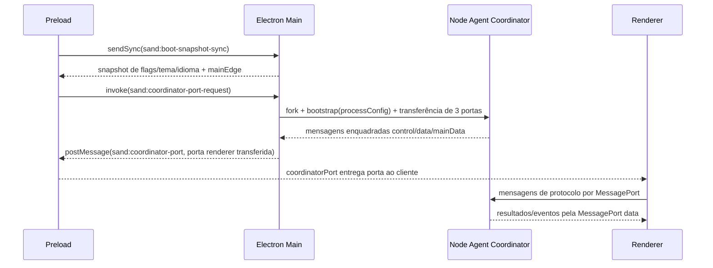
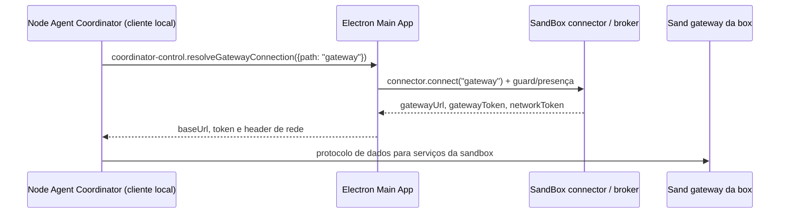

# Contratos do desktop Grok Bot 0.71.2 (análise estática)

## Escopo e método

A análise mapeia Electron Main, preload, Node Agent Coordinator e renderer com REA e inspeção estática complementar. Nenhum bundle foi executado e nenhuma screenshot serviu de base. A referência é `Grok Bot.app/Contents/Resources/app.asar`, SHA-256 `055b087a9bacc3be4e5f80c468edf2fd031dd5b928ab2e7da7e01dd10de0e860`. `Info.plist` identifica versão 0.71.2. Cada arquivo extraído para `/tmp/thegrok-desktop-contract` foi conferido contra o hash SHA-256 declarado pelo índice do ASAR; a cópia temporária não integra o produto.

Arquivos centrais e hashes (do índice ASAR e rechecados após extração):

| Caminho no ASAR | SHA-256 | Bytes |
|---|---|---:|
| `dist/electron-main/main.cjs` | `7a787fadfcbdb6e995502d011633496fb6a97aca9b31ce34fea7aab739fd8aa7` | 9,227 |
| `dist/electron-main/main-core.cjs` | `6422c2c4755d1722a9b6e842fb7117cf8eecce62d6c6a0bbdea53728999a9558` | 865,085 |
| `dist/electron-main/main-app.cjs` | `90ec55edf69be56c6cfd4fffa98fc45210acccf913b6c41402b5b6cca6fd538e` | 2,626,453 |
| `dist/electron-preload/preload.cjs` | `3996a35e9a1f38b0e6ee2de402064996ad24291518dc4e017280748e33b3be39` | 108,151 |
| `dist/node-agent-coordinator/main.cjs` | `b91b7a4e4294667cce9d923dabacdd39e9de82b8ef711f011123f80cf63b182c` | 893,328 |
| `dist/renderer/assets/index-wlkGG389.js` | `5194bef4ba4cbe4ffb697273f1458b7bca3733fb35d3c4c8d165fd4dbc9d0154` | 2,289,106 |
| `dist/renderer/assets/index.eager-app-DSuGVQNC.js` | `cb1f20a05ee14c4e6c8f5fe37e7cad7074ed432b7f67ca29b3fd928042f1547b` | 1,801,380 |

## Visão dos processos e transportes

```mermaid
flowchart LR
  R[React renderer chunks] -->|contextBridge: desktop RPC| P[Preload]
  R -->|contextBridge: coordinatorPort claim/request| P
  P -->|sendSync boot snapshot| M[Electron Main: main-core/main-app]
  P -->|invoke port request; receives transferred MessagePort| M
  M -->|three MessagePorts: control, data, main-data| C[Node Agent Coordinator child]
  C -->|data/control framed messages| R
  M <-->|main-data MessagePort| C
  M -->|fork e bootstrap processConfig| C
  C -->|coordinator-control RPC: resolveGatewayConnection| M
  M -->|connector.connect("gateway")| G[SandBox connector / broker]
  C -->|HTTP POST /api/{method}; GET /events| G2[Gateway URL retornada]
  G2 -. gateway de box condicional .-> H[Sand Host process]
  H -->|server-agent-proxy; RPC de serviço| S[Cursor backend]
  S -. contrato declara signal .-> W[grokBotTurnWorkflow]
  H -. vínculo de implantação/box não provado .-> B[SandBox / VM]
```

As setas sólidas representam relações confirmadas nos bundles: C→M resolve a conexão via RPC Main, M→G delega ao connector, C→G2 usa HTTP a URL retornada e o servidor no Sand Host despacha `/api/{method}` para handlers. A conexão ao gateway de box é condicional. O proxy chama o serviço remoto; seu comentário de contrato documenta sinalização ao workflow Temporal, mas não temos a implementação do serviço. A seta pontilhada também marca o vínculo de implantação do processo/host à box/VM, não estabelecido pelo código disponível. O handoff explícito e as mensagens foram recuperados nos códigos correspondentes de preload e Main; a alcançabilidade do ciclo de vida não foi provada aqui.

## Snapshot de inicialização e IPC direto

### Janela e chrome nativo no macOS

O Electron Main original cria a janela principal pelo construtor `BrowserWindow` e compõe `windowOptions` a partir do helper `zF`. No macOS, o helper retorna `{frame:true,titleBarStyle:"hiddenInset",trafficLightPosition:VF}`; em Windows usa frame sem borda com `titleBarStyle:"hidden"` e overlay de titlebar; outros sistemas ficam no default. A construção injeta o nome da aplicação como título, ícone e cor de fundo e espalha o objeto de opções na janela. REA selecionado no bundle Main App parseou 669.725 nós sem falhas e reportou 3 declarações BrowserWindow, mas o grafo semântico ficou parcial/truncado; o helper e seu callsite foram confirmados por leitura estática do bundle extraído, sem execução do original. O valor de `VF` e a coordenada exata dos traffic lights não estão associados com segurança nesta leitura, então não são copiados como contrato fechado.

TheGrok agora usa `hiddenInset` e a posição recuperada dos traffic lights no macOS, mantendo o nome próprio do app. O renderer local precisa continuar a tratar a faixa de titlebar/drag conforme estado; o comportamento de janela nos demais sistemas ainda deve seguir um trace dedicado.

O preload chama sincronamente `ipcRenderer.sendSync("sand:boot-snapshot-sync")`. Main Core registra o `ipcMain.on` correspondente e devolve um snapshot com `experiments`, `theme`, `language`, estado de tecnologia assistiva, estado/status do túnel de egresso, estado do proxy WebAuthn, e configuração de cor do bot, além do estado `mainEdge`. O valor `mainEdge` condiciona as chamadas RPC do preload até Main sinalizar `sand:main-edge-served`; o adaptador preload mantém chamadas e assinaturas de eventos pendentes até esse sinal.

Outros canais IPC literais identificados estaticamente:

| Canal | Direção / uso | Evidência |
|---|---|---|
| `sand:coordinator-port-request` | preload usa `invoke` para pedir a porta de dados do renderer; Main valida o solicitante confiável e transfere o MessagePort na resposta | offsets do preload ~106.7k; `main-app.cjs` `vJe`, `CJe` ~2.04M |
| `sand:coordinator-port` | Main envia a porta via lista de transferência em `sender.postMessage`; preload recebe a primeira porta e a entrega à ponte coordinator | mesmas fontes |
| `sand:render-trace-port` | preload envia um MessagePort para trace de renderização; Main aceita somente do frame principal no listener correspondente | preload `Si`; Main Core `FF` ~615k |
| `sand:encode-png` | preload envia dados da imagem com MessagePort para resposta; Main processa e responde, depois fecha a porta | preload `di`; Main App ~2.37M |
| `sand:avatar-source` | fluxo validado de pedido/resposta de avatar, na API Main do preload e no Main App | preload ~11.5k em diante; Main App ~2.36M |
| `sand:renderer-alive` | preload envia sinal de renderer ativo; Main Core o usa na prontidão e controle do boot | preload constante perto de ~11.4k; Main Core ~354.7k |
| `sand:renderer-boot-gate-landed`, `sand:renderer-boot-gate-opened` | preload envia avisos do ciclo do boot gate; Main Core os observa | constantes do preload perto ~11.4k; Main Core ~354.8k |
| `sand:network-online` | preload emite no evento `online` do browser; Main App assina para rechecagem do backend | preload ~108.1k; Main App ~1.78M |

A análise REA de `main.cjs` e preload contou 11 operações IPC (5 canais literais, 6 dinâmicos), 8 envios do renderer, 3 listeners do renderer, 5 APIs contextBridge / 6 membros expostos; nenhum handler correspondente está no bootstrap do pequeno `main.cjs`. Isso não indica ausência: handlers correspondentes aparecem em `main-core.cjs` e `main-app.cjs`. As análises REA de `main-app.cjs` e `main-core.cjs` foram executadas separadamente porque a chamada sobre o ASAR completo excedeu o limite de 300 segundos do servidor MCP.

## Edge RPC do preload: `desktop`

O preload constrói uma declaração imutável de RPC edge `Ce("main", { methods, events, failureCodes })`, com 308 contratos de método. Para cada método declarado gera uma função que valida/serializa pelo adaptador RPC e chama o canal `dune-rpc:main:m:<method>`. As respostas usam envelopes `{ok,value}` ou `{ok:false,failure}`. Se o transporte falha, consulta `dune-rpc:main:probe`; falhas tipadas distinguem método desconhecido, falha de transporte e falha de handler. Canais de evento RPC usam `dune-rpc:main:e:<event>`. A edge inteira é exposta como `window.desktop.main`; os subobjetos `boot`, `environment` e `local`, exclusivos do preload, fornecem estado inicial/ambiente e métodos locais selecionados.

Os 308 métodos abrangem controles de janela e tema/idioma; permissões e aprovações de ferramentas locais; preparação e download de anexos; gerenciamento do computador e atualizações; configurações e atualizações; feedback/telemetria; leitura do transcript; agentes Grok Bot, sessões, skills, plugins, memórias, segredos/arquivos, Slack e equipes; autenticação, contas, equipes e uso do Cursor; credenciais/MCP; finanças; passkeys; e reuniões. Os nomes completos dos métodos e validadores exatos de argumentos estão na declaração em `preload.cjs` aproximadamente nos offsets 86,278-103,250. Essa amplitude mostra que a API desktop original não equivale a uma única ponte `sendMessage`.

Main App declara a edge correspondente `Ko("main", {methods})`; compõe handlers do Main a partir de `fet(e)` e colaboradores, e então `het(e)` chama `Jc(Uk, {... ipcMainTransport, senderFacts, trust, handlers})`. A política de confiança da edge Main aceita apenas `appWindow`, exigindo o frame superior da janela Sand confiável. Os argumentos dos handlers passam por validação de schema antes da execução. `mainTasks.run("main.<method>", ...)` envolve a execução para rastreamento. O transporte usa `ipcMainTransport`; os dados do remetente incluem conteúdo confiável e frame; o broadcast de eventos é configurado à parte. São contratos estáticos; este relatório não rastreou individualmente os 308 handlers até suas implementações.

## Handoff e ciclo de vida do Coordinator

O Main App resolve `dist/node-agent-coordinator/main.cjs` em relação ao bundle Main e inicia o processo por `fork` com nome de serviço. Cria três canais/MessagePorts, envia bootstrap contendo `processConfig` e transfere as três portas. O Coordinator solicita ao Main o gateway de sandbox por `resolveGatewayConnection({path: "gateway"})`; a composição do connector e os limites dessa evidência estão na seção [Resolução do gateway da sandbox](#resolução-do-gateway-da-sandbox-pelo-coordinator). Os papéis são `control`, `data` e `mainData`. O Coordinator aceita handoff por parent-port (valida o envelope bootstrap e exige três portas transferidas) ou argumento bootstrap via fork IPC; identifica frames como `coordinator-control` e `coordinator-main-data`, deixando frames normais no canal data. Frames recebidos seguem para handlers de control/data/mainData; fechamento das portas e desconexão são propagados ao dono do transporte.

A implementação Main cria uma ponte do coordinator, recebe frames de saída e encaminha a porta de dados do renderer apenas depois de um pedido do preload. Se o processo filho termina, Main encerra aquela instância, registra o ciclo de vida e agenda nova inicialização com backoff; reinicialização ou descarte fecha canais e encerra o processo filho. Uma proteção por geração impede notificações antigas `transport-connected` / `transport-down` de substituir gerações recentes. Preload expõe `window.coordinatorPort` com `claim({onPort})`, `request` e `release`; o renderer cria um adaptador para o MessagePort transferido, trata substituição da porta e mudanças de identidade, e marca o estado da ponte como `pending` ou `coordinator`.



## Protocolo de conversa pelo gateway

O schema `gateway` declara `sendPrompt`, `promptAcceptanceStatus`, `getAgentTranscript*`, `openAgentTail` e outros métodos, enquanto o Coordinator associa `sendPrompt` à demanda `person` e leituras de transcript a `background` ou `person`, conforme o método. `sendPrompt` está no edge HTTP do gateway; o método que o renderer chama pelo `data` port tem nome ainda não confirmado. A resolução do gateway retorna `baseUrl`, token e header de rede. O código correspondente no Sand Host cria um servidor HTTP(S), publica `{port,pid,startedAt,scheme,host,token}` em `~/.cursor/sand/gateway.json`, e o Main connector projeta a resposta do broker (`gateway_url`, `gateway_token`, `network_token`) em `{baseUrl,token,headers}`; o caminho do wire entre arquivo de descoberta e broker continua específico do ambiente e não é inferido aqui.

O método gateway `sendPrompt` envia seu objeto por `POST {baseUrl}/api/sendPrompt`, com cabeçalhos de autenticação e `traceparent` quando existe; a resposta JSON passa pelo decoder `sendPrompt`. Os pedidos RPC do data port são validados e encaminhados pela policy do Coordinator, que usa o cliente HTTP do gateway (`POST {baseUrl}/api/{method}`); o Coordinator valida método e argumentos e, para demanda de usuário, cuida de box intent e retry em estados de hibernação. No Sand Host, o servidor extrai `{method}`, valida o body e chama `api[method](args)`. O handler `sendPrompt` passa ao transcript manager. O host envolve a API com `server-agent-proxy`; para agentes Temporal/proxied, `performAction` adapta o pedido para o RPC `GrokBotService.SendGrokBotUserMessage`, com `agentId`, nonce/messageId, texto, metadados opcionais e timezone, usando backend e credenciais da conta. A declaração gerada documenta roteamento pelo campo durável de harness: Temporal sinaliza `grokBotTurnWorkflow`; BOX é recusado com `send/agent-unavailable`; `(agent_id,message_id)` é idempotente. O cliente consulta `GetGrokBotSendStatus` antes de retry elegível. A implementação remota do serviço e do workflow não está no conjunto de arquivos. Para agentes não proxied, o handler local chama o transcript manager; o `SendPipeline` recusa quando o kill switch aposentou box turns. A conexão ao gateway é condicional à box e ao estado do harness. Não inferir que toda mensagem execute no Sand Host.

O Coordinator conecta separadamente a `GET {baseUrl}/events` com `Accept: text/event-stream`. O parser reúne linhas `data:`, decodifica JSON no envelope `{channel, payload}` e encaminha evento `transcript` ao pipeline `gatewayTranscript` e depois ao port server→renderer como evento `transcript`. O servidor do Sand Host fornece `/events` por `host.subscribe`; essa é a trilha de evento do gateway da box.

Há outra trilha de leitura, implementada pelo `server-agent-proxy` no host. `sand_transcript_server_tail` tem default `false`; quando ligada, Main a resolve a cada conexão do Coordinator e mantém o resultado sticky pela vida daquele Coordinator. O proxy cria um cliente Connect para `GrokBotService.WatchGrokBotTranscripts`, com headers de acesso ao backend, assina cursores e aceita os agentes temporais/proxied do roster. Frames alimentam tanto atividade do agente como `serverTranscriptTail`; um indexer separado busca intervalos históricos e grava o espelho do índice de transcript. Os handlers proxied `openAgentTail` e `getAgentTranscriptTail` leem essa cauda/armazenamento remoto; outros agentes continuam no transcript manager local.

Se o stream falha repetidamente ou a flag desliga, a máquina de estados pode voltar leituras de agentes BOX ao gateway; a flag `legacyEnabled` permite segmentar essa migração por agentes requeridos. Falha durante leitura também aciona fallback. Portanto a origem do transcript depende de harness, roster e rollout, e pode mudar para gateway após falha. A implementação backend que publica/commita as linhas continua fora do conjunto local, apesar de o contrato gerado descrever frames vindos do publisher da box ou do harness Temporal.

```mermaid
sequenceDiagram
  participant R as Renderer
  participant C as Coordinator
  participant G as SandBox gateway
  participant H as Sand Host gateway server
  participant S as Transcript server de agentes (identidade não resolvida)
  R->>C: data port request (método e schema completos pendentes)
  Note over R,C: sendPrompt não é o nome confirmado do RPC da UI
  C->>G: POST /api/{método validado} (JSON + auth)
  Note over C,G: sendPrompt é um dos métodos do registry gateway
  G-->>C: JSON response do POST (shape completo pendente)
  C->>H: GET /events (Accept: text/event-stream)
  H-->>C: SSE event {channel, payload}
  alt channel transcript
    C->>C: normalize gateway transcript / source arbitration
    C-->>R: data port event transcript
    Note over H,S: SSE do gateway e fonte server-side de transcript são caminhos distintos; identidade de S não resolvida
  end
```

Os caminhos estáticos chegam do HTTP dispatch a dois ramos: transcript manager local e, para agentes proxied, cliente de serviço remoto. A declaração de serviço atribui ao backend o roteamento para `grokBotTurnWorkflow`, mas não fornece sua implementação. O retorno de transcript também possui serviço de watch e indexer remoto, condicionado por rollout, com fallback ao gateway para BOX. O Sand Host consome `rootPromptExecutor.executeToolStream`, mas não localizei no bundle host regular a fábrica da sessão/provider; o eval runner contém um provider Connect separado, sem ligação demonstrada ao host regular. Nenhum endpoint foi chamado. A instância física e a relação de processo/container entre gateway e Sand Host continuam desconhecidas.

## Resolução do gateway da sandbox pelo Coordinator


O Coordinator não constrói o Sand Host por import local: o Coordinator empacotado descreve uma RPC Main→Coordinator `resolveGatewayConnection({ path })` no canal `coordinator-control` e, na composição inicial, o chama com `{ path: "gateway" }` antes de inicializar os serviços de gateway (offset ASAR extraído ~878.5k; módulo integral SHA-256 `b91b7a4e…3b182c`). O contrato da chamada valida o campo `path` como caminho da sandbox.

No Main App, o handler `resolveGatewayConnection` delega a `connector.connect(path)` (offset do bundle ~384k). Na composição de conexão da janela, o connector é embrulhado com guard de acesso e um SandBox connector, e o `connectForPerson` envolve a conexão com o fluxo de presença/box (`~2.617M`). O caminho `gateway` do SandBox connector exige `gatewayUrl` e projeta `gatewayUrl`, `gatewayToken` e `networkToken` em `baseUrl`, token e header; ausência de `gateway_url` é tratada como falha do broker/backend (`~1.887M`). O Coordinator também possui contrato de bootstrap explícito com versão do app, estado packaged e `dataDir`, e aceita os três canais por MessagePort transferidos ou envelope fork IPC.



Isso fecha a resolução Main↔Coordinator, o HTTP dispatch condicional do gateway e a trilha estática do proxy até o contrato gerado do backend. **Ainda não prova** endereço físico, deploy em VM, chamada executada, implementação remota ou workflow efetivamente iniciado. O REA analisou o recorte de host (13.167 nós AST, sem parse failure); a cobertura semântica ficou `unknown/partial`, com 3.246 incógnitas, e o trace da propriedade `sendPrompt` encontrou dois slots ambíguos sem relações resolvidas. Os laços funcionais aqui descritos foram confirmados separadamente por AST/bytes e offsets no host cujo SHA-256 é `d9dcf2550d6e033fc752852dffc044d34622edfbe9a7421476199761c0ce0946`; não atribuí-los como relações resolvidas pelo REA. O recorte tem SHA-256 `5d610b102f801254c2043802afe3f15d3fff219890c819e611275241f2f7a179`. O trace focado do Coordinator continua parcial (4.407 nós, 962 incógnitas); o Coordinator integral teve 209.594 nós e semântica truncada.

## Contrato do renderer e relação com chat

O bundle principal do renderer (`index-wlkGG389.js`) importa os chunks eager-app, eager-platform e eager-vendor. `index.eager-app-DSuGVQNC.js` usa diretamente 110 membros `desktop.*`; 98 nomes correspondem a métodos declarados pela Main no preload, e 12 são estado inicial, assinaturas de eventos ou outros métodos da superfície. O código do renderer reivindica a porta do coordinator, cria um transporte sobre a porta, troca conexões quando ela é substituída, suspende durante mudança de identidade e conecta fontes de transcript e cliente. O renderer chama `desktop.setViewingAgent({agentId})` para manter a presença do agente visualizado, `desktop.setComposingAgent({agentId, composing})` quando o rascunho muda entre vazio e preenchido (com debounce), e `desktop.getWindowState()` para inicializar o estado da janela nativa. O estado da sidebar usa agentes fixados e seções; fontes de transcript são assinadas pela ponte do coordinator. Essas observações de código não estabelecem o schema completo de pedido/resposta para mensagens de chat, deltas de streaming, cartões de ferramenta ou persistência do transcript: esses tipos de wire e o fluxo interno Coordinator↔Sand Host ainda precisam ser mapeados nos módulos de protocolo do coordinator e do host.

`desktop` é organizado como chamadas explícitas de métodos, sem acesso irrestrito a `ipcRenderer`. O coordinator usa um protocolo separado sobre MessagePorts transferidos. Para reconstrução fiel, capacidades tipadas UI↔Main e coordenação de streaming/agentes são contratos distintos.

## Análises REA e limites de cobertura

- `open_binary` identificou o ASAR principal com o hash informado acima.
- Uma análise REA focada do coordinator, extraído dos bytes do ASAR e validado pelo SHA-256 `b91b7a4e…3b182c` declarado no índice, parseou 209.594 nós AST sem erro e reteve 68 findings. O grafo semântico foi truncado pelo orçamento de resultado restante; use a Evidence desta fonte como identidade e análise estática parcial, nunca como prova negativa.
- Um pedido amplo `analyze_javascript_application` sobre o ASAR inteiro foi encerrado pelo servidor MCP após seu limite de 300 segundos; essa chamada não reteve Evidence. Para avançar, os arquivos-alvo foram extraídos para `/tmp` e validados byte a byte pelos hashes ASAR antes da análise individual.
- As análises REA retidas incluem Main+preload (2 arquivos solicitados), Main App (2.6 MB, 209,594 nós AST, sem falha de parsing), Main Core (865 KB, sem falha de parsing), Coordinator (893 KB, 209,594 nós AST, sem falha de parsing) e eager-app renderer (1.8 MB, 450,196 nós AST, 2,519 findings retidos). Os grafos semânticos dos bundles grandes foram parciais por tetos de nós/orçamento de resultado; as fontes não foram executadas.
- A sessão REA apresenta múltiplos artefatos temporários sob a mesma pasta `/tmp` e algumas respostas `inspect_analysis_view` projetam identificadores sem associação estável visível com a chamada imediatamente anterior. Por isso este documento não publica IDs de Evidence ambíguos. A associação precisa ser resolvida pela identidade completa dos registros na próxima etapa.

Limitações REA incluem canais dinâmicos, referências entre arquivos não selecionados, chamadas/propriedades dinâmicas, tetos de nós e orçamento de resposta. Relações ausentes não provam ausência de funcionalidade. Este relatório descreve declarações e contratos estáticos; não comprova registro em runtime, caminho exercitado, comportamento completo de chat nem paridade.

## Lacunas para continuar

1. Localize no lifecycle do host regular o `promptSession` injetado em `AnysphereAgent` e determine se algum pacote/runner externo fornece o provider; mantenha separado o provider do eval runner.
2. Relacione a publicação de transcript pelo publisher da box e pelo harness Temporal às linhas observadas em `WatchGrokBotTranscripts`; a implementação do backend não está nos arquivos extraídos.
3. Correlacione por cenário controlado os rollouts, roster temporal, cursores e fallback ao gateway. As rotas foram lidas estaticamente, nenhum endpoint foi chamado.
4. Continue sem alterar as referências originais; mantenha caminhos de Evidence, hashes, confiança e lacunas junto de cada contrato recuperado.
