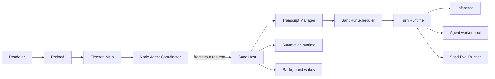

# Arquitetura recuperada do Grok Bot 0.71.2

Este é um mapa inicial de contratos locais, não uma afirmação de paridade funcional. Evidência primária: artefatos e hashes em [ARTIFACT_INVENTORY.md](ARTIFACT_INVENTORY.md), ASAR indexado pelo REA e linhas citadas de `GrokBotResearch/sand/sand-host/host-main.cjs`.

Setas sólidas entre processos são **hipóteses arquiteturais** a confirmar por chamadas e IPC. As entradas de código de cada caixa foram verificadas no ASAR ou no Sand Host extraído; presença não demonstra execução. A seta pontilhada assinala explicitamente fronteira não rastreada.

## Contratos observados no bundle do Sand Host

| Componente | Contrato estático recuperado | Fonte | Confiança |
| --- | --- | --- | --- |
| `SandRunScheduler` | `enqueue(agentId, task, options)` aceita `lane`, `source`, timestamps e callbacks. Mantém filas por agente: `user`, `agent`, `background`; executa uma tarefa ativa por agente, nessa prioridade. `drain`, `dispose`, diagnósticos e watchdog tratam espera e tarefa presa. | `host-main.cjs:739617-739904` | Alta para implementação local; sem validação de runtime |
| Transcript e turn | Módulos `transcript-manager.ts`, `send-pipeline.ts`, `turn-runtime.ts`, `run-lifecycle.ts` e `turn-execution-service.ts` estão no bundle. | `host-main.cjs:736446`, `739613`, `740157`, `783170`, `784581` | Alta para presença, média para responsabilidade inferida do nome |
| Isolamento | `agent-worker-pool.ts` constrói caminho para `agent-isolation/agent-store-worker.cjs` e registra conexão de worker por agente. | `host-main.cjs:715085-715343` | Média; limites de isolamento por testar |
| Automação e despertar | `automation-runtime.ts`, `background-wakes.ts`, filas `resumePendingWakes` e ferramenta `WakeParent` aparecem no host. Texto do prompt diz que `WakeParent` encerra a run e solicita comunicação pelo agente principal. | `host-main.cjs:733935-734756`, `740523-740534`, `733926-733927` | Alta para código/texto; comportamento remoto não provado |
| Inferência | `inference/extension.ts` e serviços de voz estão presentes; sessões/modelos e chamadas externas exigem tracing próprio. | `host-main.cjs:681893-682062` | Baixa para fluxo completo |
| Harness | `package.json` do ASAR declara `@anysphere/grok-bot-harness` como dependência de workspace. O código está compilado nos bundles, mas os módulos de origem não foram integralmente reconstituídos. | ASAR `package.json` | Alta para dependência; baixa para API efetiva |

## Fluxo de mensagem, estado da evidência

1. Renderer e preload têm entradas identificadas; envio da mensagem e validação IPC ainda não foram rastreados.
2. Main e coordinator têm bundles identificados; criação de processo, protocolo e persistência ainda não foram demonstrados.
3. O Sand Host contém `send-pipeline`, `transcript-manager`, `run-lifecycle` e `turn-runtime`, candidatos para receber e executar turnos. Ligação de chamadas pendente.
4. O scheduler local ordena tarefas por agente, com prioridade de usuário, agente e background; isso está no código compilado.
5. Inferência, tool calls, memória, subagentes, streaming e resposta ainda precisam de grafos de chamadas e observação autorizada para comprovar caminho completo.

## Limites e próximos passos

O backend remoto e o algoritmo que seleciona oportunidades proativas não foram recuperados. `WakeParent`, `PendingWake` e o scheduler demonstram mecanismos de entrega e priorização, não a origem da decisão espontânea. O REA analisou estaticamente uma seleção de arquivos; não executou bootstrap nem registrou tráfego. Próxima etapa: analisar coordinator e Main separadamente, depois rastrear contrato Main ↔ coordinator ↔ host e mapear turn/inference/tool registry dentro do Sand Host.
