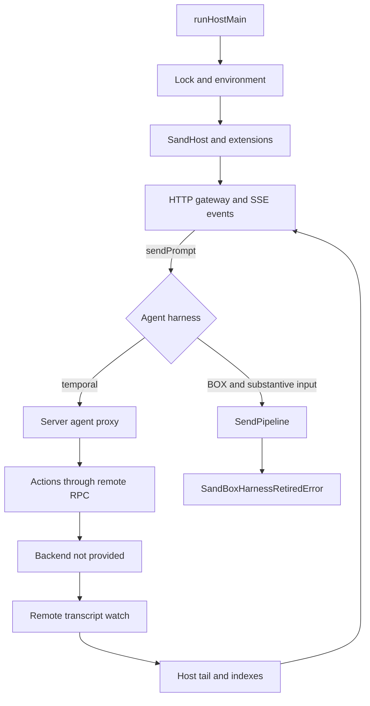
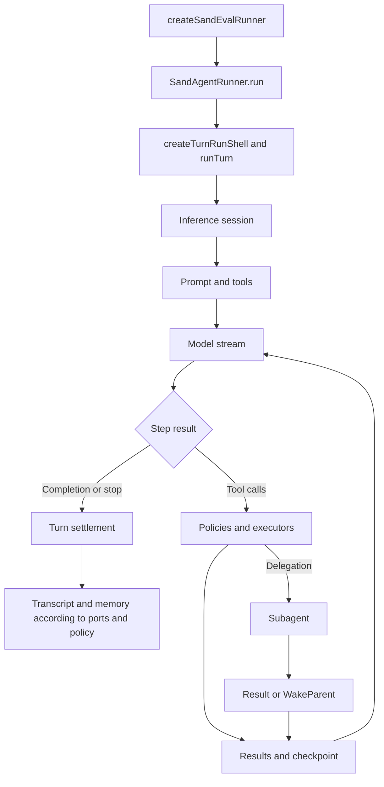
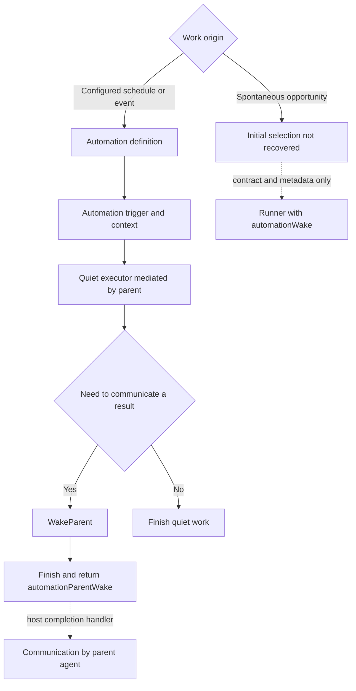

# End-to-end architecture

[English](README.en.md) · [Português (Brasil)](README.md)

The material supports reconstructing three complementary paths: the host that exposes APIs and integrations, the proxy that forwards temporal agents to the backend, and the evaluation runner that contains a concrete harness loop. Treating them as a single, continuously active process would produce an incorrect architecture.

## 1. Host, gateway, and remote control

`runHostMain` installs crash protection, acquires a lock, loads the environment, creates the host, and starts the gateway during `beforeResumeOwnership`. After startup, it publishes discovery information and signals readiness. Shutdown closes the gateway, disposes of the host, removes discovery information, and releases the lock; there is a five-second watchdog. [Implementation](../../reference/runtime/host-main.cjs#L786935-L787102), [bootstrap guide](../components/bootstrap/README.en.md).

`createHostGatewayApi` wraps the API with `wrapGatewayApiWithServerAgentProxy`. The proxy recognizes agents whose `harness` is `temporal`. Remote action and watch methods are linked to generated contracts; the service and deployment that execute them are not in this repository. [Gateway](../components/gateway/README.en.md), [transcripts](../components/transcripts/README.en.md).

`SendPipeline.sendPrompt` returns without doing work when the prompt is empty and there are no attachments. For substantive input, it checks the target and refuses the BOX path. The attachment check in this method only identifies whether a text path exists; it is not a complete validation of file contents. The proxy fallback for an `unimplemented` outcome does not reactivate a BOX loop: it also reaches the refusal. The `unavailable` and `refused` outcomes propagate errors without that fallback. [Source](../../reference/runtime/host-main.cjs#L740157-L740194), [wrapper](../../reference/runtime/host-main.cjs#L491926-L492042).

## 2. Loop recovered in the evaluation runner

The evaluation factory creates the ports and the runner. The shell controls the active generation, cancellation, snapshots, checkpoints, budgets, and termination state. The session is assembled by `createSandEvalInference` and `createCursorInferencePromptSession`; the stream reaches `InferenceService.Stream`. The prompt executor converts model calls into tool calls and feeds the results back in. [Turns](../components/turns/README.en.md), [inference](../components/inference/README.en.md), [tools](../components/tools/README.en.md).

This flow is a concrete static connection within the evaluation artifact. It does not demonstrate that production uses the same mocks, model configuration, ports, or persistence. The evaluation factory has not been treated as the hidden factory of the temporal backend.

## 3. Proactivity and communication with the parent

The automation executor mediated by the parent receives context and can work quietly. In that context, `requestAutomationParentWake` records a single message and interrupts execution with a special reason. The result distinguishes this completion from an ordinary abort. The handoff request and completion construction are implemented; resumption depends on a completion handler connected by the host. This analysis does not demonstrate actual delivery to the user. The parent owns the child execution and need not be the configured primary bot. The spontaneous branch ends at the identified contracts and metadata: it has not been proven that every `platformProactivity` trigger uses this same dispatch mediated by the parent. Dotted arrows mark contracts or dependencies without a proven production connection; the ranking or filtering of initial opportunities remains absent. [Proactivity](../components/proactivity/README.en.md), [automations](../components/automations/README.en.md), [wakes](../components/background-wakes/README.en.md).

## State and identities

| Identity or state | Responsibility | Do not confuse with |
| --- | --- | --- |
| Agent/conversation | Profile, scopes, runner, and transcript | Individual turn |
| Primary bot | Choice of the primary agent | Proactive ranking engine |
| Turn/run | Execution, generation, cancellation, and checkpoints | Task document |
| Documentary task | Document and transcript related to the task | Progress list and subagent |
| Subagent | Delegated executor with a type, context, and permissions | New primary agent |
| Automation | Persistent definition and trigger origin | A specific execution |
| Transcript | Events and messages, including publishing and watching | Consolidated memory |
| Memory | Facts structured by type and scope | Complete conversation history |

The specific contracts are covered in [tasks](../components/tasks/README.en.md), [subagents](../components/subagents/README.en.md), [memory](../components/memory/README.en.md), and [transcripts](../components/transcripts/README.en.md).

## Where to study each boundary

| Question | Primary source |
| --- | --- |
| How does the process start and publish the gateway? | `reference/runtime/host-main.cjs`, bootstrap, and extensions |
| How does a temporal agent send actions and receive history? | Remote proxy in the host |
| How does the available model-and-tools loop work? | `reference/runtime/sand-eval-runner.cjs` |
| How do per-agent state operations move to another thread? | Storage worker and host pool |
| Who selects the spontaneous opportunity? | Initial implementation not located in the available files |
| Was this executed against real services? | No; static analysis using hashes and ASTs |

[Complete index](../README.en.md) · [Method](../methodology/README.en.md) · [Function catalog](../../mapped/README.en.md)
