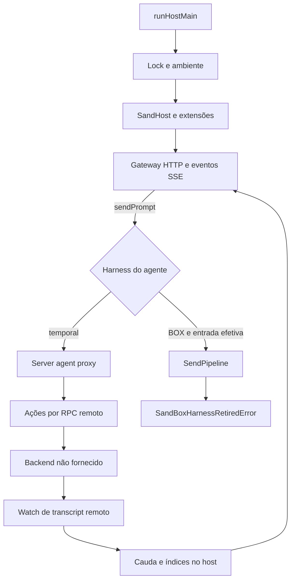
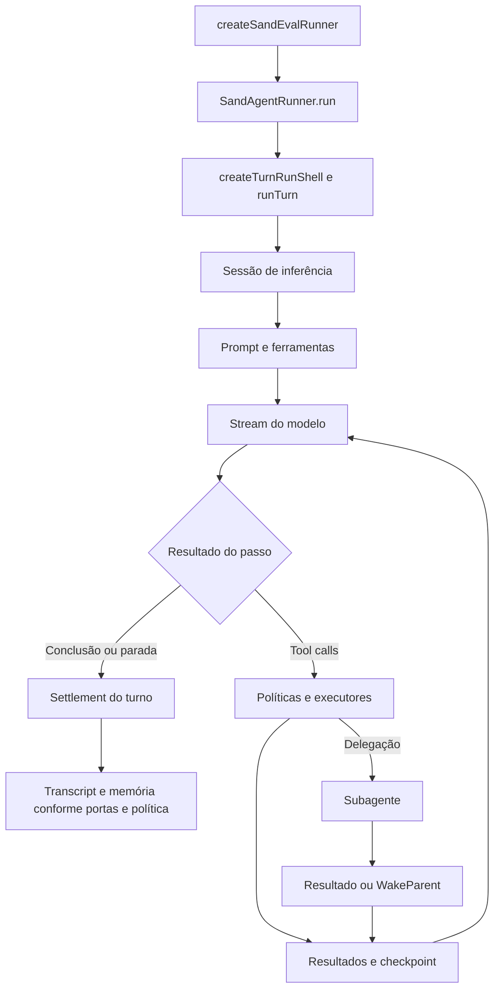
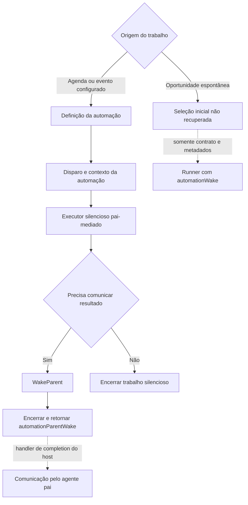

# End-to-end architecture

O material permite reconstruir três trilhas complementares: o host que oferece APIs e integrações, o proxy que encaminha agentes temporais ao backend, e o executor de avaliação que contém um loop concreto do harness. Tratá-las como um único processo sempre ativo produziria uma arquitetura incorreta.

## 1. Host, gateway e controle remoto

`runHostMain` instala proteção contra crash, adquire lock, carrega ambiente, cria o host e inicia o gateway durante `beforeResumeOwnership`. Após o início, publica a descoberta e sinaliza disponibilidade. O shutdown fecha gateway, descarta o host, remove descoberta e libera lock; há watchdog de cinco segundos. [Implementação](../../reference/runtime/host-main.cjs#L786935-L787102), [guia do bootstrap](../components/bootstrap/README.md).

`createHostGatewayApi` envolve a API com `wrapGatewayApiWithServerAgentProxy`. O proxy reconhece agentes cujo `harness` é `temporal`. Os métodos remotos de ação e watch estão ligados a contratos gerados; o serviço e a implantação que os executam não estão neste repositório. [Gateway](../components/gateway/README.md), [transcripts](../components/transcripts/README.md).

`SendPipeline.sendPrompt` retorna sem trabalho quando o prompt está vazio e não há anexos. Para uma entrada efetiva, verifica o alvo e recusa a trilha BOX. O teste de anexos nesse método apenas identifica se existe um caminho textual; não é uma validação completa do conteúdo dos arquivos. O fallback do proxy no outcome `unimplemented` não reativa um loop BOX: ele também encontra a recusa. Outcomes `unavailable` e `refused` propagam erros, sem esse fallback. [Fonte](../../reference/runtime/host-main.cjs#L740157-L740194), [wrapper](../../reference/runtime/host-main.cjs#L491926-L492042).

## 2. Loop recuperado no executor de avaliação

A factory de avaliação cria as portas e o runner. O shell controla a geração ativa, cancelamento, snapshots, checkpoints, budgets e estado de término. A sessão é montada por `createSandEvalInference` e `createCursorInferencePromptSession`; o stream chega a `InferenceService.Stream`. O executor de prompt transforma chamadas do modelo em chamadas de ferramentas e reintegra os resultados. [Turnos](../components/turns/README.md), [inferência](../components/inference/README.md), [ferramentas](../components/tools/README.md).

Esse fluxo é uma ligação estática concreta do artefato de avaliação. Não demonstra que a produção usa seus mesmos mocks, configuração de modelos, portas ou persistência. A factory de avaliação não foi tratada como a factory escondida do backend temporal.

## 3. Proatividade e comunicação com o pai

O executor pai-mediado de automação recebe contexto e pode trabalhar silenciosamente. Nesse contexto, `requestAutomationParentWake` registra uma única mensagem e interrompe a execução com um motivo especial. O resultado diferencia essa conclusão de um abort comum. O pedido de handoff e a formação da completion estão implementados; a retomada depende de um handler de completion conectado pelo host. Isso não demonstra entrega real ao usuário nesta análise. O pai é o dono da execução filha e não precisa ser o primary bot configurado. O ramo espontâneo termina nos contratos e metadados identificados: não foi provado que todo disparo `platformProactivity` usa esse mesmo dispatch pai-mediado. As setas pontilhadas marcam contratos ou dependências sem ligação de produção comprovada; o ranking ou filtro de oportunidades iniciais continua ausente. [Proatividade](../components/proactivity/README.md), [automações](../components/automations/README.md), [wakes](../components/background-wakes/README.md).

## Estado e identidades

| Identidade ou estado | Responsabilidade | Evitar confundir com |
| --- | --- | --- |
| Agente/conversa | Perfil, escopos, runner e transcript | Turno individual |
| Primary bot | Escolha do agente principal | Motor de ranking proativo |
| Turno/run | Execução, geração, cancelamento e checkpoints | Documento de tarefa |
| Task documental | Documento e transcript relacionados à tarefa | Lista de progresso e subagente |
| Subagente | Executor delegado com tipo, contexto e permissões | Novo agente principal |
| Automação | Definição persistente e origem de disparo | Uma execução específica |
| Transcript | Eventos e mensagens, inclusive publicação e watch | Memória consolidada |
| Memória | Fatos estruturados por tipo e escopo | Histórico completo da conversa |

Os contratos específicos estão em [tarefas](../components/tasks/README.md), [subagentes](../components/subagents/README.md), [memória](../components/memory/README.md) e [transcripts](../components/transcripts/README.md).

## Onde estudar cada fronteira

| Pergunta | Fonte principal |
| --- | --- |
| Como o processo sobe e publica o gateway? | `reference/runtime/host-main.cjs`, bootstrap e extensões |
| Como um agente temporal envia ações e recebe histórico? | Proxy remoto no host |
| Como funciona o loop disponível de modelo e ferramentas? | `reference/runtime/sand-eval-runner.cjs` |
| Como as operações de estado por agente passam para outra thread? | Worker de armazenamento e pool do host |
| Quem decide a oportunidade espontânea? | Implementação inicial não localizada no acervo |
| Isso foi executado contra serviços reais? | Não; análise estática com hashes e AST |

[Índice completo](../README.md) · [Método](../methodology/README.md) · [Catálogo por função](../../mapped/README.md)
