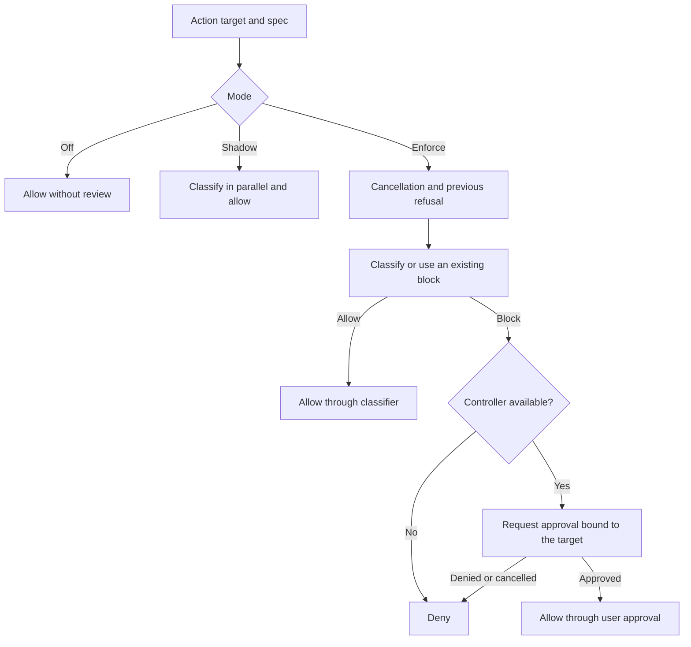

# Approvals and action review

[English](README.en.md) · [Português (Brasil)](README.md)

[Index](../../README.en.md) · [Tools](../tools/README.en.md) · [Browser](../browser-computer/README.en.md)

## Responsibility and limits

The harness has a shared flow for classifying actions, binding decisions to the target, requesting approval when necessary, and honoring cancellation. Shell, MCP, browser, subagents, automations, files, and outbound operations also have their own adaptations. The coordination code is visible; the classifier service's complete internal policy was not recovered. A call to the classifier should not be treated as evidence of its algorithm. [Shared flow](../../../reference/runtime/sand-eval-runner.cjs#L554695-L554806).

## `runSandAutoReviewFlow`

| Phase | Observed decision |
| --- | --- |
| `mode:"off"` | Allows as `unreviewed` |
| `mode:"shadow"` | Starts classification without awaiting it; errors become diagnostics; allows as `unreviewed` |
| Enforce | Applies cancellation, previous-refusal, and classification checks |
| Classifier allow | Returns `allowed.by:"classifier"` |
| Non-allowing result, without a controller | Denies; does not fabricate approval |
| Block with a controller | Requests approval bound to the fingerprint and context |
| Approval | Returns `allowed.by:"user"`; a denial preserves its reason |

The presence of this infrastructure therefore does not mean that every turn requires approval: the effective mode matters. The bundle does not provide the production value for each mode.



## Algorithm in detail

`classify2` in the evaluation runner builds the risk target from the spec and personal/project instructions. It loads conversation context only when both a state handler and an extractor are available; otherwise, it sends an empty list. `runSandAutoReviewFlow` calculates a fingerprint over `spec.fingerprintPayload(target)`. Before classifying, it checks `recordedCardRefusal` using the call ID, optional review ID, and fingerprint. A previously refused target can block another attempt without a new classification. [Construction and order](../../../reference/runtime/sand-eval-runner.cjs#L554695-L554753).

Cancellation with `abortPolicy.kind:"deny"` is checked before classification, after classification, and after approval. The policy decision can be recorded in the audit log. The spec's `requireApproval` can force the blocking path. The controller receives the reason, summary, caution, proposed/applied rules, signal, and expiration policy. The `onUserDenied` callback runs only for an explicit denial with an approval ID and without retirement. [Completion](../../../reference/runtime/sand-eval-runner.cjs#L554754-L554806).

## Specialized specs

- **Subagent:** the target includes launch/steer, prompt, type, ID, readonly, and resume; cancellation denies the action. [Source](../../../reference/runtime/host-main.cjs#L780771-L780823).
- **Phone call:** `reviewSandOutboundCall` uses a human-only ledger and `ask_human`; an absent controller results in denial. The action includes the destination, purpose, and instruction. This route is not the shared flow's automatic allow path. [Source](../../../reference/runtime/host-main.cjs#L763549-L763604).
- **Browser:** review captures the state identity and page URL; a capture failure or timeout produces a specific error before the action. [Source](../../../reference/runtime/sand-eval-runner.cjs#L516190-L516352).
- **State update:** `executeStateUpdate` can deny an update while an approval is pending, before applying memory/state changes. [Source](../../../reference/runtime/host-main.cjs#L771684-L771689).

## Safety as a mechanism, not just text

Manifests determine which tools are offered; schemas validate arguments; review decides whether an action may proceed; ports perform the effect; the audit log records the decision. No layer replaces the others. An omitted tool cannot be made available merely because the model explains a good intention, and an offered tool can still be blocked by review. The code studied also distinguishes infrastructure errors, user denial, retirement, and cancellation.

## What remains to be measured

No classification calls, approvals, or effects on real accounts were executed. The remote policy, models used, thresholds, and classifier training set are unavailable. This documentation recovers the flow's contract and error paths without inventing those elements.

```bash
rg -n 'runSandAutoReviewFlow|recordedCardRefusal|reviewSandOutboundCall|reviewSandSubagentAction' reference/runtime/{host-main,sand-eval-runner}.cjs
```
