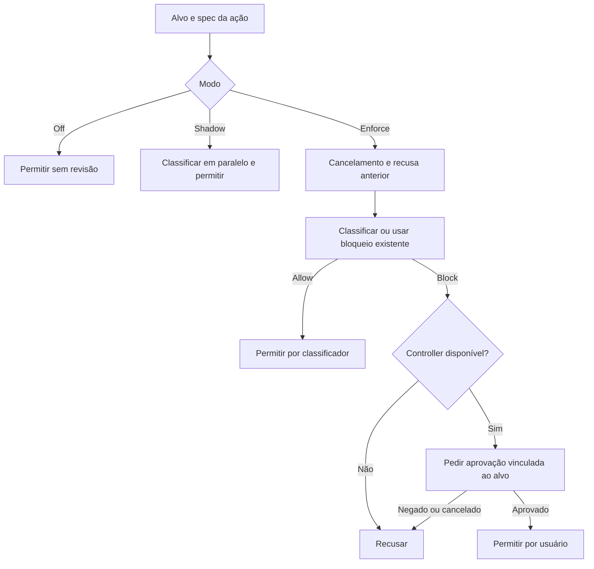

# Aprovações e revisão de ações

[Índice](../../README.md) · [Ferramentas](../tools/README.md) · [Browser](../browser-computer/README.md)

## Responsabilidade e limite

O harness possui um fluxo comum para classificar ações, vincular decisões ao alvo, pedir aprovação quando necessário e honrar cancelamento. Shell, MCP, browser, subagentes, automações, arquivos e envios também possuem adaptações próprias. O código da coordenação é visível; a política interna completa do serviço classificador não foi recuperada. Não se deve tratar uma chamada ao classificador como prova de seu algoritmo. [Fluxo comum](../../../reference/runtime/sand-eval-runner.cjs#L554695-L554806).

## `runSandAutoReviewFlow`

| Fase | Decisão observada |
| --- | --- |
| `mode:"off"` | Permite como `unreviewed` |
| `mode:"shadow"` | Inicia classificação sem aguardá-la; erro vira diagnóstico; permite como `unreviewed` |
| Enforce | Aplica checks de cancelamento, recusa anterior e classificação |
| Classificador allow | Retorna `allowed.by:"classifier"` |
| Resultado que não permite, sem controller | Recusa; não fabrica aprovação |
| Block com controller | Pede aprovação vinculada a fingerprint e contexto |
| Aprovação | Retorna `allowed.by:"user"`; recusa conserva motivo |

Portanto, a presença da infraestrutura não significa que todos os turnos exigem aprovação: o modo efetivo importa. O bundle não fornece o valor de produção de cada modo.



## Algoritmo em detalhe

`classify2` no eval constrói o risk target a partir do spec e das instruções pessoais/de projeto. Carrega contexto de conversa apenas se há state handler e extrator; do contrário envia lista vazia. `runSandAutoReviewFlow` calcula fingerprint sobre `spec.fingerprintPayload(target)`. Antes de classificar, consulta `recordedCardRefusal` com ID de chamada, ID de revisão opcional e fingerprint. Um alvo já recusado pode bloquear uma nova tentativa sem nova classificação. [Construção e ordem](../../../reference/runtime/sand-eval-runner.cjs#L554695-L554753).

Cancelamento com `abortPolicy.kind:"deny"` é conferido antes da classificação, após a classificação e após a aprovação. A decisão de policy pode ser registrada no audit. `requireApproval` do spec pode forçar o caminho de bloqueio. O controller recebe motivo, resumo, cautela, regras propostas/aplicadas, signal e política de expiração. A callback `onUserDenied` só é acionada em recusa explícita com approval ID e sem retirement. [Conclusão](../../../reference/runtime/sand-eval-runner.cjs#L554754-L554806).

## Specs especializados

- **Subagente:** alvo inclui launch/steer, prompt, tipo, ID, readonly e resume; cancelamento nega. [Fonte](../../../reference/runtime/host-main.cjs#L780771-L780823).
- **Ligação telefônica:** `reviewSandOutboundCall` usa ledger human-only e `ask_human`; ausência de controller recusa. A ação inclui destino, propósito e instrução. Essa rota não é o allow automático do fluxo comum. [Fonte](../../../reference/runtime/host-main.cjs#L763549-L763604).
- **Browser:** a revisão captura identidade do estado e URL da página; falha ou timeout de captura produz erro específico antes da ação. [Fonte](../../../reference/runtime/sand-eval-runner.cjs#L516190-L516352).
- **Atualização de estado:** `executeStateUpdate` pode recusar enquanto existe uma aprovação pendente, antes de aplicar memória/estado. [Fonte](../../../reference/runtime/host-main.cjs#L771684-L771689).

## Segurança como mecanismo, não como texto

Manifestos determinam ferramentas oferecidas; schemas validam argumentos; revisão decide a ação; portas fazem o efeito; audit registra a decisão. Nenhuma camada substitui as outras. Um tool omitido não pode ser liberado só porque o modelo explica uma boa intenção, e um tool oferecido ainda pode ser bloqueado pela revisão. O código estudado também distingue erro de infraestrutura, recusa do usuário, retirement e cancelamento.

## O que falta medir

Não foram executadas chamadas de classificação, aprovações ou efeitos em conta real. Faltam política remota, modelos usados, thresholds e conjunto de treinamento do classificador. A documentação recupera o contrato do fluxo e seus caminhos de erro, sem inventar esses elementos.

```bash
rg -n 'runSandAutoReviewFlow|recordedCardRefusal|reviewSandOutboundCall|reviewSandSubagentAction' reference/runtime/{host-main,sand-eval-runner}.cjs
```
