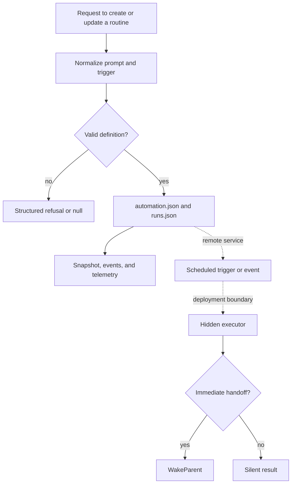

# Automations: definition, scheduling, persistence, and execution

[English](README.en.md) · [Português (Brasil)](README.md)

## Responsibility and boundaries

An automation is a persisted prompt with a trigger, name, state, and provenance. The code separates the on-disk definition, its presentation and history, remote trigger control, and the runner that performs the work. The host's `AutomationRuntime` tracks changes and exposes operations, but `runAgentAutomationNow` refuses BOX execution. In-session execution goes through `AutomationsService.testAutomation`; the shared executor implementation was recovered in `sand-eval-runner.cjs`. [Runtime](../../../reference/runtime/host-main.cjs#L733982-L734298), [in-session RPC](../../../reference/runtime/host-main.cjs#L505720-L505746), [executor](../../../reference/runtime/sand-eval-runner.cjs#L584012-L584122).



The dotted arrows do not assert that this bundle connects the local store to a complete remote scheduler. The server code that schedules work and receives events is unavailable.

## Data model

| Element | Recovered form | Note |
| --- | --- | --- |
| Directory | `agents/<agent>/automations/<id>/` | Derived from the agent directory and safe ID |
| Configuration | `automation.json` | Name, prompt, trigger/schedule, enabled, provenance, dates, and warnings |
| History | `runs.json` | Up to 20 runs, most recent first |
| Local identity | Name slug, with a suffix when necessary | `uniqueAutomationId` does not modify an existing routine by name |
| Remote identity | Hash of `agentId + NUL + localId` formatted as a UUID | Stable per pair; not a random UUID |
| Run states | `running`, `ok`, `error` | Parser normalizes unknown values to `ok` |
| Provenance | `user`, `template_import`, `untrusted` | Missing or unknown values become `untrusted` |
| Persisted run origin | `manual`, `event`, `schedule` | Different from the runner's analytical `platform` label |

[File format](../../../reference/runtime/host-main.cjs#L716457-L716620), [stable ID](../../../reference/runtime/host-main.cjs#L505708-L505718), [store](../../../reference/runtime/host-main.cjs#L720424-L720800), [maximum history](../../../reference/runtime/host-main.cjs#L485657).

This separation of IDs is necessary when reading the code: `automation.id`, `run.id`, `requestId`, `subagentAgentId`, and the remote identifier are not interchangeable.

## Limits and defaults

| Parameter | Value | Source |
| --- | --- | --- |
| Name | 80 characters after normalization | `AUTOMATION_MAX_NAME_LENGTH` |
| Definitions per agent | 50 | `AUTOMATION_MAX_PER_AGENT` |
| Display limit | 100 | `AUTOMATION_UI_LIMIT` |
| History per definition | 20 runs | `AUTOMATION_MAX_RUN_HISTORY` |
| Detail/event summary | 300 characters | `AUTOMATION_MAX_RUN_DETAIL_LENGTH` |
| Grouped run IDs | 25 | `MAX_EVENTS_IN_AUTOMATION_WAKE` |
| Watcher debounce | 50 ms | `AUTOMATION_CHANGE_DEBOUNCE_MS` |
| Minimum routine interval | 5 minutes | `SAND_AUTOMATION_MIN_INTERVAL_MS` |
| Next-cron search | Up to 366 days, with minute resolution | `MAX_CRON_SEARCH_MINUTES` |
| Cloud reconciliation | 15 seconds | `CLOUD_SYNC_RECONCILE_INTERVAL_MS` |
| Auxiliary flexible window | 15 minutes before/after when the respective limits are absent | `DEFAULT_FLEXIBLE_WINDOW_MINUTES` |

Sources: [automation limits](../../../reference/runtime/host-main.cjs#L715021-L715083), [scheduling](../../../reference/runtime/host-main.cjs#L682267-L682596), [watcher](../../../reference/runtime/host-main.cjs#L720424-L720503), [timer](../../../reference/runtime/host-main.cjs#L505894-L506027), [flexible timing](../../../reference/runtime/host-main.cjs#L761934-L761992). The 15-second cloud sync interval is neither a routine's cadence nor an opportunity search.

## Parsing and persistence functions

### `parseStoredAutomationConfig(raw, fallbackCreatedAt)`

Parses JSON and returns `null` for invalid JSON, a missing object, an empty name/prompt, or an unrecoverable trigger. The structured trigger is preferred; a legacy textual schedule is the fallback. The name is capped, the prompt receives `trim`, `enabled` becomes false only when the file contains exactly `false`, and `createdAt` is the minimum of the valid declared date and the file's fallback date. Warnings are filtered by known IDs and deduplicated. [Implementation](../../../reference/runtime/host-main.cjs#L716464-L716532).

`parseStoredAutomationRuns` only accepts an array, discards entries without an `id` or finite `startedAt`, normalizes optional fields, sorts by descending start time, and caps the history. A corrupted history returns an empty list; this function does not automatically reconstruct remote history. [Implementation](../../../reference/runtime/host-main.cjs#L716566-L716615).

### `FileAutomationStore.readConfig`, `list`, and `listDefinitions`

`readConfig` reads the configuration through Sand data access, derives a date from birthtime/mtime, and migrates old intervals below the minimum, writing the migration when necessary. `list` computes `nextRunAt` and sorts by next execution and creation; `listDefinitions` skips schedule calculation and sorts by creation. These operations differ in cost and purpose. [Implementation](../../../reference/runtime/host-main.cjs#L720517-L720589).

### `upsert`, `update`, `setEnabled`, and `remove`

Despite its name, `upsert` creates a new unique ID: it validates the specification, checks the limit of 50 definitions, generates an available slug, and writes it. `update` requires a safe ID and an existing configuration; `setEnabled` avoids a write when the value already matches. `remove` checks the directory, removes that automation's tree, and schedules a notification. `upsert` does not update by matching names. [Implementations](../../../reference/runtime/host-main.cjs#L720597-L720655), [removal](../../../reference/runtime/host-main.cjs#L720783-L720799).

### `beginRun`, `setRunRequestIdDefinition`, and `finishRunWith`

`beginRun` requires an existing definition, accepts a supplied `runId` or creates a UUID, and returns the existing entry when the same `runId` already appears in the history. Otherwise it adds `running`, `finishedAt: null`, an event summary, and grouped IDs. `setRunRequestIdDefinition` only fills in a nonempty request ID when none exists yet. `finishRunWith` updates the matching entry with its status and finish time, preserving the previous request ID; if it cannot find the run, it returns the automation without creating an orphan completion. [Implementation](../../../reference/runtime/host-main.cjs#L720675-L720781).

This idempotency is limited to retained history and store state. It is not a distributed exactly-once guarantee.

## Scheduling functions

### `parseEverySchedule` and `computeNextRunAt`

The interval parser accepts compound durations and an optional phase, such as `@every 1h30m/10m`. It rejects an invalid duration, unconsumed components, a zero interval, and a phase greater than or equal to the interval. Without a phase, the next instant is `afterMs + intervalMs`; with a phase, it uses the next strictly later multiple, aligned to the epoch. [Parser](../../../reference/runtime/host-main.cjs#L682464-L682487), [computeNextRunAt README](../../functions/computeNextRunAt/README.en.md).

### Cron and timezone

The common matcher accepts five fields, aliases such as `@daily`, lists, intervals, ranges, and `CRON_TZ=` or `TZ=`. Sunday `7` becomes `0`. If both day-of-month and day-of-week are restricted, the condition is OR; otherwise the present restrictions apply. The timezone expressed in the schedule takes precedence over the supplied timezone; without a valid fallback formatter, it uses the box's local clock. The search begins at the minute after the supplied instant. [Parsing and day rule](../../../reference/runtime/host-main.cjs#L682290-L682376), [search and timezone](../../../reference/runtime/host-main.cjs#L682429-L682596).

`cronIntervalIsAtLeast` checks spacing between times of day and, when crossing midnight could violate the minimum, traverses the Gregorian cycle from 2000 to 2400 to determine whether consecutive eligible days exist. This is an interval-validation detail, not a running scheduler. `clampScheduleToMinimumInterval` has broader compatibility with legacy schedules than the common parser; this migration does not imply that every legacy format is accepted for a new definition. [Validation and migration](../../../reference/runtime/host-main.cjs#L682501-L682579).

### `applyAutomationTiming`

If there is no cron, it changes nothing. If timing is not offered, it removes timing metadata. If the model provides `timing` or limits, it applies the explicit choice. Without a choice, it preserves the previous timing when possible; when changing the trigger without a previous policy, it uses `flexible` for recurrence and `exact` when the schedule is recognized as a one-time occurrence. [Implementation](../../../reference/runtime/host-main.cjs#L761934-L761992).

## Events and scope validation

The trigger file has parsers for each family and structured errors with `family` and `reason`. The GitHub parser requires a specific repository, removes invalid/duplicate events, validates a positive PR number, deduplicates logins without regard to case, and requires a branch when a CI event is not tied to a PR. Without a branch or PR, it removes CI events; it may retain other valid events. [GitHub](../../../reference/runtime/host-main.cjs#L716079-L716144).

`findUnboundedRepoListener` identifies high-volume events (`pr-pushed`, `pr-comment`, `inline-review-comment`, `review-commented`) without a PR and without a user allowlist. This produces a refusal for overly broad scope. Validation does not replace the event service's filters. [Implementation](../../../reference/runtime/host-main.cjs#L761995-L762033).

Slack supports matching by mention, message, keyword, or reaction; the Teams parser requires a tenant and at least one team and preserves channel and text filters. Linear and other families also have parsers. The existence of parsers establishes accepted formats, not an authenticated connection or observed event delivery. [Parsers](../../../reference/runtime/host-main.cjs#L715994-L716456).

## Concurrency and lifecycle

`AutomationRuntime.watchSessionAutomations` removes the previous watcher, seeds a snapshot per agent, and registers a callback. `runOnPerAgentChain` chains promises per agent with `previous.then(task, task)`, so a previous failure does not block subsequent changes. The returned promise preserves the operation's error; the promise stored in the chain absorbs the error only to continue the queue and release the slot. [Runtime and chaining](../../../reference/runtime/host-main.cjs#L733982-L734076).

`enqueueAutomationMutation` distinguishes active and inactive sessions, records already-present changes with origin `agent`, applies the requested operation, records the diff as `automations_ui`, and publishes the result. `diffAuthoredAutomationAction` prioritizes changes to name/prompt/trigger as `updated`; it only distinguishes `enabled` and `disabled` when those fields have not changed. [Diff](../../../reference/runtime/host-main.cjs#L733939-L733962), [mutation](../../../reference/runtime/host-main.cjs#L734077-L734151).

`emitAutomationLifecycle` assigns a stable remote ID, age, and run count, calculates a forecast of triggers over the next seven days for cron, and sends telemetry. An analytical schedule forecast is not an execution record. [Telemetry](../../../reference/runtime/host-main.cjs#L734166-L734226).

## Remote control and failure behavior

`SandAutomationCloudSync.reconcileNow` coalesces simultaneous calls into one promise; a new call during execution marks `rerun`. In the available code, the work performed is `retryPendingAgentDeletions`. `deleteAgent` lists remote routines, attempts to remove them, deletes webhook keys after each successful removal, and rereads the server to check convergence. Pending agents remain for another attempt; failures feed diagnostics and warnings, with recovery removing the warning. [Implementation](../../../reference/runtime/host-main.cjs#L505585-L505705).

`runSandAutomationNowInSession` only locally refuses a routine it finds when the trigger is not exclusively schedule-based. It then calls `testAutomation` with the stable ID, cron payload, and `grokBotSessionId`. If the record was not found locally, it still attempts the RPC; recognized Connect refusals become `SandAutomationRunNowRefusedError`, and other errors propagate. [Function README](../../functions/runSandAutomationNowInSession/README.en.md).

The extension starts polling, reconciles once when authentication becomes available, and stops/restarts polling in `suspendWakes` and `resumeWakes`. In this snapshot these methods control polling; they do not establish that all remote work stops. [Extension](../../../reference/runtime/host-main.cjs#L505894-L506027).

## Execution and communication

The executor receives the persisted instruction, with hidden execution and a quiet origin. It can start children; their results are drained and incorporated before it finishes. If communication is needed, `WakeParent` creates a handoff and exits. Ordinary `finalAssistantText` serves as the run result, not as a post in the user's chat. The READMEs for [proactivity](../proactivity/README.en.md), [dispatch](../../functions/createAutomationSubagentDispatch/README.en.md), and [WakeParent](../../functions/createWakeParentTool/README.en.md) detail this path.

The automation manifest omits direct user communication, actions under the user's identity, and capabilities requiring approval in chat. Support for messages between agents is separate and has its own instructions; it does not mean unrestricted permission to contact external recipients. [Manifest](../../../reference/runtime/host-main.cjs#L756821-L756882).

## Static verification

```bash
rg -n 'FileAutomationStore|AUTOMATION_MAX_RUN_HISTORY|SAND_AUTOMATION_MIN_INTERVAL_MS' reference/runtime/host-main.cjs
rg -n 'runOnPerAgentChain|runAgentAutomationNow|retryPendingAgentDeletions' reference/runtime/host-main.cjs
rg -n 'createAutomationSubagentDispatch|parentMediated|quietWork' reference/runtime/sand-eval-runner.cjs
```

Reading based on snapshot `655acca99bff0d17466547611108f94ed6a8a5e7`. This analysis did not execute the bundle, cron, connectors, or remote services.
