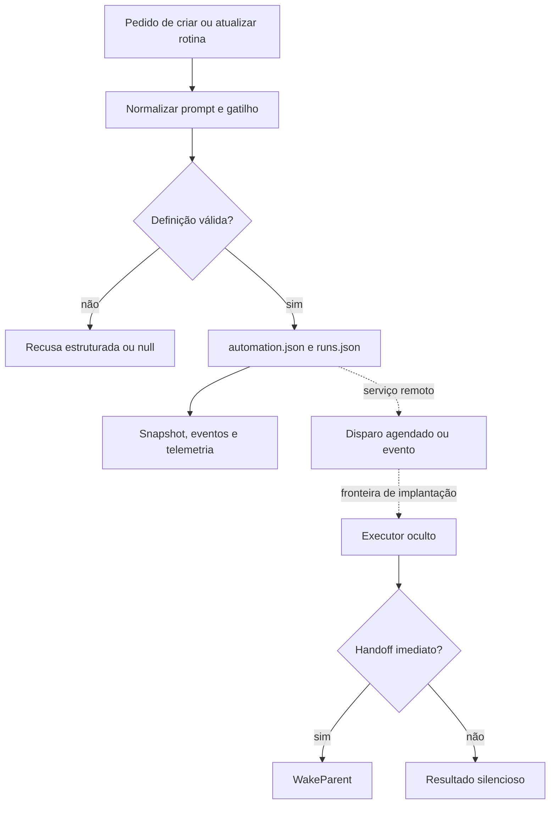

# Automations: definição, agenda, persistência e execução

## Responsabilidade e fronteiras

Uma automação é um prompt persistido com um gatilho, nome, estado e proveniência. O código separa a definição em disco, sua apresentação e histórico, o controle remoto de disparos e o runner que executa o trabalho. O `AutomationRuntime` do host acompanha alterações e expõe operações, mas `runAgentAutomationNow` recusa uma execução BOX. A execução em sessão passa por `AutomationsService.testAutomation`; a implementação compartilhada do executor está recuperada em `sand-eval-runner.cjs`. [Runtime](../../../reference/runtime/host-main.cjs#L733982-L734298), [RPC em sessão](../../../reference/runtime/host-main.cjs#L505720-L505746), [executor](../../../reference/runtime/sand-eval-runner.cjs#L584012-L584122).



As setas pontilhadas não afirmam que o store local está conectado por este bundle a um scheduler remoto completo. O código do servidor que agenda e recebe eventos não está disponível.

## Modelo de dados

| Elemento | Forma recuperada | Observação |
| --- | --- | --- |
| Diretório | `agents/<agent>/automations/<id>/` | Derivado do diretório do agente e do ID seguro |
| Configuração | `automation.json` | Nome, prompt, gatilho/agenda, enabled, provenance, datas e avisos |
| Histórico | `runs.json` | Até 20 runs, mais recentes primeiro |
| Identidade local | Slug do nome, com sufixo quando necessário | `uniqueAutomationId` não altera uma rotina preexistente por nome |
| Identidade remota | Hash de `agentId + NUL + localId` formatado como UUID | Estável por par, não é um UUID aleatório |
| Estados de run | `running`, `ok`, `error` | Parser normaliza desconhecidos para `ok` |
| Proveniência | `user`, `template_import`, `untrusted` | Valor ausente ou desconhecido vira `untrusted` |
| Origem de run persistida | `manual`, `event`, `schedule` | Diferente do rótulo analítico `platform` do runner |

[Formato de arquivo](../../../reference/runtime/host-main.cjs#L716457-L716620), [ID estável](../../../reference/runtime/host-main.cjs#L505708-L505718), [store](../../../reference/runtime/host-main.cjs#L720424-L720800), [histórico máximo](../../../reference/runtime/host-main.cjs#L485657).

Essa separação de IDs é necessária para ler o código: `automation.id`, `run.id`, `requestId`, `subagentAgentId` e o identificador remoto não são intercambiáveis.

## Limites e defaults

| Parâmetro | Valor | Fonte |
| --- | --- | --- |
| Nome | 80 caracteres após normalização | `AUTOMATION_MAX_NAME_LENGTH` |
| Definições por agente | 50 | `AUTOMATION_MAX_PER_AGENT` |
| Limite de apresentação | 100 | `AUTOMATION_UI_LIMIT` |
| Histórico por definição | 20 runs | `AUTOMATION_MAX_RUN_HISTORY` |
| Resumo de detalhe/evento | 300 caracteres | `AUTOMATION_MAX_RUN_DETAIL_LENGTH` |
| IDs de runs agrupadas | 25 | `MAX_EVENTS_IN_AUTOMATION_WAKE` |
| Debounce do watcher | 50 ms | `AUTOMATION_CHANGE_DEBOUNCE_MS` |
| Intervalo mínimo de rotina | 5 minutos | `SAND_AUTOMATION_MIN_INTERVAL_MS` |
| Busca pelo próximo cron | Até 366 dias, com resolução de minuto | `MAX_CRON_SEARCH_MINUTES` |
| Reconciliação cloud | 15 segundos | `CLOUD_SYNC_RECONCILE_INTERVAL_MS` |
| Janela flexível auxiliar | 15 minutos antes/depois quando faltam os respectivos limites | `DEFAULT_FLEXIBLE_WINDOW_MINUTES` |

Fontes: [limites de automação](../../../reference/runtime/host-main.cjs#L715021-L715083), [agenda](../../../reference/runtime/host-main.cjs#L682267-L682596), [watcher](../../../reference/runtime/host-main.cjs#L720424-L720503), [timer](../../../reference/runtime/host-main.cjs#L505894-L506027), [timing flexível](../../../reference/runtime/host-main.cjs#L761934-L761992). Os 15 segundos de cloud sync não são a cadência de uma rotina nem uma busca de oportunidades.

## Funções de parsing e persistência

### `parseStoredAutomationConfig(raw, fallbackCreatedAt)`

Faz parsing de JSON e devolve `null` para JSON inválido, objeto ausente, nome/prompt vazios ou gatilho não recuperável. O gatilho estruturado é preferido; uma agenda textual legada é fallback. O nome é limitado, o prompt recebe `trim`, `enabled` só fica falso quando o arquivo traz exatamente `false`, e `createdAt` é o mínimo entre a data declarada válida e a data de fallback do arquivo. Avisos são filtrados por IDs conhecidos e deduplicados. [Implementação](../../../reference/runtime/host-main.cjs#L716464-L716532).

`parseStoredAutomationRuns` aceita apenas array, descarta entradas sem `id` ou `startedAt` finito, normaliza campos opcionais, ordena por início decrescente e corta o histórico. Corrupção de um histórico retorna lista vazia; não há reconstrução automática do histórico remoto nessa função. [Implementação](../../../reference/runtime/host-main.cjs#L716566-L716615).

### `FileAutomationStore.readConfig`, `list` e `listDefinitions`

`readConfig` lê a configuração com o acesso de dados Sand, deriva uma data a partir de birthtime/mtime e migra intervalos antigos abaixo do mínimo, gravando a migração quando necessário. `list` calcula `nextRunAt` e ordena por próxima execução e criação; `listDefinitions` dispensa o cálculo de agenda e ordena por criação. São operações diferentes em custo e finalidade. [Implementação](../../../reference/runtime/host-main.cjs#L720517-L720589).

### `upsert`, `update`, `setEnabled` e `remove`

Apesar do nome, `upsert` cria um novo ID único: valida a especificação, verifica o limite de 50 definições, gera o slug disponível e grava. `update` exige ID seguro e configuração existente; `setEnabled` evita uma escrita quando o valor já coincide. `remove` verifica o diretório, remove a árvore dessa automação e agenda notificação. Não há atualização por igualdade de nome dentro de `upsert`. [Implementações](../../../reference/runtime/host-main.cjs#L720597-L720655), [remoção](../../../reference/runtime/host-main.cjs#L720783-L720799).

### `beginRun`, `setRunRequestIdDefinition` e `finishRunWith`

`beginRun` exige definição existente, aceita um `runId` fornecido ou cria UUID, e retorna a entrada existente quando o mesmo `runId` já aparece no histórico. Caso contrário acrescenta `running`, `finishedAt: null`, resumo de evento e IDs agrupados. `setRunRequestIdDefinition` só preenche um request ID não vazio quando ainda não existe. `finishRunWith` atualiza a entrada encontrada com status e término, preservando o request ID anterior; se não encontra a run, retorna a automação sem criar um encerramento órfão. [Implementação](../../../reference/runtime/host-main.cjs#L720675-L720781).

Essa idempotência é limitada ao histórico retido e ao estado do store. Não equivale a uma garantia distribuída de exactly-once.

## Funções de agenda

### `parseEverySchedule` e `computeNextRunAt`

O parser de intervalos aceita durações compostas e uma fase opcional, como `@every 1h30m/10m`. Rejeita duração inválida, componentes não consumidos, intervalo nulo e fase maior ou igual ao intervalo. Sem fase, o próximo instante é `afterMs + intervalMs`; com fase, usa o próximo múltiplo estritamente posterior, alinhado ao epoch. [Parser](../../../reference/runtime/host-main.cjs#L682464-L682487), [README de computeNextRunAt](../../functions/computeNextRunAt/README.md).

### Cron e timezone

O matcher comum aceita cinco campos, aliases como `@daily`, listas, intervalos, ranges e `CRON_TZ=` ou `TZ=`. Domingo `7` vira `0`. Se dia do mês e dia da semana estão ambos restritos, a condição é OR; caso contrário aplicam-se as restrições presentes. O timezone expresso na agenda vence o timezone recebido; sem um formatter válido de fallback, usa o relógio local da box. A busca começa no minuto seguinte ao instante fornecido. [Parsing e regra de dias](../../../reference/runtime/host-main.cjs#L682290-L682376), [busca e timezone](../../../reference/runtime/host-main.cjs#L682429-L682596).

`cronIntervalIsAtLeast` verifica espaçamento entre horários do dia e, quando a passagem da meia-noite pode violar o mínimo, percorre o ciclo gregoriano de 2000 a 2400 para saber se há dias consecutivos elegíveis. Esse é um detalhe de validação do intervalo, não um scheduler em execução. `clampScheduleToMinimumInterval` tem uma compatibilidade mais ampla para agendas legadas que a do parser comum; não se deve inferir dessa migração que todos os formatos legados sejam aceitos em uma nova definição. [Validação e migração](../../../reference/runtime/host-main.cjs#L682501-L682579).

### `applyAutomationTiming`

Se não há cron, não altera nada. Se a oferta de timing está desligada, retira metadados de timing. Caso o modelo forneça `timing` ou limites, aplica a escolha explícita. Sem escolha, conserva o timing anterior quando possível; ao mudar o gatilho sem política anterior, usa `flexible` para recorrência e `exact` quando a agenda é reconhecida como ocorrência única. [Implementação](../../../reference/runtime/host-main.cjs#L761934-L761992).

## Eventos e validações de escopo

O arquivo de gatilhos possui parsers por família e erro estruturado com `family` e `reason`. O parser GitHub exige um repositório concreto, remove eventos inválidos/duplicados, valida PR positivo, deduplica logins ignorando caixa e exige branch quando um evento CI não está vinculado a PR. Sem branch ou PR, remove os eventos CI; pode conservar outros eventos válidos. [GitHub](../../../reference/runtime/host-main.cjs#L716079-L716144).

`findUnboundedRepoListener` identifica eventos de grande volume (`pr-pushed`, `pr-comment`, `inline-review-comment`, `review-commented`) sem PR e sem allowlist de usuários. Isso produz uma recusa de escopo amplo. A validação não substitui os filtros do serviço de eventos. [Implementação](../../../reference/runtime/host-main.cjs#L761995-L762033).

No Slack há match por menção, mensagem, palavra-chave ou reação; no Teams o parser exige tenant e ao menos um time e preserva filtros de canais e texto. Há também parsing de Linear e outras famílias. A existência dos parsers demonstra formatos aceitos, não uma conexão autenticada ou entrega de eventos observada. [Parsers](../../../reference/runtime/host-main.cjs#L715994-L716456).

## Concorrência e lifecycle

`AutomationRuntime.watchSessionAutomations` remove o watcher anterior, semeia um snapshot por agente e registra um callback. `runOnPerAgentChain` encadeia promises por agente com `previous.then(task, task)`, de modo que uma falha anterior não bloqueie alterações seguintes. A promise devolvida preserva o erro da operação; a promise guardada na cadeia absorve o erro apenas para continuar a fila e liberar o slot. [Runtime e encadeamento](../../../reference/runtime/host-main.cjs#L733982-L734076).

`enqueueAutomationMutation` distingue sessão ativa e inativa, registra alterações já presentes como origem `agent`, aplica a operação solicitada, registra o diff como `automations_ui` e publica o resultado. `diffAuthoredAutomationAction` prioriza alterações de nome/prompt/gatilho como `updated`; só quando esses campos não mudam distingue `enabled` e `disabled`. [Diff](../../../reference/runtime/host-main.cjs#L733939-L733962), [mutação](../../../reference/runtime/host-main.cjs#L734077-L734151).

`emitAutomationLifecycle` atribui ID remoto estável, idade e contagem de runs, calcula uma previsão de disparos nos próximos sete dias para cron e envia telemetria. Previsão analítica de agenda não é registro de execução. [Telemetria](../../../reference/runtime/host-main.cjs#L734166-L734226).

## Controle remoto e comportamento de falha

`SandAutomationCloudSync.reconcileNow` coalesce chamadas simultâneas em uma promise; uma nova chamada durante a execução marca `rerun`. No código presente, o trabalho feito é `retryPendingAgentDeletions`. `deleteAgent` lista rotinas remotas, tenta removê-las, apaga chaves de webhook após cada remoção bem-sucedida e relê o servidor para verificar convergência. Agentes pendentes permanecem para nova tentativa; falhas alimentam diagnósticos e avisos, com recuperação removendo o aviso. [Implementação](../../../reference/runtime/host-main.cjs#L505585-L505705).

`runSandAutomationNowInSession` só recusa localmente a rotina encontrada quando o gatilho não é exclusivamente de agenda. Depois chama `testAutomation` com o ID estável, payload de cron e `grokBotSessionId`. Se o registro não foi encontrado localmente, ainda assim tenta o RPC; recusas Connect reconhecidas viram `SandAutomationRunNowRefusedError`, e outros erros são propagados. [README da função](../../functions/runSandAutomationNowInSession/README.md).

A extensão inicia o polling, reconcilia uma vez ao surgir autenticação e interrompe/reinicia o polling em `suspendWakes` e `resumeWakes`. Neste snapshot esses métodos controlam o polling, não provam interrupção de todos os trabalhos remotos. [Extensão](../../../reference/runtime/host-main.cjs#L505894-L506027).

## Execução e comunicação

O executor recebe a instrução persistida, com execução oculta e origem quiet. Pode iniciar filhos; seus resultados são drenados e incorporados antes de terminar. Se precisa comunicar, `WakeParent` cria um handoff e encerra. `finalAssistantText` simples serve como resultado da run, não como postagem no chat do usuário. Os READMEs de [proatividade](../proactivity/README.md), [dispatch](../../functions/createAutomationSubagentDispatch/README.md) e [WakeParent](../../functions/createWakeParentTool/README.md) detalham esse percurso.

O manifesto de automação omite comunicação direta ao usuário, ações sob identidade dele e capacidades que precisam de aprovação no chat. O suporte a mensagens entre agentes é separado e tem orientação própria; não significa permissão irrestrita para contatos externos. [Manifesto](../../../reference/runtime/host-main.cjs#L756821-L756882).

## Verificação estática

```bash
rg -n 'FileAutomationStore|AUTOMATION_MAX_RUN_HISTORY|SAND_AUTOMATION_MIN_INTERVAL_MS' reference/runtime/host-main.cjs
rg -n 'runOnPerAgentChain|runAgentAutomationNow|retryPendingAgentDeletions' reference/runtime/host-main.cjs
rg -n 'createAutomationSubagentDispatch|parentMediated|quietWork' reference/runtime/sand-eval-runner.cjs
```

Leitura baseada no snapshot `655acca99bff0d17466547611108f94ed6a8a5e7`. Sem execução do bundle, do cron, de conectores ou de serviços remotos nesta análise.
