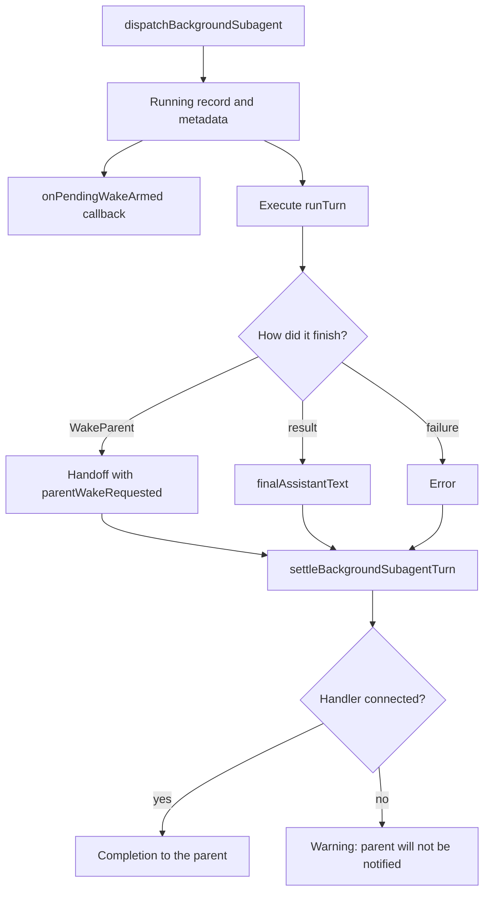

# Background wakes: completion, messages, and resumption

[English](README.en.md) · [Português (Brasil)](README.md)

## Three different mechanisms

The name `BackgroundWakes` suggests a broad engine, but the class present in the host is small: it delegates messages between agents and records timeline events. Actual background execution and completion production appear in the eval runner's subagent runtime. The spontaneous opportunity selector is not in this class. [Class](../../../reference/runtime/host-main.cjs#L734695-L734756), [subagent runtime](../../../reference/runtime/sand-eval-runner.cjs#L535230-L535489).

| Mechanism | Input | Established effect |
| --- | --- | --- |
| Message from another agent | Text, sender, destination, and optional ID | Transcript recording, in-memory deduplication, and events |
| Completion of child work | Result/error/cancellation and dispatch metadata | Completion callback to the parent host |
| Parent revival | One or more completions with origin and age | Appropriate prompt for continuation and possible delivery |

Recording a message, triggering a new turn, and delivering to the user are different events. A textual acknowledgement mentioning a wake does not by itself establish a connection to the scheduler.

## Completion flow recovered in the eval runner



[Dispatch](../../../reference/runtime/sand-eval-runner.cjs#L535230-L535294), [result normalization](../../../reference/runtime/sand-eval-runner.cjs#L535295-L535347), [settle and handler](../../../reference/runtime/sand-eval-runner.cjs#L535348-L535490).

### `dispatchBackgroundSubagent(params)`

Checks that subagent ownership is open, reuses an in-flight execution with the same ID, and stores name, type, origin, request IDs, connector scope, time, and lineage. It records `running`, optionally signals `onPendingWakeArmed`, and starts `startBackgroundSubagentTurn`.

The arming callback is optional. The function does not contain wake-queue persistence. Having `kind: "subagent"` and a `workId` in the callback establishes the contract for a host implementing that persistence, not where it is stored.

### `startBackgroundSubagentTurn(subagentAgentId, runTurn)`

Converts a synchronous error from the execution function into a rejected promise. On success, it prioritizes a nonempty `automationParentWake` over the executor's final message; only in that case does it mark `parentWakeRequested`. An aborted run becomes an aborted outcome; rejection becomes an error outcome. The promise is placed in the execution map and removed when it settles, after checking that the map still points to the same execution. [Implementation](../../../reference/runtime/sand-eval-runner.cjs#L535289-L535347).

### `settleBackgroundSubagentTurn`

Before finishing, it checks for a pending steering message. If a runner exists and is not being aborted, it starts another run with the updated instruction. Otherwise it awaits abort cleanup, updates the registry, releases the computer-use window, and removes active session/metadata entries. Parent-requested aborts return before notification. Without metadata or a handler, it logs a warning and returns; with a handler, it supplies the result, duration, provenance, automation IDs, and `parentWakeRequested` when applicable. [Implementation](../../../reference/runtime/sand-eval-runner.cjs#L535348-L535490).

There is therefore an explicit point where a completion can exist without notifying the parent. The absence of this handler cannot correctly be replaced with an assumption of automatic recovery.

### `steerSubagent`, `abortSubagent`, `drainBackgroundSubagents`

Steering requires a running child, incorporates the new text into instruction history, narrows connector scope to the applicable intersection, stores the pending instruction, and interrupts the current run. Abort requires a running child, prevents duplicate abort procedures, removes pending steering, signals `onPendingWakeDisarmed`, and requests recursive termination of child work. `drainBackgroundSubagents` waits for all promises while work remains, using `Promise.allSettled` so an error does not end the wait prematurely. [Implementations](../../../reference/runtime/sand-eval-runner.cjs#L535524-L535604).

The prompt composition policy after completion is covered in [proactivity](../proactivity/README.en.md) and [revivalInstructionOf](../../functions/revivalInstructionOf/README.en.md).

## Messages between agents in the host

### `sendToAgent`

Limits text to 8,000 characters and rejects empty text, self-messaging, a removed agent, or a destination absent from the roster. Groups are handled by `postToGroup`, with a warning that image attachments and priority interruption do not apply to that path. For an individual agent, it obtains a background session lease, appends the inbound message, records telemetry, and appends the sender's outbound record. [Limit and class](../../../reference/runtime/host-main.cjs#L734311-L734476).

The return text describes priority as interrupting routine work and replies as waking the sender. **The local `appendAgentInboundEntries` code present in this snapshot only records entries and updates activity/roster; it does not execute a turn or call the scheduler.** The advertised wake behavior must be validated in the connected remote path, not inferred from that text. [Inbound persistence](../../../reference/runtime/host-main.cjs#L734592-L734638).

### `sendToRemotePeer`

Receives a `deliver` callback and sends only text, sender, and destination. It records outbound activity only when `result.delivered` is true. Even if the caller supplies images or `priority`, it does not forward them to the callback; it returns notes explaining these limitations. Telemetry records `is_priority: false`. [Implementation](../../../reference/runtime/host-main.cjs#L734477-L734510).

### `receiveFromPeer` and deduplication

Normalizes the text, checks the destination, and constructs a `toAgentId + NUL + messageId` key. With a nonempty ID, a previously remembered delivery returns `delivered`; an in-flight delivery reuses the promise. Without an ID, it proceeds without deduplication. The in-flight delivery map is cleared in `finally`. [Implementation](../../../reference/runtime/host-main.cjs#L734511-L734552).

`deliverPeerMessage` handles groups and individuals separately. For a group, it requires a valid sender ID and maps `posted`, `empty`, `not_found`, `not_member`, and `unavailable` to the delivery protocol. It only remembers a message after successful delivery. `rememberPeerMessageId` keeps up to 512 keys, removing the oldest. [Implementation](../../../reference/runtime/host-main.cjs#L734553-L734591).

Deduplication is process-scoped and has a bounded window. Nothing in this structure guarantees deduplication after a restart or after an old key is removed.

### Transcript entries

`appendInbound` returns false if it cannot acquire a lease or if the session is a group. `appendAgentInboundEntries` records a `user`-role entry with `fromAgent`, distinguishing its origin from a human message; for an inactive session, it uses the session database and publishes a roster update. `appendAgentInboundEntry` uses a stable ID for cloud-agent reports, based on the SHA-256 of the cloud ID, exchange round, and text, truncated to 16 hexadecimal digits. [Entry and hash](../../../reference/runtime/host-main.cjs#L734399-L734409), [writes](../../../reference/runtime/host-main.cjs#L734592-L734660).

`appendAgentOutboundEntry` does not write if the sender has no live session. When it writes, it marks `role: "assistant"`, `toAgent`, and applicable images and attachments. The absence of a local outbound entry therefore does not establish that the remote callback failed to deliver. [Implementation](../../../reference/runtime/host-main.cjs#L734661-L734693).

## The `BackgroundWakes` class

Its five messaging methods delegate to the `AgentToAgentMessaging` object. Its additional responsibility is the timeline:

| Method | Behavior |
| --- | --- |
| `emitTimelineEvent` | Ignores a removed agent and starts an asynchronous write |
| `recordTimelineEvent` | Acquires a lease; returns if it cannot open the session or if it is a group |
| `appendTimelineEventEntry` | Creates an `event` entry with a UUID and timestamp; writes through the manager if active, through the DB if inactive |

[Complete implementation](../../../reference/runtime/host-main.cjs#L734695-L734756). This class contains no priority calculation, connector scanner, opportunity ranking, or schedule.

## Persistence and recovery: what exists and what is missing

`host-pending-wakes.json` appears in the durable-file policy and in the list excluded from store mirroring. `pendingWakeTelemetry` can record outcomes such as persistence failure, rearming failure, pruning, and discarding. This recovers names and a diagnostic schema, but not the algorithm for persisting, rereading, deduplicating, and rearming a wake. [File policy](../../../reference/runtime/host-main.cjs#L453680-L453699), [telemetry](../../../reference/runtime/host-main.cjs#L472234-L472249).

`pauseTurnsForRecreate` returns `resumeAgentIds: []` and `resumePendingWakes: []` in both branches of the snapshot, and `signalTurnsForPause` only calls `traceFlusher`. No restoration from these lists is implemented here. [Implementation](../../../reference/runtime/host-main.cjs#L740501-L740535).

## Questions that new evidence must resolve

| Boundary | Evidence needed to close the gap |
| --- | --- |
| Completion becomes a new turn | Who connects `setBackgroundSubagentHandler` and which admission/scheduler receives the callback in production |
| Durable wake | Writer, reader, states, and replay policy of the pending-wakes store |
| A priority message interrupts | A concrete preemption call in the remote path, beyond the textual description |
| Restart recovers work | External-work identification, rearming, and handling of an already-delivered result |
| A remote result arrives exactly once | Durable ledger or consumer idempotency contract |

## Static verification

```bash
rg -n 'BackgroundWakes|AgentToAgentMessaging|PEER_MESSAGE_ID_LEDGER_CAP' reference/runtime/host-main.cjs
rg -n 'onPendingWakeArmed|onPendingWakeDisarmed|setBackgroundSubagentHandler' reference/runtime/sand-eval-runner.cjs
rg -n 'resumePendingWakes|SAND_PENDING_WAKE_FILE_NAME|pendingWakeTelemetry' reference/runtime/host-main.cjs
```

This is a static reading of snapshot `655acca99bff0d17466547611108f94ed6a8a5e7`. The communication mechanisms described here were not invoked during the analysis.
