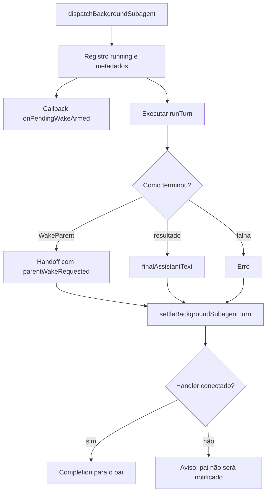

# Background wakes: conclusão, mensagens e retomada

## Três mecanismos diferentes

O nome `BackgroundWakes` sugere um motor amplo, mas a classe presente no host é pequena: delega mensagens entre agentes e grava eventos de timeline. A execução em background propriamente dita e a produção de completions aparecem no runtime de subagentes do eval runner. O seletor de oportunidades espontâneas não está nessa classe. [Classe](../../../reference/runtime/host-main.cjs#L734695-L734756), [runtime de subagentes](../../../reference/runtime/sand-eval-runner.cjs#L535230-L535489).

| Mecanismo | Entrada | Efeito comprovado |
| --- | --- | --- |
| Mensagem de outro agente | Texto, remetente, destino e ID opcional | Registro de transcript, deduplicação em memória e eventos |
| Conclusão de um trabalho filho | Resultado/erro/cancelamento e metadados de dispatch | Callback de completion para o host pai |
| Revival do pai | Uma ou mais completions com origem e idade | Prompt apropriado para continuação e eventual entrega |

A gravação de uma mensagem, o disparo de um novo turno e a entrega para o usuário são eventos diferentes. Um acknowledgement textual que menciona um wake não comprova sozinho a ligação ao scheduler.

## Fluxo de conclusão recuperado no eval runner



[Dispatch](../../../reference/runtime/sand-eval-runner.cjs#L535230-L535294), [normalização do resultado](../../../reference/runtime/sand-eval-runner.cjs#L535295-L535347), [settle e handler](../../../reference/runtime/sand-eval-runner.cjs#L535348-L535490).

### `dispatchBackgroundSubagent(params)`

Verifica que a ownership do subagente está aberta, reaproveita uma execução em andamento do mesmo ID e guarda nome, tipo, origem, request IDs, escopo de conectores, horário e linhagem. Registra `running`, sinaliza opcionalmente `onPendingWakeArmed` e inicia `startBackgroundSubagentTurn`.

O callback de armamento é opcional. A função não contém a persistência de uma fila de wakes. Ter `kind: "subagent"` e um `workId` no callback demonstra o contrato para um host que implemente essa persistência, não prova onde ela é gravada.

### `startBackgroundSubagentTurn(subagentAgentId, runTurn)`

Converte erro síncrono da função de execução em promise rejeitada. Em sucesso, prioriza `automationParentWake` não vazio sobre a mensagem final do executor; só nesse caso marca `parentWakeRequested`. Abortado vira outcome abortado; rejeição vira outcome de erro. A promise é colocada no mapa de execuções e removida ao assentar, verificando se o mapa ainda aponta para a mesma execução. [Implementação](../../../reference/runtime/sand-eval-runner.cjs#L535289-L535347).

### `settleBackgroundSubagentTurn`

Antes de finalizar, verifica uma mensagem de steering pendente. Se existe runner e ele não está sendo abortado, inicia outra run com a instrução atualizada. Caso contrário aguarda cleanup de aborto, atualiza o registry, libera janela de computer-use e remove sessão/metadados ativos. Abortos solicitados pelo pai retornam antes de notificar. Sem metadados ou sem handler, registra aviso e retorna; com handler, fornece resultado, duração, proveniência, IDs de automação e `parentWakeRequested` quando aplicável. [Implementação](../../../reference/runtime/sand-eval-runner.cjs#L535348-L535490).

Há portanto um ponto explícito em que a conclusão pode existir sem notificação ao pai. Não é correto substituir a ausência desse handler por uma suposição de recuperação automática.

### `steerSubagent`, `abortSubagent`, `drainBackgroundSubagents`

Steering exige filho em execução, incorpora o novo texto ao histórico de instruções, estreita o escopo de conectores à interseção aplicável, guarda a instrução pendente e interrompe a run atual. Abort requer filho em execução, impede duplicar o procedimento, remove steering pendente, sinaliza `onPendingWakeDisarmed` e pede término recursivo do trabalho filho. `drainBackgroundSubagents` aguarda todas as promises enquanto houver trabalho, com `Promise.allSettled` para não perder a espera após um erro. [Implementações](../../../reference/runtime/sand-eval-runner.cjs#L535524-L535604).

A política de composição do prompt depois da completion está em [proatividade](../proactivity/README.md) e [revivalInstructionOf](../../functions/revivalInstructionOf/README.md).

## Mensagens entre agentes no host

### `sendToAgent`

Limita o texto a 8.000 caracteres, rejeita texto vazio, envio para si mesmo, agente removido ou destino ausente no roster. Grupos são tratados por `postToGroup`, com aviso de que anexos de imagem e interrupção por prioridade não se aplicam àquela via. Para agente individual, obtém um lease de sessão em background, acrescenta a mensagem de entrada, registra telemetria e acrescenta o registro de saída do remetente. [Limite e classe](../../../reference/runtime/host-main.cjs#L734311-L734476).

O retorno textual descreve que prioridade interrompe trabalho de rotina e que respostas acordam o remetente. **O trecho local de `appendAgentInboundEntries` presente neste snapshot apenas grava entradas e atualiza atividade/roster; não executa um turno nem chama o scheduler.** O comportamento de wake anunciado deve ser validado no caminho remoto conectado, não inferido desse texto. [Persistência de entrada](../../../reference/runtime/host-main.cjs#L734592-L734638).

### `sendToRemotePeer`

Recebe um callback `deliver` e envia apenas texto, remetente e destino. Só registra saída quando `result.delivered` é verdadeiro. Mesmo que o chamador passe imagens ou `priority`, não os encaminha ao callback; retorna notas sobre essas limitações. A telemetria registra `is_priority: false`. [Implementação](../../../reference/runtime/host-main.cjs#L734477-L734510).

### `receiveFromPeer` e deduplicação

Normaliza o texto, verifica destino e constrói uma chave `toAgentId + NUL + messageId`. Com ID não vazio, uma entrega já lembrada retorna `delivered`; uma entrega em andamento reutiliza a promise. Sem ID, segue sem deduplicação. O mapa de entregas em andamento é limpo em `finally`. [Implementação](../../../reference/runtime/host-main.cjs#L734511-L734552).

`deliverPeerMessage` trata grupos e indivíduos separadamente. Para grupo, exige ID de remetente válido e mapeia `posted`, `empty`, `not_found`, `not_member` e `unavailable` para o protocolo de entrega. Só lembra uma mensagem depois da entrega bem-sucedida. `rememberPeerMessageId` mantém até 512 chaves, eliminando a mais antiga. [Implementação](../../../reference/runtime/host-main.cjs#L734553-L734591).

A deduplicação tem escopo de processo e janela limitada. Nada nessa estrutura garante deduplicação depois de reinício ou após a remoção da chave antiga.

### Entradas do transcript

`appendInbound` devolve falso se não consegue adquirir lease ou se a sessão é de grupo. `appendAgentInboundEntries` grava entrada de papel `user` com `fromAgent`, distinguindo a origem de uma mensagem humana; para sessão inativa, usa o banco da sessão e publica atualização do roster. `appendAgentInboundEntry` usa um ID estável para relatórios de cloud-agent, baseado em SHA-256 do ID cloud, rodada de troca e texto, truncado a 16 dígitos hexadecimais. [Entrada e hash](../../../reference/runtime/host-main.cjs#L734399-L734409), [gravações](../../../reference/runtime/host-main.cjs#L734592-L734660).

`appendAgentOutboundEntry` não escreve se o remetente não tem sessão viva. Quando escreve, marca `role: "assistant"`, `toAgent`, imagens e anexos aplicáveis. Portanto a ausência de uma entrada local de saída não prova que o callback remoto não entregou. [Implementação](../../../reference/runtime/host-main.cjs#L734661-L734693).

## A classe `BackgroundWakes`

Os cinco métodos de mensagens são delegações ao objeto `AgentToAgentMessaging`. A responsabilidade adicional é timeline:

| Método | Comportamento |
| --- | --- |
| `emitTimelineEvent` | Ignora agente removido e inicia gravação assíncrona |
| `recordTimelineEvent` | Adquire lease; retorna se não consegue abrir a sessão ou se é grupo |
| `appendTimelineEventEntry` | Cria entrada `event` com UUID e timestamp; escreve pelo manager se ativa, pelo DB se inativa |

[Implementação completa](../../../reference/runtime/host-main.cjs#L734695-L734756). Não há cálculo de prioridade, scanner de conectores, ranking de oportunidades ou agenda dentro dessa classe.

## Persistência e recuperação: o que existe e o que falta

`host-pending-wakes.json` aparece na política de arquivos duráveis e na lista excluída do espelhamento do store. `pendingWakeTelemetry` sabe registrar resultados como falha de persistência, falha de rearmamento, pruning e descarte. Isso recupera nomes e esquema de diagnóstico, mas não o algoritmo de persistir, reler, deduplicar e rearmar um wake. [Política de arquivos](../../../reference/runtime/host-main.cjs#L453680-L453699), [telemetria](../../../reference/runtime/host-main.cjs#L472234-L472249).

`pauseTurnsForRecreate` devolve `resumeAgentIds: []` e `resumePendingWakes: []` nos dois ramos do snapshot, e `signalTurnsForPause` só chama `traceFlusher`. Não há aqui uma restauração implementada a partir dessas listas. [Implementação](../../../reference/runtime/host-main.cjs#L740501-L740535).

## Perguntas que uma nova evidência precisa resolver

| Fronteira | Evidência necessária para fechar |
| --- | --- |
| Completion vira novo turno | Quem conecta `setBackgroundSubagentHandler` e qual admission/scheduler recebe o callback em produção |
| Wake durável | Escritor, leitor, estados e política de replay do store de pending wakes |
| Mensagem prioritária interrompe | Chamada concreta de preempção no caminho remoto, além da descrição textual |
| Reinício recupera trabalho | Identificação de trabalho externo, rearmamento e tratamento de resultado já entregue |
| Resultado remoto chega uma única vez | Ledger durável ou contrato de idempotência do consumidor |

## Verificação estática

```bash
rg -n 'BackgroundWakes|AgentToAgentMessaging|PEER_MESSAGE_ID_LEDGER_CAP' reference/runtime/host-main.cjs
rg -n 'onPendingWakeArmed|onPendingWakeDisarmed|setBackgroundSubagentHandler' reference/runtime/sand-eval-runner.cjs
rg -n 'resumePendingWakes|SAND_PENDING_WAKE_FILE_NAME|pendingWakeTelemetry' reference/runtime/host-main.cjs
```

A leitura é estática e usa o snapshot `655acca99bff0d17466547611108f94ed6a8a5e7`. Os mecanismos de comunicação aqui descritos não foram acionados durante a análise.
