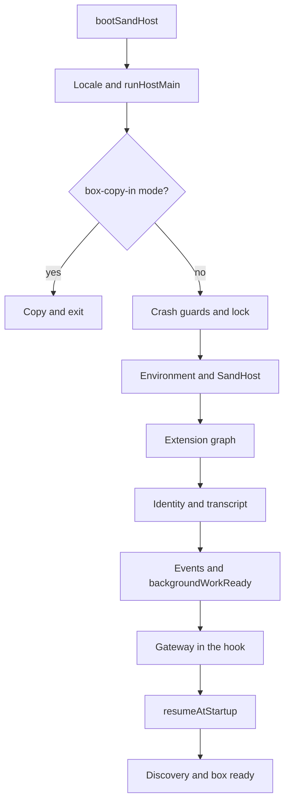

# Sand Host initialization and lifecycle

[English](README.en.md) · [Português (Brasil)](README.md)

## What this component does

The observed entry point prepares the host environment, acquires a process lock, starts extensions according to their dependencies, restores state, opens the gateway, and only then hands resume ownership to the corresponding subsystem. It is a harness infrastructure program. Reading this bundle does not prove that every compiled path within it is reached during current execution. Source: [host-main.cjs:786935–787088](../../../reference/runtime/host-main.cjs#L786935-L787088).

**Evidence status:** an identified compiled implementation, without executing the artifacts or contacting the original services. Base snapshot: `655acca99bff0d17466547611108f94ed6a8a5e7`.

## Inputs and outputs

| Element | Observed contract |
| --- | --- |
| `process.argv` | `--box-copy-in` mode takes a separate exit before the normal server. |
| `process.env` | `readSandHostEnvironment` and `resolveGatewayServerConfig` resolve configuration. |
| Host lock | `acquireHostLock` returns ownership and, when applicable, the previous PID. |
| Registry | A list of extensions with dependencies and internal APIs. |
| Normal output | An active gateway, recorded discovery information, and a readiness report. |
| Fatal failure | A crash marker, telemetry flush, lock release, and exit code 1. |

Sources: [host-main.cjs:786935–787050](../../../reference/runtime/host-main.cjs#L786935-L787050), [host-main.cjs:786172–786242](../../../reference/runtime/host-main.cjs#L786172-L786242).

## Operating sequence



### `bootSandHost(runHostMain)`

Activates the host locale and awaits the main function. Listeners, networking, and file operations are set up later, in `runHostMain`; this small function is not an agent scheduler. Source: [host-main.cjs:493976–493980](../../../reference/runtime/host-main.cjs#L493976-L493980).

### `runHostMain()`

1. Resolves the auxiliary copy mode first.
2. Installs crash guards, acquires the lock, reads the environment, and creates `SandHost`.
3. Connects diagnostics and invariants to the host.
4. Calls `host.start` with `beforeResumeOwnership`. This hook builds the gateway with APIs, listeners, authentication, TLS, and bridges.
5. After `start` returns, writes discovery information containing the port, PID, start time, scheme, and access configuration. The discovery file contains sensitive access data; the documentation describes its contract without copying those values.
6. Starts `reportBoxReady` without blocking the return.

The `catch` path maintains a `stage` variable, writes a marker for the failure stage, and exits. Source: [host-main.cjs:786937–787050](../../../reference/runtime/host-main.cjs#L786937-L787050). [Function README](../../functions/runHostMain/README.en.md).

### `SandHost.start(hooks)` and `startWithLifecycle`

`start` injects the environment, event bus, idle observation, and the `whenBackgroundWorkReady` Promise into extensions. The observed startup policy allows **5 minutes per extension start call**; the mechanism applies the deadline on each iteration, rather than using one 5-minute timer for the entire graph. After the registry starts, `startWithLifecycle` connects callbacks for MCP, settings, handoff, and disk; resolves identity and bundle; loads the transcript resiliently; installs observers; connects events; releases the background-work barrier; calls the gateway hook; and finally executes `resumeOwnership.resumeAtStartup`. Sources: [host-main.cjs:786355–786568](../../../reference/runtime/host-main.cjs#L786355-L786568).

The `backgroundWorkReady` barrier signals that a dependency has initialized. It does not decide which proactive opportunities to execute. This meaning must remain separate from the content of [proactivity](../proactivity/README.en.md).

### `startHostPluginRegistry` and `startHostExtensions`

The registry contains extensions for auth, automations, session, transcript, server-agent-proxy, memory, MCP, and several system bridges. `startHostPluginRegistry` delegates initialization to the generic mechanism, exposing `order`, `api(id)`, and `stop()`. The dependency mechanism is compiled into [host-main.cjs:471305](../../../reference/runtime/host-main.cjs#L471305); the concrete composition appears in [host-main.cjs:786172–786242](../../../reference/runtime/host-main.cjs#L786172-L786242). The array's physical order should not be confused with the final topological order.

### `reportBoxReady()`

With a valid `bootId` and timestamp, checks a marker at `/tmp/sand-box-ready-stage`. If it already matches the boot, returns. Otherwise, attempts to confirm the `ready` stage up to **3 times**, waiting **30 seconds** between attempts; writes the marker only after confirmation. This reduces duplicate boot reporting, without proving global deduplication in the backend. Source: [host-main.cjs:786355–786448](../../../reference/runtime/host-main.cjs#L786355-L786448).

### `installShutdownHandlers` and `SandHost.dispose`

`SIGTERM` and `SIGINT` enter a shutdown path guarded by `isShuttingDown`. The normal path removes the proxy credential, closes the gateway, disposes the host, and clears discovery information. A **5-second** watchdog can force exit code 1 after reporting a failure. `SandHost.dispose` suspends resume ownership and automation wakes, closes the transcript, and stops extensions. Sources: [host-main.cjs:787051–787083](../../../reference/runtime/host-main.cjs#L787051-L787083), [host-main.cjs:786662–786674](../../../reference/runtime/host-main.cjs#L786662-L786674).

## The boundary that remains unresolved

The recovered initialization code does not provide the implementation of the remote service that receives `SendGrokBotUserMessage`, or its Temporal workflow. The host contains client code for communicating with that service. An extension named `turn-execution` is also insufficient evidence of local LLM execution: in this snapshot, it exposes a boolean registry, detailed in [turns](../turns/README.en.md).

## How to check statically

```bash
rg -n 'bootSandHost|runHostMain|beforeResumeOwnership|HOST_EXTENSION_START_TIMEOUT_MS|hostExtensionRegistry' reference/runtime/host-main.cjs
sed -n '786935,787088p' reference/runtime/host-main.cjs
```

Lines are counted by LF, as in `rg`, `sed`, and GitHub. Do not import the bundle to perform this check: it has an entry point with real effects.
