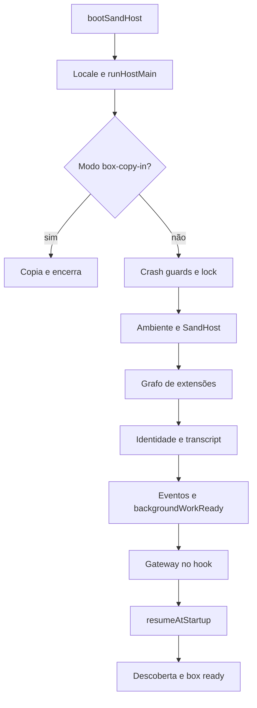

# Inicialização e ciclo de vida do Sand Host

## O que este componente faz

O entrypoint observado prepara o ambiente do host, adquire exclusão de processo, inicia extensões por dependência, restaura estado, abre o gateway e só então entrega a posse de retomada ao subsistema correspondente. É um programa de infraestrutura do harness. A leitura deste bundle não prova que todos os caminhos nele compilados sejam alcançados na execução atual. Fonte: [host-main.cjs:786935–787088](../../../reference/runtime/host-main.cjs#L786935-L787088).

**Estado da evidência:** implementação compilada identificada, sem execução dos artefatos nem contato com os serviços originais. Snapshot-base: `655acca99bff0d17466547611108f94ed6a8a5e7`.

## Entradas e saídas

| Elemento | Contrato observado |
| --- | --- |
| `process.argv` | O modo `--box-copy-in` toma uma saída separada antes do servidor normal. |
| `process.env` | `readSandHostEnvironment` e `resolveGatewayServerConfig` resolvem configuração. |
| Lock do host | `acquireHostLock` devolve posse e, eventualmente, PID anterior. |
| Registry | Lista de extensões com dependências e APIs internas. |
| Saída normal | Gateway ativo, descoberta gravada, relatório de prontidão. |
| Falha fatal | Marcador de crash, flush de telemetria, liberação do lock e saída 1. |

Fontes: [host-main.cjs:786935–787050](../../../reference/runtime/host-main.cjs#L786935-L787050), [host-main.cjs:786172–786242](../../../reference/runtime/host-main.cjs#L786172-L786242).

## Ordem de funcionamento



### `bootSandHost(runHostMain)`

Ativa o locale do host e aguarda a função principal. A instalação de listeners, rede e arquivos acontece depois, em `runHostMain`; esta pequena função não é um scheduler de agentes. Fonte: [host-main.cjs:493976–493980](../../../reference/runtime/host-main.cjs#L493976-L493980).

### `runHostMain()`

1. Resolve primeiro o modo auxiliar de cópia.
2. Instala proteções de crash, obtém o lock, lê ambiente e cria `SandHost`.
3. Conecta diagnósticos e invariantes ao host.
4. Chama `host.start` passando `beforeResumeOwnership`. Esse hook constrói o gateway com APIs, listeners, autenticação, TLS e pontes.
5. Depois do retorno de `start`, grava descoberta com porta, PID, início, esquema e configuração de acesso. O arquivo de descoberta contém dados sensíveis de acesso; a documentação descreve o contrato sem copiá-los.
6. Dispara `reportBoxReady` sem bloquear o retorno.

O `catch` mantém uma variável `stage`, grava um marcador para o estágio da falha e encerra. Fonte: [host-main.cjs:786937–787050](../../../reference/runtime/host-main.cjs#L786937-L787050). [README da função](../../functions/runHostMain/README.md).

### `SandHost.start(hooks)` e `startWithLifecycle`

`start` injeta o ambiente, event bus, observação de ociosidade e a Promise `whenBackgroundWorkReady` nas extensões. A política de início observada dá **5 minutos por chamada de start de extensão**; o mecanismo aplica o deadline em cada iteração, não um único cronômetro de 5 minutos para o grafo todo. Após o registry, `startWithLifecycle` liga callbacks de MCP, configurações, handoff e disco; resolve identidade e bundle; carrega o transcript de forma resiliente; instala observadores; liga eventos; libera a barreira de trabalho em background; chama o hook do gateway; finalmente executa `resumeOwnership.resumeAtStartup`. Fontes: [host-main.cjs:786355–786568](../../../reference/runtime/host-main.cjs#L786355-L786568).

A barreira `backgroundWorkReady` é um sinal de dependência inicializada. Ela não decide quais oportunidades proativas executar. Esse significado deve permanecer separado do conteúdo de [proatividade](../proactivity/README.md).

### `startHostPluginRegistry` e `startHostExtensions`

O registry contém extensões de auth, automations, session, transcript, server-agent-proxy, memory, MCP e várias pontes de sistema. `startHostPluginRegistry` delega a inicialização ao mecanismo genérico, expondo `order`, `api(id)` e `stop()`. O mecanismo de dependências está compilado em [host-main.cjs:471305](../../../reference/runtime/host-main.cjs#L471305); a composição concreta está em [host-main.cjs:786172–786242](../../../reference/runtime/host-main.cjs#L786172-L786242). A lista física do array não deve ser confundida com a ordem topológica final.

### `reportBoxReady()`

Com `bootId` e timestamp válidos, verifica um marcador em `/tmp/sand-box-ready-stage`. Se já corresponde ao boot, retorna. Caso contrário, tenta confirmar a etapa `ready` até **3 vezes**, aguardando **30 segundos** entre tentativas; apenas após confirmação grava o marcador. Isso reduz duplicação no relato de boot, sem provar deduplicação global no backend. Fonte: [host-main.cjs:786355–786448](../../../reference/runtime/host-main.cjs#L786355-L786448).

### `installShutdownHandlers` e `SandHost.dispose`

`SIGTERM` e `SIGINT` entram em um encerramento protegido por `isShuttingDown`. O caminho normal retira a credencial de proxy, fecha gateway, dispõe host e limpa descoberta. Um watchdog de **5 segundos** pode forçar saída 1 após relatar falha. `SandHost.dispose` suspende posse de retomada e wakes de automações, fecha transcript e para extensões. Fontes: [host-main.cjs:787051–787083](../../../reference/runtime/host-main.cjs#L787051-L787083), [host-main.cjs:786662–786674](../../../reference/runtime/host-main.cjs#L786662-L786674).

## Fronteira que permanece aberta

A inicialização recuperada não fornece a implantação do serviço remoto que recebe `SendGrokBotUserMessage`, nem seu workflow Temporal. O host tem código cliente de comunicação com esse serviço. Também não basta a presença de uma extensão chamada `turn-execution` para afirmar execução local de LLM: neste snapshot ela expõe um registro booleano, detalhado em [turnos](../turns/README.md).

## Como conferir estaticamente

```bash
rg -n 'bootSandHost|runHostMain|beforeResumeOwnership|HOST_EXTENSION_START_TIMEOUT_MS|hostExtensionRegistry' reference/runtime/host-main.cjs
sed -n '786935,787088p' reference/runtime/host-main.cjs
```

As linhas são contadas por LF, como `rg`, `sed` e GitHub. Não importar o bundle para fazer essa conferência: ele possui entrypoint com efeitos reais.
