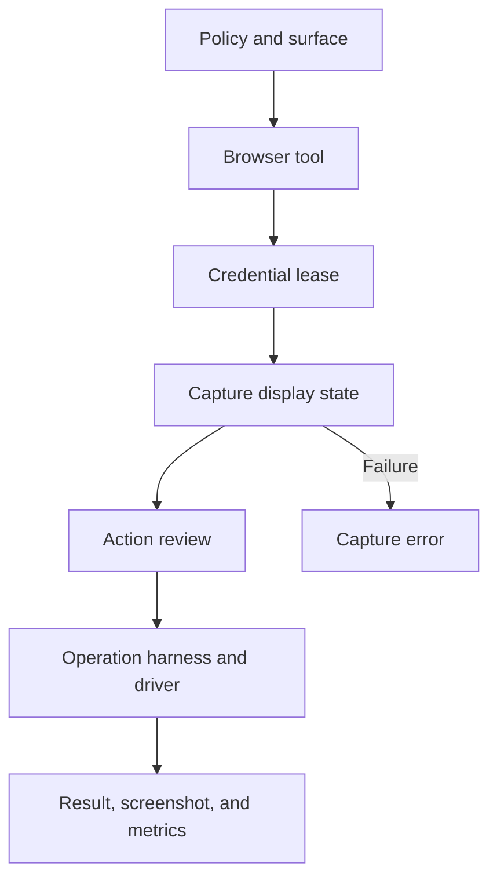

# Browser, computer, and secure fill

[English](README.en.md) · [Português (Brasil)](README.md)

[Index](../../README.en.md) · [Subagents](../subagents/README.en.md) · [Approvals](../approvals/README.en.md)

## Boundaries

The remote box, the user's computer, and mobile devices have distinct capabilities. `computerUse` is a subagent type; browser tools are assembled for a selected surface; the host also knows about shell, screenshot, and driver-execution resources. The existence of a driver bundle does not make the user's local browser part of the same environment. [computerUse manifest](../../../reference/runtime/host-main.cjs#L756882-L756921), [browser assembly](../../../reference/runtime/host-main.cjs#L778908-L778978).

## Assembly: `createSandBrowserTools`

1. `resolveSandBrowserSurface(host,decisions)` selects the surface. `none` returns no tools.
2. The surface factory receives the operation harness, box access, MCP resources, and review configuration.
3. It injects agent-display resolution, window dependencies, the secure-value guard, and run-code parameters.
4. Code mode is supplied when the runner is computerUse.
5. Each tool receives a refusal counter; afterward, `gateSandBrowserTools` enforces exclusion while a credential-fill lease is held.

The screenshot tool is assembled only when the host declares a desktop and an available box. The availability check is separate from the permissions manifest. [Source](../../../reference/runtime/host-main.cjs#L778908-L778969).



## State accompanying the review

`toBrowserReviewAction` projects the operation and relevant arguments: view, URL, reference, text, key, coordinates, code, CDP parameters, and modifiers. `captureBrowserReviewState` requires a resolvable display, runs a probe through the shell resource, and can read that display's view mapping. The nominal capture limit is 4 seconds; the backstop is 4.25 seconds. The state hash/identity and target URL accompany the review. An unreachable browser and a generic capture failure have different classifications. [Code](../../../reference/runtime/sand-eval-runner.cjs#L516190-L516352).

This binds the assessment to the observed context, but this analysis does not demonstrate an atomic transaction between capturing state and acting. Any protections against page changes must be confirmed in the complete execution path.

## Secure fill

`authorizeSandSecureFillDomain` requires valid HTTPS URLs for both the frame and the top-level page. Domain comparison uses the value's metadata and the top-level site; the `anySite` rule applies only when the option is enabled and the value type permits it. The function returns a structured decision with a frame classification and a reason, such as `scheme` or `top_origin`. A cross-origin iframe is classified, rather than universally rejected by this function. [Policy](../../../reference/runtime/host-main.cjs#L766673-L766734).

`sandSecureFillFieldAccepts` rejects contentEditable; passwords require a password input; vault values may accept a textarea. Cards have their own site authorization and field validation. These details prevent attributing a broader policy to the code than it implements.

## Subagents and access

The computerUse manifest removes connectors, memory, messaging as the user, tools for the user's computer, and further delegation, with named exceptions for forms and available secure values. The parent remains responsible for context and operations that require its capabilities. The effective tool assembly can be smaller still because of absent ports or gates. [Manifest](../../../reference/runtime/host-main.cjs#L756882-L756921).

`lentBrowserTools` lends tools only when the executor declares `sharesBrowserTools()===true`; lending is not universal. The code records run-code failures and refusals separately from operation success. [Gate and lending](../../../reference/runtime/host-main.cjs#L778938-L778950).

## Limitations

No browser was opened and no driver was executed. Isolation between displays, OS sandboxing, and authentication were not tested. Box control, control of the user's computer, and runtime policies each require their own evidence before being described as equivalent.

```bash
rg -n 'createSandBrowserTools|gateSandBrowserTools|captureBrowserReviewState|authorizeSandSecureFillDomain' reference/runtime/{host-main,sand-eval-runner}.cjs
```
