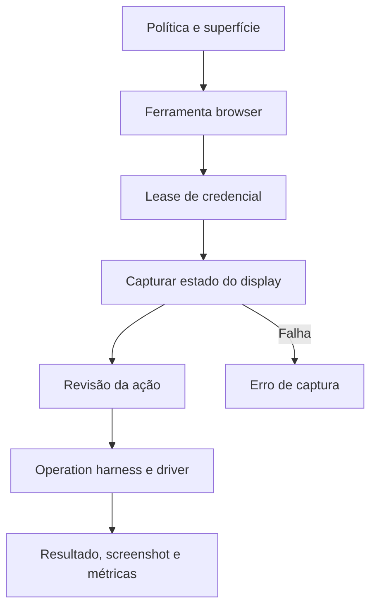

# Browser, computador e preenchimento seguro

[Índice](../../README.md) · [Subagentes](../subagents/README.md) · [Aprovações](../approvals/README.md)

## Fronteiras

A box remota, o computador do usuário e dispositivos móveis têm capacidades distintas. `computerUse` é um tipo de subagente; ferramentas browser são montadas conforme uma superfície escolhida; o host também conhece recursos de shell, screenshot e execução de driver. A existência de um bundle de driver não torna o browser local do usuário parte do mesmo ambiente. [Manifesto computerUse](../../../reference/runtime/host-main.cjs#L756882-L756921), [montagem browser](../../../reference/runtime/host-main.cjs#L778908-L778978).

## Montagem: `createSandBrowserTools`

1. `resolveSandBrowserSurface(host,decisions)` escolhe a superfície. `none` devolve nenhuma ferramenta.
2. A factory da superfície recebe o operation harness, acesso à box, recursos MCP e configuração de revisão.
3. Injeta resolução do display do agente, dependências de janela, secure-value guard e parâmetros de run-code.
4. Code mode é fornecido quando o runner é computerUse.
5. Cada ferramenta recebe contador de recusas e, depois, `gateSandBrowserTools` aplica a exclusão durante lease de preenchimento de credenciais.

O screenshot só é montado quando o host declara desktop e box disponível. A checagem de disponibilidade é distinta do manifesto de permissões. [Fonte](../../../reference/runtime/host-main.cjs#L778908-L778969).



## Estado que acompanha a revisão

`toBrowserReviewAction` projeta operação e argumentos relevantes: view, URL, referência, texto, tecla, coordenadas, código, parâmetros CDP e modificadores. `captureBrowserReviewState` exige um display resolvível, executa probe no recurso shell e pode ler o mapeamento de views desse display. Limite nominal de captura: 4 segundos; backstop: 4,25 segundos. O hash/identidade de estado e a URL do alvo acompanham a revisão. Browser não alcançável e falha genérica de captura possuem classificações diferentes. [Código](../../../reference/runtime/sand-eval-runner.cjs#L516190-L516352).

Isso vincula a avaliação ao contexto observado, mas esta análise não demonstra uma transação atômica entre capturar estado e agir. Eventuais proteções contra mudança de página devem ser confirmadas na execução completa.

## Secure fill

`authorizeSandSecureFillDomain` exige URLs HTTPS válidas para frame e página superior. A comparação de domínio usa metadados do valor e o site superior; a regra `anySite` só vale quando a opção está habilitada e o tipo do valor permite. Retorna decisão estruturada com classificação de frame e motivo, como `scheme` ou `top_origin`. Um iframe cross-origin é classificado, não rejeitado universalmente nessa função. [Política](../../../reference/runtime/host-main.cjs#L766673-L766734).

`sandSecureFillFieldAccepts` recusa contentEditable; senha exige input password; valores de vault podem aceitar textarea. Cartões possuem autorização de sites e validação de campos próprias. Esses detalhes evitam atribuir uma política mais ampla do que o código implementa.

## Subagentes e acesso

O manifesto computerUse remove conectores, memória, mensagens como usuário, ferramentas de computador do usuário e nova delegação, com exceções nominais para formulário e valores seguros disponíveis. O parent continua responsável por contexto e operações que exigem suas capacidades. A montagem efetiva pode ser ainda menor por ausência de portas ou gates. [Manifesto](../../../reference/runtime/host-main.cjs#L756882-L756921).

`lentBrowserTools` só empresta ferramentas quando o executor declara `sharesBrowserTools()===true`; não é empréstimo universal. O código registra falhas e recusas de run-code separadamente de sucesso da operação. [Gate e empréstimo](../../../reference/runtime/host-main.cjs#L778938-L778950).

## Limitações

Não foi aberto browser nem executado driver. Não foi testado isolamento entre displays, OS sandbox ou autenticação. Controle da box, controle do usuário e políticas de runtime precisam de evidência própria antes de serem anunciados como equivalentes.

```bash
rg -n 'createSandBrowserTools|gateSandBrowserTools|captureBrowserReviewState|authorizeSandSecureFillDomain' reference/runtime/{host-main,sand-eval-runner}.cjs
```
