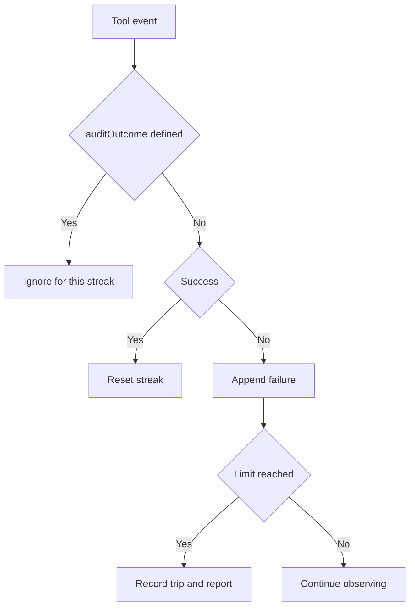

# Budgets and recovery

[English](README.en.md) · [Português (Brasil)](README.md)

The recovered executor uses separate mechanisms for steps, total time, tool timeouts, and consecutive failures. Each mechanism has its own activation conditions and semantics; a waiting diagnostic is not equivalent to stopping execution.

## Step limit

`createSandStepCap(budget)` returns `undefined` if `maxSteps <= 0`; otherwise, it maintains `stepsTaken`, initialized from `stepsAlreadyTaken`, and increments it only when `noteCheckpoint()` is called. The limit is reached when `stepsTaken >= maxSteps`. This counts checkpoints recorded by the caller, rather than tokens, individual tool calls, or seconds. [Code](../../../reference/runtime/sand-eval-runner.cjs#L587266-L587283).

`stepCapWrapUpAtStep(maxSteps)` calculates:

\[
s_{aviso}=s_{max}-\max(2,\lceil s_{max}/10\rceil)
\]

For 100 steps, the warning starts at 90; for 10, it starts at 8. `StepCapReminderMiddleware` adds the instruction to finish only before the cap and when the same reminder has not appeared since the last summary. The formula is not clamped for very small numbers; the middleware conditions must be read alongside the formula. [Reminder](../../../reference/runtime/sand-eval-runner.cjs#L587284-L587349).

There is also `SAND_AGENT_MAX_STEPS = 5000`, passed to the composed agent. This agent cap differs from a subagent's optional budget. The presence of 5,000 does not mean that every task takes that many steps. [Composition](../../../reference/runtime/sand-eval-runner.cjs#L588010-L588036), [usage](../../../reference/runtime/sand-eval-runner.cjs#L588246-L588279).

## Deadline and consecutive timeouts

`createSandTurnBudgetGuard(args)` schedules the absolute deadline `deadlineAtMs` only when it is defined and positive, with a delay of `max(0, deadline - now)`. A positive deadline that has already passed schedules zero delay; an absent, zero, or negative deadline does not create this timer. The `onExceeded` callback fires only once. `dispose()` cancels the timer and makes future attempts to exceed the budget inert. [Code](../../../reference/runtime/sand-eval-runner.cjs#L587809-L587844).

For timeouts, the counter increases only for events satisfying `!event.success` and `errorClassification === "timeout"`. Any other event resets the streak. On reaching `maxConsecutiveToolTimeouts`, the reason is `consecutive_tool_timeouts`. Zero or a negative value disables this limit. The guard signals the caller; the cancellation action belongs to the composition receiving the callback.

`inProcessComputerUseTurnBudget(parent, maxSteps)` uses the positive `maxSteps` supplied as the second argument and inherits the parent's positive timeout limit. It does not indiscriminately copy the entire budget, and this helper does not forward `deadlineAtMs`. [Inheritance](../../../reference/runtime/sand-eval-runner.cjs#L587799-L587808).

## Consecutive computer-use failures

`createSandToolFailureBreaker` maintains a failure streak. Events with a defined `auditOutcome` are ignored by the `isRefusedOrCancelled` predicate; a policy refusal therefore should not count as an infrastructure failure on this path. Success resets the streak, a failure is appended, and the first trip is retained. [Implementation](../../../reference/runtime/sand-eval-runner.cjs#L590438-L590490).

The concrete default used for computer-use subagents is 20. The caller creates this breaker only when `host.isComputerUseSubagent` is true. The report includes failure classes and the latest available update. This is not a universal limit for every agent type. [Activation](../../../reference/runtime/sand-eval-runner.cjs#L591728-L591746).

## Ending a turn with a parallel failure

`createEndTurnFailedCallHold` can defer the end when an end-turn call succeeded but another call in the same step failed. The declared limit is two holds, and the reminder considers failures only while `deps.completing()` is true. The reminder asks the agent to fix what matters without resending anything already sent. State retains the ending step and failure IDs; `settleStep()` returns the held items and clears the per-step state. [Code](../../../reference/runtime/sand-eval-runner.cjs#L590538-L590567).

This prevents premature completion in a mixed-result step, but it is not a distributed transaction and does not undo external effects. For cancellation and generations, read [cancellation-recovery](../cancellation-recovery/README.en.md). For the distinction between a watchdog and actual termination, read [scheduling](../scheduling/README.en.md).

## Validation contract

The numbers above are constants or input values identified in the code. They are not latency or resource-consumption measurements. Runtime validation would need to observe the budget's origin, the checkpoints, and the cancellation callback in the chosen environment.
