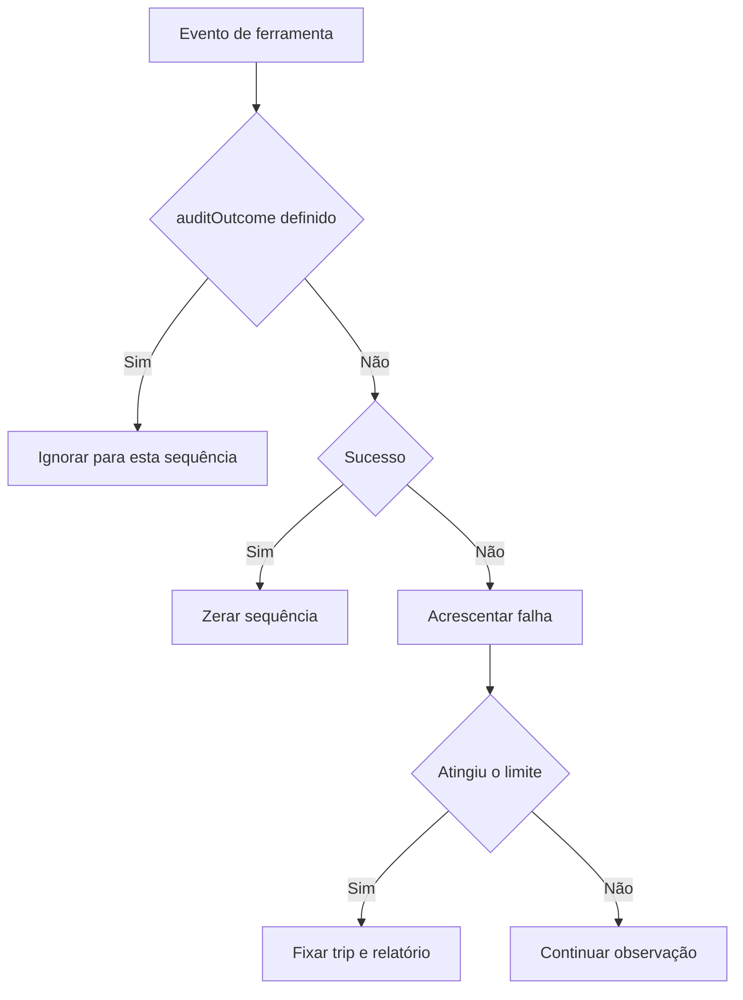

# Budgets and recovery

O executor recuperado usa mecanismos separados para passos, tempo total, timeouts de ferramentas e falhas consecutivas. Cada mecanismo tem ativação e semântica próprias; um diagnóstico de espera não equivale a interromper a execução.

## Limite de passos

`createSandStepCap(budget)` devolve `undefined` se `maxSteps <= 0`; caso contrário, mantém `stepsTaken`, inicializado por `stepsAlreadyTaken`, e incrementa apenas quando `noteCheckpoint()` é chamado. O limite foi atingido quando `stepsTaken >= maxSteps`. Isso conta checkpoints registrados pelo chamador, não tokens, chamadas individuais de ferramenta ou segundos. [Código](../../../reference/runtime/sand-eval-runner.cjs#L587266-L587283).

`stepCapWrapUpAtStep(maxSteps)` calcula:

\[
s_{aviso}=s_{max}-\max(2,\lceil s_{max}/10\rceil)
\]

Para 100 passos, o aviso começa em 90; para 10, começa em 8. `StepCapReminderMiddleware` acrescenta a instrução de finalizar somente antes do teto e se não houver o mesmo lembrete desde o último resumo. Não há clamp da fórmula para números muito pequenos; é preciso ler as condições do middleware junto com a fórmula. [Lembrete](../../../reference/runtime/sand-eval-runner.cjs#L587284-L587349).

Existe ainda `SAND_AGENT_MAX_STEPS = 5000`, passado ao agente composto. Esse teto do agente é diferente do budget opcional de um subagente. A presença de 5.000 não significa que toda tarefa percorre esse número de passos. [Composição](../../../reference/runtime/sand-eval-runner.cjs#L588010-L588036), [uso](../../../reference/runtime/sand-eval-runner.cjs#L588246-L588279).

## Deadline e timeouts consecutivos

`createSandTurnBudgetGuard(args)` agenda o prazo absoluto `deadlineAtMs` somente quando ele está definido e é positivo, com atraso `max(0, deadline - now)`. Prazo positivo já vencido agenda atraso zero; prazo ausente, zero ou negativo não cria esse timer. O callback `onExceeded` só é disparado uma vez. `dispose()` cancela o timer e torna futuras tentativas de exceder o budget inertes. [Código](../../../reference/runtime/sand-eval-runner.cjs#L587809-L587844).

Para timeouts, o contador cresce apenas em eventos que satisfazem `!event.success` e `errorClassification === "timeout"`. Qualquer outro evento zera a sequência. Ao atingir `maxConsecutiveToolTimeouts`, o motivo é `consecutive_tool_timeouts`. Zero ou valor negativo desativa esse limite. O guard sinaliza ao chamador; a ação de cancelamento pertence à composição que recebe o callback.

`inProcessComputerUseTurnBudget(parent, maxSteps)` usa o `maxSteps` positivo recebido no segundo argumento e herda o limite positivo de timeouts do pai. Não copia todo o budget indiscriminadamente, e não repassa `deadlineAtMs` nesse helper. [Herança](../../../reference/runtime/sand-eval-runner.cjs#L587799-L587808).

## Falhas consecutivas de computer use

`createSandToolFailureBreaker` mantém uma sequência de falhas. Eventos com `auditOutcome` definido são ignorados pelo predicado `isRefusedOrCancelled`; portanto, uma recusa de política não deve ser contada como falha de infraestrutura nesse caminho. Sucesso zera a sequência, falha é acrescentada e o primeiro trip é mantido. [Implementação](../../../reference/runtime/sand-eval-runner.cjs#L590438-L590490).

O default concreto usado para subagentes de computer use é 20. O chamador cria esse breaker somente quando `host.isComputerUseSubagent` é verdadeiro. O relatório inclui classes de falha e a última atualização disponível. Isso não é um limite universal de todo tipo de agente. [Ativação](../../../reference/runtime/sand-eval-runner.cjs#L591728-L591746).

## Encerramento com falha paralela

`createEndTurnFailedCallHold` pode adiar o fim quando uma chamada de término teve sucesso, mas outra chamada do mesmo passo falhou. O limite declarado é duas retenções, e o lembrete só considera falhas enquanto `deps.completing()` é verdadeiro. O lembrete pede corrigir o que importa sem reenviar o que já saiu. O estado guarda o passo de encerramento e os IDs de falha; `settleStep()` devolve os itens retidos e limpa o estado por passo. [Código](../../../reference/runtime/sand-eval-runner.cjs#L590538-L590567).

Isso evita concluir cedo demais em um passo misto, mas não é uma transação distribuída nem desfaz efeitos externos. Para cancelamento e gerações, leia [cancellation-recovery](../cancellation-recovery/README.md). Para a diferença entre watchdog e encerramento real, leia [scheduling](../scheduling/README.md).

## Contrato de validação

Os números acima são constantes ou valores de entrada identificados no código. Não são medições de latência ou consumo. Uma validação de runtime precisaria observar a origem do budget, os checkpoints e o callback de cancelamento no ambiente escolhido.
