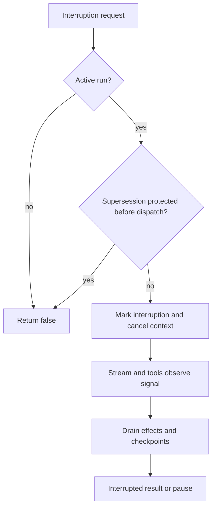

# Cancellation, replay, checkpoints, and shutdown

[English](README.en.md) · [Português (Brasil)](README.md)

## Four independent domains

| Domain | Observed mechanism |
| --- | --- |
| Message sent to the backend | Nonce, status lookup, and conditional replay. |
| Evaluation runner | Cooperative cancellation, subagent interruption, and generations. |
| Turn persistence | Serialized checkpoints, pending state, and completion markers. |
| Host process | Extension disposal and shutdown watchdog. |

Sources: [host-main.cjs:710798–710832](../../../reference/runtime/host-main.cjs#L710798-L710832), [sand-eval-runner.cjs:591314–591414](../../../reference/runtime/sand-eval-runner.cjs#L591314-L591414), [sand-eval-runner.cjs:592329–592377](../../../reference/runtime/sand-eval-runner.cjs#L592329-L592377), [host-main.cjs:787051–787083](../../../reference/runtime/host-main.cjs#L787051-L787083). A transport timeout does not establish that the effect did not occur.

## Runner cancellation

### `createTurnRunShell.interrupt(reason, supersede)`

Checks whether `cancelActiveRun` exists. There is protection against supersession before dispatch: if the new request does not carry the appropriate recovery, it returns `false`. After dispatch, supersession marks that unfinished tasks should be remembered. It marks interrupted state, clears the stop request, marks supersession when applicable, and cancels with an intentional `SandRunAbortError`. Source: [sand-eval-runner.cjs:591341–591359](../../../reference/runtime/sand-eval-runner.cjs#L591341-L591359).

### `interruptAll(reason)`

Calls `interrupt` for the main run and iterates over subagent sessions, calling `abortSubagent`. The return value indicates whether a main run was active; it does not confirm that all remote effects were reversed. Source: [sand-eval-runner.cjs:591369–591375](../../../reference/runtime/sand-eval-runner.cjs#L591369-L591375).

### `requestPauseForUpgrade`

Sets an intent to pause. In `SandAgentRunner`, it also expires approvals for a host pause and cancels registered MCP cancellers. Cancelling the pause restores the appropriate controller. Sources: [sand-eval-runner.cjs:591360–591368](../../../reference/runtime/sand-eval-runner.cjs#L591360-L591368), [sand-eval-runner.cjs:594058–594072](../../../reference/runtime/sand-eval-runner.cjs#L594058-L594072).



## Inference recovery

### `createStreamAttempt(host)`

Coordinates attempts, deadline, latest checkpoint, and error classification. Each attempt receives initial state or a resumption checkpoint. Persistence operations are tracked; a checkpoint failure is retained and propagated, avoiding treating inference as complete when its state did not become consistent. Source: [sand-eval-runner.cjs:590191–590350](../../../reference/runtime/sand-eval-runner.cjs#L590191-L590350).

At the call site, the `transientStreamRetry` policy is added only under explicit conditions: a supplied override or a subagent runner. `hidden`, overload, and other policies also influence handling. It is therefore incorrect to claim that every user turn always receives the same number of retries. Source: [sand-eval-runner.cjs:592292–592298](../../../reference/runtime/sand-eval-runner.cjs#L592292-L592298).

### Checkpoint and effects

`checkpointChain` preserves write order. It checks the generation and run callback before installing state, then acknowledges step waiters and associated commits. Completion drains tool effects. `createTurnSettle.persistCheckpoint` uses the store when available, including completion/waiting IDs only when no tool calls are pending; without a store it injects local state. Sources: [sand-eval-runner.cjs:592329–592364](../../../reference/runtime/sand-eval-runner.cjs#L592329-L592364), [sand-eval-runner.cjs:592378–592425](../../../reference/runtime/sand-eval-runner.cjs#L592378-L592425), [sand-eval-runner.cjs:590729–590764](../../../reference/runtime/sand-eval-runner.cjs#L590729-L590764).

### Completion replay

At the start of a resumed attempt, if the checkpoint already marks the same turn as complete or waiting for the user and there are no pending calls, the run shell returns that state. This guard protects against re-executing the final checkpoint, but does not establish exactly-once execution for arbitrary external tools. Source: [sand-eval-runner.cjs:592300–592309](../../../reference/runtime/sand-eval-runner.cjs#L592300-L592309).

## Remote-send recovery

### `createServerAgentActionCore`

After a potentially replayable send error, it queries status using the same `clientNonce`. Only `not-found` authorizes a second execution. Found or unknown returns the first classified error. No network fallback automatically executes a BOX turn. Sources: [host-main.cjs:710798–710832](../../../reference/runtime/host-main.cjs#L710798-L710832), [host-main.cjs:491926–491946](../../../reference/runtime/host-main.cjs#L491926-L491946).

## Scheduler watchdog

The queue watchdog records the `interrupted` phase; after grace, it can release the slot and retain the real Promise in `zombies`. It does not kill the runner by itself. This allows overlap after escape, which must be assessed alongside generation/persistence guards. Source: [host-main.cjs:739853–739903](../../../reference/runtime/host-main.cjs#L739853-L739903); details in [scheduling](../scheduling/README.en.md).

## Evaluation deadline

`runSandEvalRequest` listens for the `stopWaiting` signal, calls `runner.interruptAll`, and allows a grace period of **20 seconds** by default before cutting off the wait. The cutoff result includes `turnCutOffAtDeadline`, and background work may be listed as abandoned. `Promise.race` limits the wait; it does not reverse actions already performed. Sources: [sand-eval-runner.cjs:630213–630222](../../../reference/runtime/sand-eval-runner.cjs#L630213-L630222), [sand-eval-runner.cjs:630362–630395](../../../reference/runtime/sand-eval-runner.cjs#L630362-L630395), [sand-eval-runner.cjs:630544–630579](../../../reference/runtime/sand-eval-runner.cjs#L630544-L630579).

## Host shutdown

The normal flow unpublishes the proxy credential, closes connections, disposes the host, clears discovery, and releases the lock. A **5-second** watchdog protects against stuck shutdown. Lock release and the exit code are guaranteed in the normal path's `finally`. Source: [host-main.cjs:787051–787083](../../../reference/runtime/host-main.cjs#L787051-L787083).

## How to verify

```bash
rg -n 'function interrupt|function interruptAll|function createStreamAttempt|checkpointChain|turnCutOffAtDeadline' reference/runtime/sand-eval-runner.cjs
rg -n 'isNonceDedupedSendReplayable|createServerAgentActionCore|escapeWedgedRun' reference/runtime/host-main.cjs
```

No failure test was performed against the original system. The effects described are derived from the recovered control structure.
