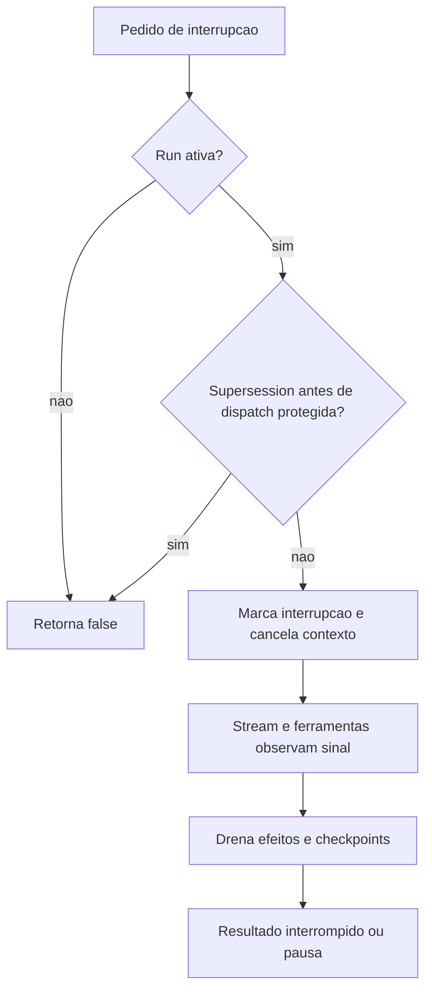

# Cancelamento, replay, checkpoints e encerramento

## Quatro domínios independentes

| Domínio | Mecanismo observado |
| --- | --- |
| Mensagem enviada ao backend | Nonce, consulta de status e replay condicionado. |
| Runner de avaliação | Cancelamento cooperativo, interrupção de subagentes e gerações. |
| Persistência do turno | Checkpoints serializados, estado pendente e marcadores de conclusão. |
| Processo do host | Dispose de extensões e watchdog de shutdown. |

Fontes: [host-main.cjs:710798–710832](../../../reference/runtime/host-main.cjs#L710798-L710832), [sand-eval-runner.cjs:591314–591414](../../../reference/runtime/sand-eval-runner.cjs#L591314-L591414), [sand-eval-runner.cjs:592329–592377](../../../reference/runtime/sand-eval-runner.cjs#L592329-L592377), [host-main.cjs:787051–787083](../../../reference/runtime/host-main.cjs#L787051-L787083). Um timeout de transporte não prova que o efeito não aconteceu.

## Cancelamento do runner

### `createTurnRunShell.interrupt(reason, supersede)`

Verifica se existe `cancelActiveRun`. Há proteção para supersession antes do dispatch: se o novo pedido não carrega a recuperação apropriada, retorna `false`. Depois do dispatch, supersession marca que deve lembrar tarefas inacabadas. Marca estado interrompido, limpa stop request, marca supersession quando aplicável e cancela com `SandRunAbortError` intencional. Fonte: [sand-eval-runner.cjs:591341–591359](../../../reference/runtime/sand-eval-runner.cjs#L591341-L591359).

### `interruptAll(reason)`

Chama `interrupt` para a run principal e percorre as sessões de subagente chamando `abortSubagent`. O retorno informa se havia run principal ativa; não equivale a confirmação de que todos os efeitos remotos foram revertidos. Fonte: [sand-eval-runner.cjs:591369–591375](../../../reference/runtime/sand-eval-runner.cjs#L591369-L591375).

### `requestPauseForUpgrade`

Define uma intenção de pausa. No `SandAgentRunner`, também expira aprovações para pausa do host e cancela os cancellers MCP registrados. Cancelar a pausa restaura o controlador apropriado. Fontes: [sand-eval-runner.cjs:591360–591368](../../../reference/runtime/sand-eval-runner.cjs#L591360-L591368), [sand-eval-runner.cjs:594058–594072](../../../reference/runtime/sand-eval-runner.cjs#L594058-L594072).



## Recuperação da inferência

### `createStreamAttempt(host)`

Coordena tentativas, deadline, checkpoint mais recente e classificação de erro. Cada tentativa recebe estado inicial ou checkpoint de retomada. Operações de persistência são acompanhadas; falha de checkpoint é guardada e propagada, evitando tratar a inferência como concluída quando seu estado não ficou consistente. Fonte: [sand-eval-runner.cjs:590191–590350](../../../reference/runtime/sand-eval-runner.cjs#L590191-L590350).

No call site, a política `transientStreamRetry` só é adicionada em condições explícitas: override fornecido ou runner de subagente. `hidden`, overload e outras políticas também influenciam tratamento. Portanto, não afirmar que todo turno de usuário sempre ganha o mesmo número de retries. Fonte: [sand-eval-runner.cjs:592292–592298](../../../reference/runtime/sand-eval-runner.cjs#L592292-L592298).

### Checkpoint e efeitos

`checkpointChain` preserva a ordem de gravação. Verifica geração e callback de run antes de instalar estado; depois confirma waiters de etapa e commits associados. A conclusão drena efeitos de ferramentas. `createTurnSettle.persistCheckpoint` usa store quando disponível, incluindo IDs de conclusão/aguardo somente quando não há tool calls pendentes; sem store injeta estado local. Fontes: [sand-eval-runner.cjs:592329–592364](../../../reference/runtime/sand-eval-runner.cjs#L592329-L592364), [sand-eval-runner.cjs:592378–592425](../../../reference/runtime/sand-eval-runner.cjs#L592378-L592425), [sand-eval-runner.cjs:590729–590764](../../../reference/runtime/sand-eval-runner.cjs#L590729-L590764).

### Replay de conclusão

No início de uma tentativa retomada, se o checkpoint já marca o mesmo turno como concluído ou aguardando o usuário e não existem chamadas pendentes, a run shell retorna esse estado. Esse guard protege o caso de reexecução do checkpoint final, mas não é prova de exatamente uma execução para ferramentas externas arbitrárias. Fonte: [sand-eval-runner.cjs:592300–592309](../../../reference/runtime/sand-eval-runner.cjs#L592300-L592309).

## Recuperação de envio remoto

### `createServerAgentActionCore`

Após erro de envio potencialmente replayable, consulta status com o mesmo `clientNonce`. Somente `not-found` autoriza a segunda execução. Encontrado ou desconhecido devolve o primeiro erro classificado. Nenhum fallback de rede executa automaticamente o turno BOX. Fontes: [host-main.cjs:710798–710832](../../../reference/runtime/host-main.cjs#L710798-L710832), [host-main.cjs:491926–491946](../../../reference/runtime/host-main.cjs#L491926-L491946).

## Watchdog do scheduler

O watchdog de fila registra a fase `interrupted`; após grace, pode soltar o slot e manter a Promise real em `zombies`. Ele não mata o runner por si só. Isso permite sobreposição depois do escape, que precisa ser avaliada junto com guardas de geração/persistência. Fonte: [host-main.cjs:739853–739903](../../../reference/runtime/host-main.cjs#L739853-L739903); detalhes em [scheduling](../scheduling/README.md).

## Deadline de avaliação

`runSandEvalRequest` escuta o sinal `stopWaiting`, chama `runner.interruptAll` e permite uma grace de **20 segundos** por padrão antes de cortar a espera. O resultado cortado inclui `turnCutOffAtDeadline`, e trabalho de background pode constar como abandonado. `Promise.race` limita a espera; não reverte ações já executadas. Fontes: [sand-eval-runner.cjs:630213–630222](../../../reference/runtime/sand-eval-runner.cjs#L630213-L630222), [sand-eval-runner.cjs:630362–630395](../../../reference/runtime/sand-eval-runner.cjs#L630362-L630395), [sand-eval-runner.cjs:630544–630579](../../../reference/runtime/sand-eval-runner.cjs#L630544-L630579).

## Encerramento do host

No fluxo normal, despublica credencial de proxy, fecha conexões, dispõe host, limpa descoberta e libera lock. Watchdog de **5 segundos** protege shutdown preso. A liberação de lock e o código de saída são garantidos no `finally` do caminho normal. Fonte: [host-main.cjs:787051–787083](../../../reference/runtime/host-main.cjs#L787051-L787083).

## Como verificar

```bash
rg -n 'function interrupt|function interruptAll|function createStreamAttempt|checkpointChain|turnCutOffAtDeadline' reference/runtime/sand-eval-runner.cjs
rg -n 'isNonceDedupedSendReplayable|createServerAgentActionCore|escapeWedgedRun' reference/runtime/host-main.cjs
```

Não foi executado teste de falha no sistema original. Os efeitos descritos são derivados da estrutura de controle recuperada.
