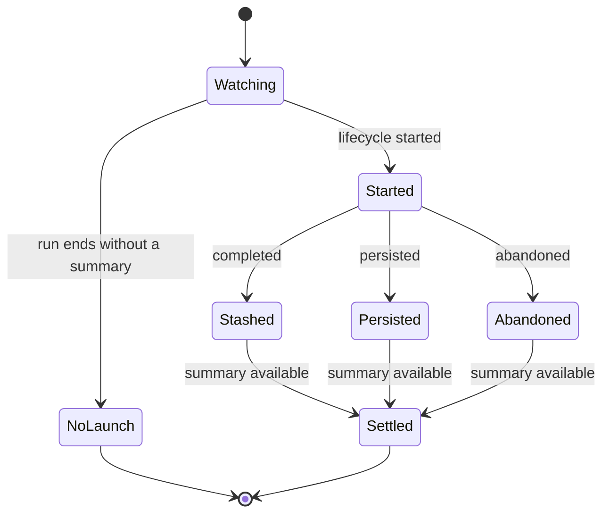

# Context compaction

[English](README.en.md) · [Português (Brasil)](README.md)

Context compaction, durable memory, and proactivity serve different purposes. Compaction reduces the context loaded by a session; memory records facts by type/scope; selecting a spontaneous opportunity is a separate decision. This README covers the summarization implementation available in the executor.

## Summarization properties

`createSandBackgroundSummarizationProps(session, canUseSelfSummary, isSubagent, override)` returns the override when one is supplied. Without an override, it checks `session.getEarlyCompaction()` and uses the early threshold only when this is not a subagent, self-summary is allowed, and input tokens have already reached the supplied threshold. [Implementation](../../../reference/runtime/sand-eval-runner.cjs#L588016-L588036).

| Default property | Value | Interpretation limited to the code |
| --- | --- | --- |
| Unused tokens required to start | 10,000 | A parameter forwarded to the summarization mechanism |
| Unused fraction required to start | 0.1 | Another mechanism parameter; do not infer how they combine without reading the consumer |
| Tokens/fraction required to persist | 10,000 / 0.1 | Declared persistence thresholds |
| `discardOnError` | true | Requests discarding on error |
| `requireTriggerThresholdForMidLoopPersist` | true | Requires the threshold for persistence in the middle of the loop |

This table does not turn these parameters into an assumed production rule. The same factory allows all of them to be replaced.

## Compaction while idle

`startIdleCompaction(runner, options)` installs a summary-lifecycle observer and calls `runner.run` with an empty prompt, `idleCompaction:true`, `requestSource:"idle-compaction"`, `isSilenceAllowed:true`, `quietWork:true`, `autoReviewEpoch:"continue"`, and `NO_CONNECTORS`. [Code](../../../reference/runtime/sand-eval-runner.cjs#L526374-L526447).

This helper starts a special run when called. Its presence does not define when the product decides to call it. It also does not mean that a user received a message: the run uses idle-compaction mode, permits silence, and receives `quietWork`. The `isSilenceAllowed` flag permits completion without a message; its name alone should not be interpreted as a general prohibition on all output.

The `fired` result includes the cycle ID, summarization model, self-summary indicator, time to launch, initial snapshot, and a settlement Promise. Completing that Promise requires both an available summary and a terminal state corresponding to the same cycle. Without a launch or summary, the helper returns `aborted` or `error/not_launched`; exceptions return the error class and, when present, launch data from before the failure. The listener is removed in the identified termination paths.

`completed` is recorded as `stashed`, `persisted` as `persisted_in_activity`, and `abandoned` retains its reason. These are not synonyms for successful durable persistence.

## Continuity and metrics

`SandSummaryLifecycleWatch` maintains a set of cycles that have started and have not yet been persisted/abandoned. `hasUnsettledOrPersistedSince` observes this set and the change in the size of `summaryArchives` relative to the recorded epoch. This tracks context changes; it is not a complete execution replay. [Source](../../../reference/runtime/sand-eval-runner.cjs#L526353-L526373).

`createIdleCompactionCollector` collects request IDs and the model served, and sums input, output, and cache tokens. `summary()` returns copies of the IDs and current usage. These metrics explain the cost of a pass when it occurs, without establishing how often it is triggered. [Collector](../../../reference/runtime/sand-eval-runner.cjs#L526448-L526478).

Also read [prompts](../prompts/README.en.md), [memory](../memory/README.en.md), [turns](../turns/README.en.md), and [observability](../observability/README.en.md).
