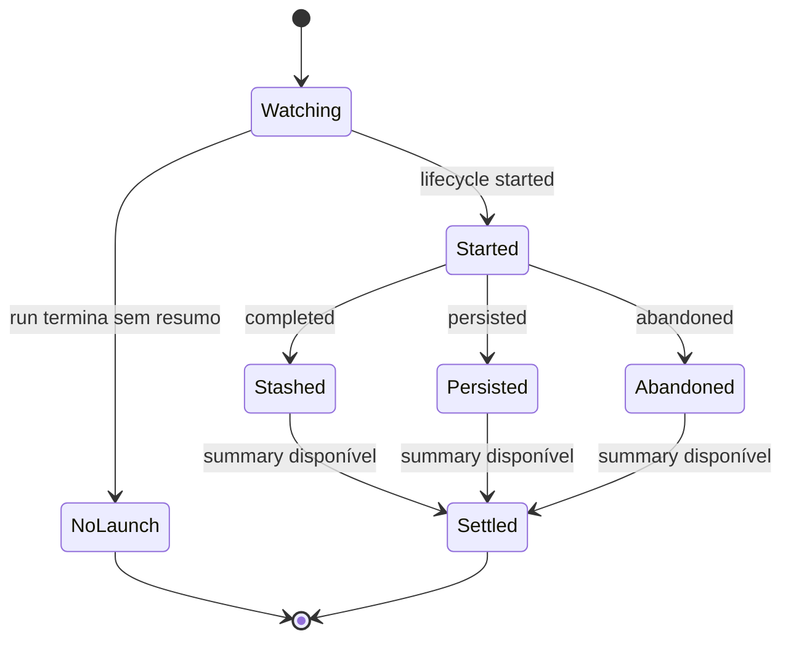

# Context compaction

Compactação de contexto, memória durável e proatividade têm funções diferentes. A compactação reduz o contexto carregado por uma sessão; memória registra fatos por tipo/escopo; a escolha de uma oportunidade espontânea é outra decisão. Este README cobre a implementação de sumarização disponível no executor.

## Propriedades de sumarização

`createSandBackgroundSummarizationProps(session, canUseSelfSummary, isSubagent, override)` devolve o override quando fornecido. Sem override, consulta `session.getEarlyCompaction()` e só usa o threshold antecipado se não for subagente, se self-summary for permitido e se os tokens de entrada já atingirem o threshold informado. [Implementação](../../../reference/runtime/sand-eval-runner.cjs#L588016-L588036).

| Propriedade padrão | Valor | Interpretação limitada ao código |
| --- | --- | --- |
| Tokens não usados para iniciar | 10.000 | Parâmetro repassado ao mecanismo de sumarização |
| Percentual não usado para iniciar | 0,1 | Outro parâmetro do mecanismo; não inferir a combinação sem ler o consumidor |
| Tokens/percentual para persistir | 10.000 / 0,1 | Limiares de persistência declarados |
| `discardOnError` | true | Solicita descarte em erro |
| `requireTriggerThresholdForMidLoopPersist` | true | Exige threshold para persistência no meio do loop |

A tabela não transforma esses parâmetros em uma regra presumida de produção. A mesma factory permite substituí-los integralmente.

## Compactação enquanto ocioso

`startIdleCompaction(runner, options)` instala um observador de ciclo de resumo e chama `runner.run` com prompt vazio, `idleCompaction:true`, `requestSource:"idle-compaction"`, `isSilenceAllowed:true`, `quietWork:true`, `autoReviewEpoch:"continue"` e `NO_CONNECTORS`. [Código](../../../reference/runtime/sand-eval-runner.cjs#L526374-L526447).

Esse helper inicia uma execução especial quando chamado. Sua presença não define quando o produto decide chamá-lo. Também não significa que um usuário recebeu uma mensagem: a execução usa o modo de compactação ociosa, permite silêncio e recebe `quietWork`. A flag `isSilenceAllowed` permite terminar sem mensagem; seu nome não deve ser interpretado, isoladamente, como uma proibição geral de toda saída.

O resultado `fired` inclui ID do ciclo, modelo de sumarização, indicador de self-summary, tempo até lançamento, snapshot inicial e uma Promise de settlement. A conclusão dessa Promise requer tanto um resumo disponível quanto um estado terminal correspondente ao mesmo ciclo. Sem lançamento ou resumo, retorna `aborted` ou `error/not_launched`; exceções retornam classe de erro e, se houver, dados do lançamento anterior à falha. O listener é removido nos caminhos de encerramento identificados.

`completed` é registrado como `stashed`, `persisted` como `persisted_in_activity`, e `abandoned` conserva seu motivo. Não são sinônimos de persistência durável bem-sucedida.

## Continuidade e métricas

`SandSummaryLifecycleWatch` mantém um conjunto de ciclos iniciados e ainda não persistidos/abandonados. `hasUnsettledOrPersistedSince` observa esse conjunto e a diferença no tamanho de `summaryArchives` em relação ao epoch registrado. Isso é controle de mudança de contexto, não replay integral de execução. [Fonte](../../../reference/runtime/sand-eval-runner.cjs#L526353-L526373).

`createIdleCompactionCollector` coleta request IDs, modelo servido e soma tokens de entrada, saída e cache. `summary()` devolve cópias dos IDs e uso corrente. Essas métricas explicam o custo de uma passagem quando ela ocorre, sem demonstrar frequência de disparo. [Collector](../../../reference/runtime/sand-eval-runner.cjs#L526448-L526478).

Leia também [prompts](../prompts/README.md), [memória](../memory/README.md), [turnos](../turns/README.md) e [observabilidade](../observability/README.md).
