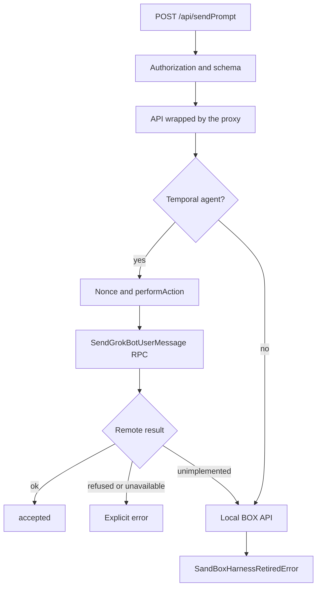

# Gateway, routing, and proxying for remote agents

[English](README.en.md) · [Português (Brasil)](README.md)

## Main conclusion

The HTTP gateway composes a local API and wraps it with `wrapGatewayApiWithServerAgentProxy`. In this snapshot, agents with `harness === "temporal"` enter the proxy and send actions to `GrokBotService`. For a substantive input, the local `SendPipeline.sendPrompt` path ends in a refusal because the BOX harness is retired. An empty prompt without attachments returns without work before that refusal. The correct diagram therefore needs to show the remote-routing decision before any inference loop. Sources: [host-main.cjs:491926–492042](../../../reference/runtime/host-main.cjs#L491926-L492042), [host-main.cjs:493271–493277](../../../reference/runtime/host-main.cjs#L493271-L493277), [host-main.cjs:714581–714609](../../../reference/runtime/host-main.cjs#L714581-L714609), [host-main.cjs:740157–740194](../../../reference/runtime/host-main.cjs#L740157-L740194).

## HTTP contract

| Surface | Responsibility |
| --- | --- |
| `GET /health` | A summary of health, PID, activity, and saturation. |
| `POST /api/{method}` | Method and argument validation, execution, and a JSON response. |
| `GET /events` | An SSE stream of local events/events projected by the host. |
| `POST /events/echo` | Nonce echo on existing streams. |
| `/attachments`, `/avatars` | Reading media served by the gateway. |
| `/local-exec/*`, `/webauthn/*`, `/cookie-origin-approval/*` | Specialized bridges, with authentication required. |

Sources: [host-main.cjs:486081–486104](../../../reference/runtime/host-main.cjs#L486081-L486104), [host-main.cjs:493817–493960](../../../reference/runtime/host-main.cjs#L493817-L493960). The `/events` SSE stream differs from the remote `WatchGrokBotTranscripts` RPC.

## Send flow



## Functions and decisions

### `resolveGatewayServerConfig(env)`

Uses `127.0.0.1` as the default bind address. It enables authentication outside loopback, when explicitly required, or when a token is configured. It can generate a random token; TLS requires both a certificate and a key. A separate WebAuthn proxy token is created when primary authentication is present. These are contracts, not credentials to reuse. Source: [host-main.cjs:483840–483895](../../../reference/runtime/host-main.cjs#L483840-L483895).

### `startGatewayServer(deps)` and `handleRequest`

The factory chooses HTTP or HTTPS, installs the request listener, and calls `listen`. `handleRequest` rejects untrusted browser requests before routing. Health has a dedicated path; other known surfaces pass through authentication rules. Local bridges do not work without authentication. Methods receiving secret values also require authentication, even on loopback. Source: [host-main.cjs:493817–493960](../../../reference/runtime/host-main.cjs#L493817-L493960).

### `routeCommand` and `runGatewayCommand`

The name must belong to the `isSandGatewayMethod` catalog; an unknown name returns 404 with a failure code. The execution helper validates arguments against the API schemas before invoking the handler. The gateway measures duration, creates a span, and reports classified failures. Telemetry errors are contained so they do not replace the original error. Source: [host-main.cjs:493530–493579](../../../reference/runtime/host-main.cjs#L493530-L493579). [Function README](../../functions/routeCommand/README.en.md).

### `createHostGatewayApi(deps)`

Obtains extensions through their APIs and assembles domain methods, including sending, history, profiles, groups, media, and request resolutions. The local `sendPrompt` reports the send and calls `TranscriptManager.sendPrompt`; `accepted: true` appears only after that method completes. Finally, the function wraps the entire API with the proxy. Sources: [host-main.cjs:492329–492488](../../../reference/runtime/host-main.cjs#L492329-L492488), [host-main.cjs:493271–493277](../../../reference/runtime/host-main.cjs#L493271-L493277).

### `wrapGatewayApiWithServerAgentProxy`

Overrides the relevant operations. For `sendPrompt`, it checks eligibility by ID and generates `clientNonce` if absent. `settle` converts `ok`, `refused`, `unavailable`, and `unimplemented`: only the last invokes the fallback. Network unavailability does not authorize alternative local execution. In this snapshot's local send fallback, the retired harness refuses the turn. Source: [host-main.cjs:491926–492042](../../../reference/runtime/host-main.cjs#L491926-L492042). [Function README](../../functions/wrapGatewayApiWithServerAgentProxy/README.en.md).

### `createServerAgentProxy` and `performAction`

`refreshRoster` keeps only Temporal agents in `requiredAgents`. The proxy prepares the transcript client, tail, indexer, activity overlays, and action client. The first action or read starts the tail. With no listeners, the tail can remain active for **60 seconds** before stopping; roster reconciliation has a minimum interval of **30 seconds**. This manages connection usage, rather than scheduling proactive reasoning. Source: [host-main.cjs:714543–714847](../../../reference/runtime/host-main.cjs#L714543-L714847).

### `createServerAgentActionCore` and `perform`

`perform` translates the command into protobuf. For sending, `clientNonce` becomes `messageId`; text, attachments, `sessionId`, `taskId`, origin, and trace are transported. An `ACCEPTED_BOX`, `ACCEPTED_TEMPORAL`, or `DUPLICATE` response is converted into acceptance. These enums document the server protocol and do not reactivate this host's BOX code. Source: [host-main.cjs:710249–710335](../../../reference/runtime/host-main.cjs#L710249-L710335).

The core handles an ambiguous send failure by querying `GetGrokBotSendStatus` with the same nonce. It repeats `perform` only when the query returns `not-found`; a found status or unknown durability preserves the first error. A `ConnectError` is eligible for this replay only when it is `Unavailable` and carries no `retry-after`. Sources: [host-main.cjs:709961–709964](../../../reference/runtime/host-main.cjs#L709961-L709964), [host-main.cjs:710798–710832](../../../reference/runtime/host-main.cjs#L710798-L710832). [Function README](../../functions/createServerAgentActionCore/README.en.md).

### `openSseStream` and `handleEvents`

Open `text/event-stream`, optionally with gzip, and publish `retry: 1000`, heartbeats, and serialized events. Closing removes the subscription, heartbeat, echo, and compressor. The `channels` and `surface` filters limit events. Source: [host-main.cjs:493580–493643](../../../reference/runtime/host-main.cjs#L493580-L493643).

## What was not recovered

These clients do not reveal the server code behind `GrokBotService` or the Temporal workflow implementation. Message acceptance, tool execution, completion, and delivery are different events. The gateway provides transport and projection; it does not demonstrate that spontaneous proactivity decisions originate there.

## Verification

```bash
rg -n 'wrapGatewayApiWithServerAgentProxy|createServerAgentActionCore|sendGrokBotUserMessage|isProxiedAgent|refuseBoxTurn' reference/runtime/host-main.cjs
```

Continue with [transcripts](../transcripts/README.en.md), [turns](../turns/README.en.md), and [inference](../inference/README.en.md).
