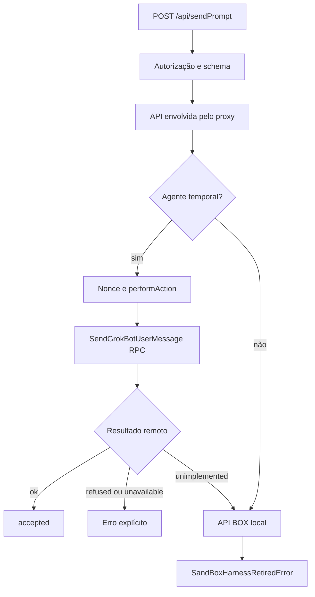

# Gateway, roteamento e proxy para agentes remotos

## Conclusão principal

O gateway HTTP compõe uma API local e a envolve com `wrapGatewayApiWithServerAgentProxy`. No snapshot, agentes com `harness === "temporal"` entram no proxy e enviam ações a `GrokBotService`. Para uma entrada efetiva, o caminho local de `SendPipeline.sendPrompt` termina em uma recusa de harness BOX aposentado. Prompt vazio sem anexos retorna sem trabalho antes dessa recusa. Portanto, o diagrama correto precisa mostrar a decisão remota antes de qualquer loop de inferência. Fontes: [host-main.cjs:491926–492042](../../../reference/runtime/host-main.cjs#L491926-L492042), [host-main.cjs:493271–493277](../../../reference/runtime/host-main.cjs#L493271-L493277), [host-main.cjs:714581–714609](../../../reference/runtime/host-main.cjs#L714581-L714609), [host-main.cjs:740157–740194](../../../reference/runtime/host-main.cjs#L740157-L740194).

## Contrato HTTP

| Superfície | Responsabilidade |
| --- | --- |
| `GET /health` | Estado resumido de saúde, PID, atividade e saturação. |
| `POST /api/{method}` | Validação do método e argumentos, execução e resposta JSON. |
| `GET /events` | Stream SSE de eventos locais/projetados pelo host. |
| `POST /events/echo` | Eco de nonce em streams existentes. |
| `/attachments`, `/avatars` | Leitura de mídia servida pelo gateway. |
| `/local-exec/*`, `/webauthn/*`, `/cookie-origin-approval/*` | Pontes específicas, com autenticação exigida. |

Fontes: [host-main.cjs:486081–486104](../../../reference/runtime/host-main.cjs#L486081-L486104), [host-main.cjs:493817–493960](../../../reference/runtime/host-main.cjs#L493817-L493960). O stream SSE de `/events` é diferente do RPC remoto `WatchGrokBotTranscripts`.

## Fluxo de envio



## Funções e decisões

### `resolveGatewayServerConfig(env)`

Usa `127.0.0.1` como bind padrão. Fora de loopback, com exigência explícita, ou com token configurado, ativa autenticação. Pode gerar token aleatório; TLS requer certificado e chave juntos. Um token de proxy WebAuthn separado é criado quando há autenticação principal. Esses são contratos, não credenciais para reutilização. Fonte: [host-main.cjs:483840–483895](../../../reference/runtime/host-main.cjs#L483840-L483895).

### `startGatewayServer(deps)` e `handleRequest`

A fábrica escolhe HTTP ou HTTPS, instala o request listener e faz `listen`. `handleRequest` rejeita requisições de browser não confiáveis antes de rotear. A saúde possui caminho específico; as demais superfícies conhecidas passam pelas regras de autenticação. Pontes locais não funcionam sem autenticação. Métodos que recebem valores secretos também exigem autenticação mesmo em loopback. Fonte: [host-main.cjs:493817–493960](../../../reference/runtime/host-main.cjs#L493817-L493960).

### `routeCommand` e `runGatewayCommand`

O nome precisa pertencer ao catálogo `isSandGatewayMethod`; desconhecido retorna 404 com código de falha. O helper de execução valida argumentos conforme os schemas da API antes do handler. O gateway mede duração, cria span e relata falhas classificadas. Erros de telemetria são contidos para não substituir o erro original. Fonte: [host-main.cjs:493530–493579](../../../reference/runtime/host-main.cjs#L493530-L493579). [README da função](../../functions/routeCommand/README.md).

### `createHostGatewayApi(deps)`

Obtém extensões por API e monta métodos do domínio, incluindo envio, histórico, perfis, grupos, mídia e resoluções de solicitações. O `sendPrompt` local relata envio e chama `TranscriptManager.sendPrompt`; `accepted: true` só vem depois da conclusão desse método. No final, a função envolve toda a API com o proxy. Fonte: [host-main.cjs:492329–492488](../../../reference/runtime/host-main.cjs#L492329-L492488), [host-main.cjs:493271–493277](../../../reference/runtime/host-main.cjs#L493271-L493277).

### `wrapGatewayApiWithServerAgentProxy`

Sobrescreve as operações relevantes. Para `sendPrompt`, consulta elegibilidade por ID e gera `clientNonce` se ausente. `settle` converte `ok`, `refused`, `unavailable`, `unimplemented`: apenas o último chama fallback. Indisponibilidade de rede não autoriza execução local alternativa. No fallback local de envio deste snapshot, o harness aposentado recusa. Fonte: [host-main.cjs:491926–492042](../../../reference/runtime/host-main.cjs#L491926-L492042). [README da função](../../functions/wrapGatewayApiWithServerAgentProxy/README.md).

### `createServerAgentProxy` e `performAction`

`refreshRoster` mantém `requiredAgents` apenas com agentes Temporal. O proxy prepara cliente de transcript, tail, indexador, overlays de atividade e cliente de ações. A primeira ação ou leitura inicia a cauda. Sem listeners, a cauda pode permanecer por **60 segundos** antes de parar; reconciliação de roster é limitada por intervalo mínimo de **30 segundos**. Isso administra consumo da conexão, não agenda raciocínio proativo. Fonte: [host-main.cjs:714543–714847](../../../reference/runtime/host-main.cjs#L714543-L714847).

### `createServerAgentActionCore` e `perform`

`perform` traduz o comando em protobuf. Em envio, `clientNonce` torna-se `messageId`; texto, anexos, `sessionId`, `taskId`, origem e trace são transportados. A resposta `ACCEPTED_BOX`, `ACCEPTED_TEMPORAL` ou `DUPLICATE` é convertida em aceitação. Esses enums documentam o protocolo do servidor e não reativam o código BOX deste host. Fonte: [host-main.cjs:710249–710335](../../../reference/runtime/host-main.cjs#L710249-L710335).

O core lida com falha ambígua de envio consultando `GetGrokBotSendStatus` com o mesmo nonce. Só repete `perform` quando a consulta retorna `not-found`; status encontrado ou durabilidade desconhecida preserva o primeiro erro. Um `ConnectError` só é elegível para esse replay quando é `Unavailable` e não carrega `retry-after`. Fontes: [host-main.cjs:709961–709964](../../../reference/runtime/host-main.cjs#L709961-L709964), [host-main.cjs:710798–710832](../../../reference/runtime/host-main.cjs#L710798-L710832). [README da função](../../functions/createServerAgentActionCore/README.md).

### `openSseStream` e `handleEvents`

Abrem `text/event-stream`, opcionalmente gzip, publicam `retry: 1000`, heartbeat e eventos serializados. O fechamento remove inscrição, heartbeat, echo e compressor. Filtros `channels` e `surface` limitam eventos. Fonte: [host-main.cjs:493580–493643](../../../reference/runtime/host-main.cjs#L493580-L493643).

## O que não está recuperado

O código servidor por trás de `GrokBotService` e a implementação do workflow Temporal não estão demonstrados por estes clientes. Aceitação de mensagem, execução de ferramentas, conclusão e entrega são eventos diferentes. O gateway fornece transporte e projeção; não demonstra que a decisão espontânea de proatividade nasceu nele.

## Conferência

```bash
rg -n 'wrapGatewayApiWithServerAgentProxy|createServerAgentActionCore|sendGrokBotUserMessage|isProxiedAgent|refuseBoxTurn' reference/runtime/host-main.cjs
```

Continue em [transcripts](../transcripts/README.md), [turnos](../turns/README.md) e [inferência](../inference/README.md).
