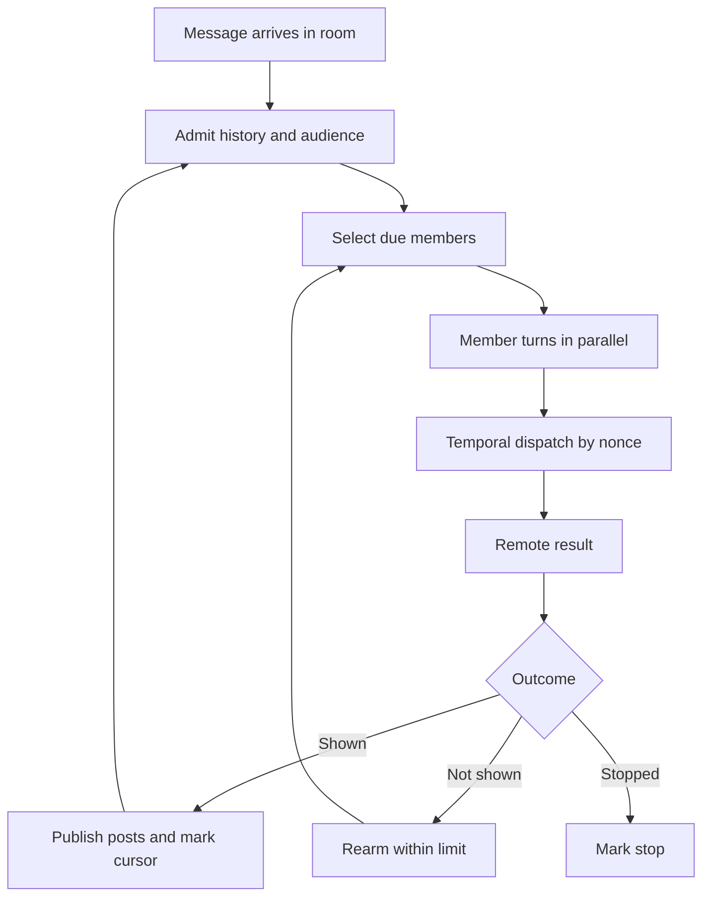

# Groups: room orchestration, delivery, and remote turns

[English](README.en.md) · [Português (Brasil)](README.md)

[Index](../../README.en.md) · [Subagents](../subagents/README.en.md) · [Integrations](../integrations/README.en.md) · [Scheduling](../scheduling/README.en.md)

## Conclusion supported by the snapshot

A room is not simply a bot executing a prompt with several names. There is a `GroupChatOrchestrator`, a per-member delivery record, message admission, and turn dispatch. In the host's concrete binding, `runGroupMemberTurn` executes only members with `harness:"temporal"`; local/BOX members are marked as skipped and return `not_shown`. The code preserves room orchestration, but execution of these agents depends on the remote service. [Orchestrator](../../../reference/runtime/host-main.cjs#L737383-L737561), [effective binding](../../../reference/runtime/host-main.cjs#L738573-L738705).

## Distinct identities

| Entity | Identity and role |
| --- | --- |
| Room/group | Has configuration, members, history, and a room turn |
| Member agent | Individual bot, with a profile and harness type |
| Member turn | A request to process new messages for that member |
| Task/Subagent | Delegated work with its own lifecycle; not automatically a room member |
| `SendToAgent` | Individual send to a bot or room; the room uses its own admission/orchestration |

`assertMembersAreNotGroups` refuses nesting. `resolveGroupMembers` also ignores groups found in the roster and nonexistent profiles. [Member validation](../../../reference/runtime/host-main.cjs#L491265-L491278), [resolution](../../../reference/runtime/host-main.cjs#L738573-L738598).

## Recovered limits and actual units

| Constant | Value | Observed use |
| --- | --- | --- |
| `GROUP_MAX_MEMBERS2` | 6 | Composition limit |
| `GROUP_MAX_MESSAGES_PER_TURN` | 3 | Deliverable messages from a member turn |
| `GROUP_MAX_MEMBER_TURNS` | 10 | Despite the name, compared against `trigger.posts`, which is incremented by the number of posts |
| `GROUP_MAX_ROUNDS` | 3 | Normal waves; catch-up for owed messages may follow |
| `GROUP_MAX_MEMBER_REDELIVERIES` | 2 | Rearms up to two consecutive failures; the third does not rearm |
| `GROUP_MAX_ROOM_TURN_DISPATCHES` | 36 | `2 × 3 × 6`, additional dispatch cap during the orchestrator run |
| Prompt history | 24 messages | History/context window |
| Text per message | 8,000 characters | Limit used in content normalization |

The unit matters: saying “each agent can speak ten times” contradicts the counter used by the code. A newly admitted input can reset `waves/posts/caughtUp`, while the dispatch cap remains in force for the current run. [Constants](../../../reference/runtime/host-main.cjs#L491251-L491264), [counter and catch-up](../../../reference/runtime/host-main.cjs#L737400-L737430), [settle](../../../reference/runtime/host-main.cjs#L737526-L737560).

## `GroupChatOrchestrator.run`

1. Resolves members and admits history into the delivery record.
2. Maintains `working` per member, `settled` results, `pending` promises, and forced/held turns.
3. Calculates due members, excluding those already running. Different members can start in parallel.
4. Gets unseen messages and the `through` cursor; marks dispatch before requesting the turn.
5. Composes a prompt with peers and a wind-down indicator. Receipts and attachments can force processing.
6. Waits for a result or new input when the dependency offers `waitForInbound`. An admitted input resets the trigger budget.
7. `settle` publishes valid posts and updates delivery state. A not-shown failure can rearm; stopped only records the stop.
8. Honors `isCurrent`, `shouldYield`, and the global dispatch cap; finishes by awaiting still-pending promises with `allSettled`.
9. May return failure and held for work that remains eligible. The caller must decide what to persist or reschedule.

The host's concrete `runGroupTurn` checks `failure`, updates the roster, and finishes the session; this section does not consume `result.held`. The generic held return therefore does not establish durable re-execution in this caller. [Caller](../../../reference/runtime/host-main.cjs#L738518-L738551).

The orchestrator supports optional live-input dependencies, but this host's `groupOrchestratorDeps` supplies a subset: resolve/read/delivery/run/post/isCurrent. Do not infer that every optional hook is connected in the analyzed path. [Run](../../../reference/runtime/host-main.cjs#L737384-L737526), [host dependencies](../../../reference/runtime/host-main.cjs#L738552-L738572).

## `RoomDeliveryRecord`

`admit` only judges messages beyond `judgedThrough`. It calculates the audience from mentions, names, and reply-to. It skips the author; a message with named recipients only wakes those members. An open/everyone message can reach the others.

The cursors have different meanings: `shownThrough` is context confirmed as shown; `dispatchedThrough` is context sent to a turn; `wokenThrough` identifies new material that causes a wake; `owedThrough` records work that became due through overlap. `turnOverlapped` uses a dispatch/settle logical clock to identify who needs catch-up.

`noteShown` advances the cursor and resets failures; `rearmAfterFailedTurn` increments failures and restores `dispatchedBefore` to allow redelivery. `snapshot/restore` preserve part of the state, including shown/due/failures. These are delivery-control mechanisms, not evidence of remote exactly-once behavior. [Class](../../../reference/runtime/host-main.cjs#L737681-L737801).

## Audience and silence

`parseGroupMentions` understands `@everyone`, `@all`, and member-name aliases. `parseGroupAddressees` also detects names in agent messages, with protection against fragments inside emails/paths. `groupLineAudience` includes the reply-to recipient and removes the author. For a human message, it uses explicit mentions; it does not automatically apply the full agent-name heuristic.

`deliverablePosts` filters content and caps it at three messages. An empty pass/`(pass)` means silence; `postToGroupWithStatus` does not publish that text. Silence is an accepted state and does not require another message explaining the absence. [Audience](../../../reference/runtime/host-main.cjs#L491280-L491390), [filter](../../../reference/runtime/host-main.cjs#L737613-L737621), [post](../../../reference/runtime/host-main.cjs#L738333-L738410).

## `createTemporalMemberTurns`

Creates a pending map keyed by nonce; stores room ID and member ID. `requestTemporalMemberTurn` validates the ID, assembles room/peers/messages, and sends the RPC. Accepted and duplicate keep waiting for a result; not-temporal/target-not-found return skipped; unavailable/unspecified return an error. A dispatch exception removes the pending entry and reports failure.

`receiveRoomMemberTurnResult` requires a known nonce and matching room ID. Only a delivered result retains posts/messages; an invalid outcome becomes an error. The helper cancels upstream when its deadline expires and allows cancellation of every pending entry for a room. [Client](../../../reference/runtime/host-main.cjs#L708312-L708439).

There are three different durations: a 20-second RPC timeout; a 5-minute deadline sent to the service; and a 10-minute host wait deadline, bound in the extension. These are limits declared in the client, not measured latencies or a guarantee of on-time execution. [Constants](../../../reference/runtime/host-main.cjs#L708309-L708320), [deadline binding](../../../reference/runtime/host-main.cjs#L708440-L708466).

## Evidence limits

The backend that processes the Temporal turn is not in this factory. The code shows requests, correlation, waiting, cancellation, and result consumption. Remote-side deduplication guarantees, the complete room authorization policy, and evidence of behavior in a real session are missing. No account traffic was generated for this map.
