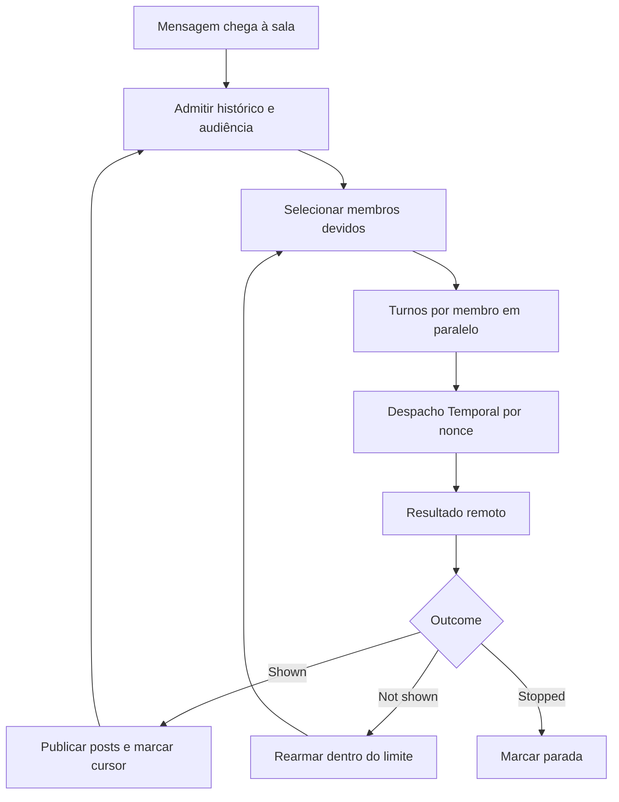

# Grupos: orquestração de sala, entrega e turnos remotos

[Índice](../../README.md) · [Subagentes](../subagents/README.md) · [Integrações](../integrations/README.md) · [Scheduling](../scheduling/README.md)

## Conclusão sustentada pelo snapshot

Uma sala não é simplesmente um bot executando um prompt com vários nomes. Existe um `GroupChatOrchestrator`, registro de entrega por membro, admissão de mensagens e despacho de turnos. Na ligação concreta do host, `runGroupMemberTurn` executa apenas membros com `harness:"temporal"`; membros locais/BOX são marcados como skipped e retornam `not_shown`. O código preserva a orquestração da sala, mas a execução desses agentes depende do serviço remoto. [Orquestrador](../../../reference/runtime/host-main.cjs#L737383-L737561), [ligação efetiva](../../../reference/runtime/host-main.cjs#L738573-L738705).

## Identidades distintas

| Entidade | Identidade e função |
| --- | --- |
| Room/group | Possui configuração, membros, histórico e turno de sala |
| Member agent | Bot individual, com perfil e tipo de harness |
| Member turn | Uma solicitação de processamento de mensagens novas para esse membro |
| Task/Subagent | Delegação de trabalho com ciclo próprio; não é automaticamente um membro de sala |
| `SendToAgent` | Envio pontual para bot ou sala; a sala usa sua própria admissão/orquestração |

`assertMembersAreNotGroups` recusa nesting. `resolveGroupMembers` também ignora grupos encontrados dentro do roster e perfis inexistentes. [Validação de membros](../../../reference/runtime/host-main.cjs#L491265-L491278), [resolução](../../../reference/runtime/host-main.cjs#L738573-L738598).

## Limites recuperados e unidades reais

| Constante | Valor | Uso observado |
| --- | --- | --- |
| `GROUP_MAX_MEMBERS2` | 6 | Limite de composição |
| `GROUP_MAX_MESSAGES_PER_TURN` | 3 | Mensagens entregáveis de um turno de membro |
| `GROUP_MAX_MEMBER_TURNS` | 10 | Apesar do nome, comparada a `trigger.posts`, incrementado por quantidade de posts |
| `GROUP_MAX_ROUNDS` | 3 | Ondas normais; depois pode haver catch-up de mensagens devidas |
| `GROUP_MAX_MEMBER_REDELIVERIES` | 2 | Rearma até duas falhas consecutivas; a terceira não rearma |
| `GROUP_MAX_ROOM_TURN_DISPATCHES` | 36 | `2 × 3 × 6`, teto adicional de despachos na execução do orquestrador |
| Histórico para prompt | 24 mensagens | Recorte de histórico/contexto |
| Texto por mensagem | 8.000 caracteres | Limite usado em normalização de conteúdo |

A unidade importa: dizer “cada agente pode falar dez vezes” contradiz o contador que o código usa. Uma nova entrada admitida pode reiniciar `waves/posts/caughtUp`, enquanto o teto de despachos continua na execução corrente. [Constantes](../../../reference/runtime/host-main.cjs#L491251-L491264), [contador e catch-up](../../../reference/runtime/host-main.cjs#L737400-L737430), [settle](../../../reference/runtime/host-main.cjs#L737526-L737560).

## `GroupChatOrchestrator.run`

1. Resolve membros e admite o histórico no delivery record.
2. Mantém `working` por membro, resultados `settled`, promises `pending` e turnos forçados/retidos.
3. Calcula membros due, excluindo os já em execução. Pode iniciar membros diferentes em paralelo.
4. Obtém mensagens ainda não vistas e cursor `through`; marca despacho antes de pedir o turno.
5. Compõe prompt com peers e indicador de wind-down. Receipts e anexos podem forçar processamento.
6. Espera resultado ou nova entrada quando a dependência oferece `waitForInbound`. Uma entrada admitida reinicia o orçamento do trigger.
7. `settle` publica posts válidos e atualiza o estado de entrega. Falha não exibida pode rearmar; stopped apenas registra parada.
8. Honra `isCurrent`, `shouldYield` e o teto global de dispatches; termina aguardando promises ainda pendentes com `allSettled`.
9. Pode retornar failure e held para trabalho ainda elegível. O caller deve decidir o que persistir ou reagendar.

O `runGroupTurn` concreto do host verifica `failure`, atualiza roster e finaliza a sessão; nesse trecho não consome `result.held`. Portanto, o retorno genérico de held não prova reexecução durável nesse caller. [Caller](../../../reference/runtime/host-main.cjs#L738518-L738551).

O orquestrador suporta dependências opcionais de entrada ao vivo, mas o `groupOrchestratorDeps` deste host fornece um subconjunto: resolve/read/delivery/run/post/isCurrent. Não inferir que todos os hooks opcionais estão ligados no caminho analisado. [Run](../../../reference/runtime/host-main.cjs#L737384-L737526), [deps do host](../../../reference/runtime/host-main.cjs#L738552-L738572).

## `RoomDeliveryRecord`

`admit` só julga mensagens além de `judgedThrough`. Calcula audiência a partir de mentions, nomes e reply-to. Pula o autor; uma mensagem com destinatários nomeados só acorda esses membros. Mensagem aberta/everyone pode alcançar os demais.

Os cursores têm significados diferentes: `shownThrough` é contexto confirmado como mostrado; `dispatchedThrough` é contexto enviado a um turno; `wokenThrough` identifica novidade que acorda; `owedThrough` registra trabalho que ficou devido por sobreposição. `turnOverlapped` usa um relógio lógico de dispatch/settle para identificar quem precisa de catch-up.

`noteShown` avança cursor e zera falhas; `rearmAfterFailedTurn` incrementa falhas e restaura `dispatchedBefore` para permitir reentrega. `snapshot/restore` conservam parte do estado, incluindo shown/due/failures. São mecanismos de controle de entrega, não prova de exactly-once remoto. [Classe](../../../reference/runtime/host-main.cjs#L737681-L737801).

## Audiência e silêncio

`parseGroupMentions` entende `@everyone`, `@all` e aliases de nome dos membros. `parseGroupAddressees` também detecta nomes em mensagens de agentes, com proteção contra fragmentos dentro de emails/paths. `groupLineAudience` inclui destinatário do reply-to e remove o próprio autor. Para mensagem humana, usa mentions explícitas; não aplica automaticamente toda a heurística de nomes de agentes.

`deliverablePosts` filtra conteúdo e limita a três mensagens. Pass vazio/`(pass)` significa silêncio; `postToGroupWithStatus` não publica esse texto. Silêncio é estado aceito e não obriga outra mensagem para explicar a ausência. [Audiência](../../../reference/runtime/host-main.cjs#L491280-L491390), [filtro](../../../reference/runtime/host-main.cjs#L737613-L737621), [post](../../../reference/runtime/host-main.cjs#L738333-L738410).

## `createTemporalMemberTurns`

Cria mapa de pendências por nonce; guarda room ID e member ID. `requestTemporalMemberTurn` valida o ID, monta room/peers/mensagens e envia RPC. Accepted e duplicate seguem aguardando resultado; not-temporal/target-not-found retornam skipped; indisponibilidade/unspecified retornam erro. Exceção de despacho remove a pendência e reporta falha.

`receiveRoomMemberTurnResult` exige nonce conhecido e room ID correspondente. Só resultado delivered conserva posts/mensagens; outcome inválido vira erro. O helper cancela upstream quando esgota o prazo e permite cancelar todas as pendências de uma sala. [Cliente](../../../reference/runtime/host-main.cjs#L708312-L708439).

Há três tempos diferentes: timeout RPC de 20 segundos; deadline enviado ao serviço de 5 minutos; deadline de espera do host de 10 minutos, ligado na extensão. São limites declarados no cliente, não latências medidas nem garantia de execução pontual. [Constantes](../../../reference/runtime/host-main.cjs#L708309-L708320), [binding do deadline](../../../reference/runtime/host-main.cjs#L708440-L708466).

## Limites da prova

O backend que processa o turno Temporal não está nesta factory. O código mostra pedido, correlação, espera, cancelamento e consumo de resultado. Faltam garantias de deduplicação do lado remoto, política de autorização completa de sala e provas de comportamento em uma sessão real. Nenhum tráfego de conta foi executado para este mapa.
