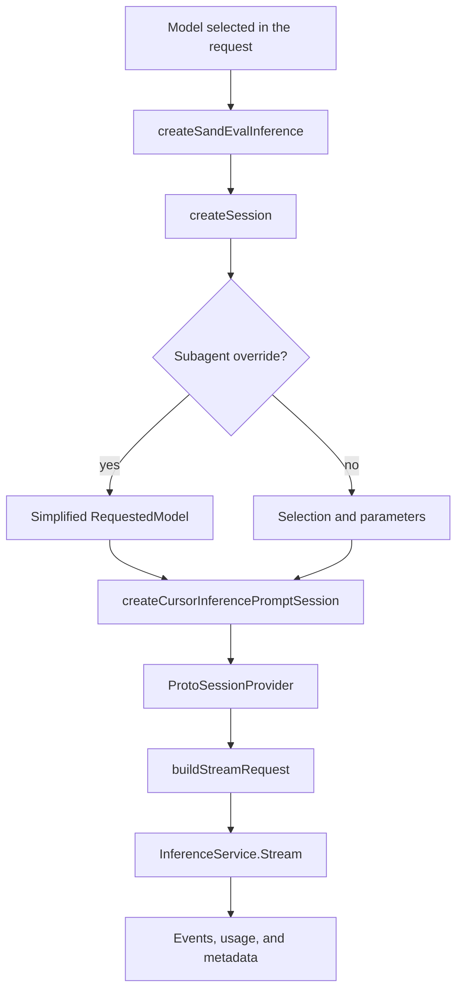

# Inference: session, model, stream, and external boundary

[English](README.en.md) · [Português (Brasil)](README.md)

## What was recovered with a concrete connection

The most complete inference path in this snapshot is in `sand-eval-runner.cjs`: `main` creates `createSandEvalInference`, which provides `createSession`; the `createCursorInferencePromptSession` factory assembles an `InferenceService` client, a protobuf session provider, and image middleware. The executor calls `client.stream` with context, tools, model, and a cancellation signal. Sources: [sand-eval-runner.cjs:630752–630792](../../../reference/runtime/sand-eval-runner.cjs#L630752-L630792), [sand-eval-runner.cjs:597538–597577](../../../reference/runtime/sand-eval-runner.cjs#L597538-L597577), [sand-eval-runner.cjs:494620–494721](../../../reference/runtime/sand-eval-runner.cjs#L494620-L494721).

In `host-main.cjs`, the extension named `inference` provides only audio transcription and voice preview. It does not inject a provider for the main turn. Source: [host-main.cjs:682062–682074](../../../reference/runtime/host-main.cjs#L682062-L682074).

## Flow



## Functions and contracts

### `createSandRequestedModelFromSelection(selection)`

Builds `RequestedModel` with `modelId`, `maxMode`, and a list of `{id, value}` parameters. The code alone does not identify which model the backend will serve; requested and served are different concepts. Source: [sand-eval-runner.cjs:597500–597514](../../../reference/runtime/sand-eval-runner.cjs#L597500-L597514).

### `createSandSubagentRequestedModel(modelId)`

Builds an override with the model ID and `maxMode: false`. `createSandEvalInference.createSession` uses this path when `sessionOptions.modelId` exists and differs from the main model; otherwise, it retains the main selection. Sources: [sand-eval-runner.cjs:597515–597517](../../../reference/runtime/sand-eval-runner.cjs#L597515-L597517), [sand-eval-runner.cjs:597549–597577](../../../reference/runtime/sand-eval-runner.cjs#L597549-L597577).

### `createSandEvalInference(options)`

Exposes three ports: resolving privacy, obtaining media URLs, and creating sessions. The session receives auth/team/machine getters, the requested model, optional config, inference reason, request-ID callback, and lineage. The evaluation code calls this factory explicitly. Source: [sand-eval-runner.cjs:597549–597577](../../../reference/runtime/sand-eval-runner.cjs#L597549-L597577). [README](../../functions/createSandEvalInference/README.en.md).

### `createCursorInferencePromptSession(options)`

Creates a Connect client for `InferenceService`; delegates to `createProtoSessionProvider(client, requestedModel, modelConfig, inferenceReason)`; and calls `getSession(imageResizingWithContentHashMiddleware)`. This is not an HTTP API compatible with any server simply by changing a URL: the observed contracts use protobuf/Connect and include multiple dependencies. Source: [sand-eval-runner.cjs:597538–597547](../../../reference/runtime/sand-eval-runner.cjs#L597538-L597547). [README](../../functions/createCursorInferencePromptSession/README.en.md).

### Building and sending a stream

`buildStreamRequest` includes messages, tools, provider-defined tools, model/config, invocation, conversation/group, automation, origin, routing reason, parent/root request, parent tool call, subagent type, turn unit, compaction, summary, and simulated-message markers. Headers carry the request ID and trace when present. `client.stream` receives `ctx.signal`. Source: [sand-eval-runner.cjs:494620–494671](../../../reference/runtime/sand-eval-runner.cjs#L494620-L494671).

This metadata supports correlation and policy in the remote service. Its presence does not recover the internal routing algorithm, weights, backend prompts, or final model provider.

### `createFullStream` and asynchronous outputs

The executor returns `fullStream` and separate Promises for `usage`, `extendedUsage`, `providerMetadata`, `invocationId`, and `response`. The Promises have preventive handling for unconsumed rejections. The run shell observes the served model and accounts for usage through wrappers before executing the agent. Sources: [sand-eval-runner.cjs:494671–494725](../../../reference/runtime/sand-eval-runner.cjs#L494671-L494725), [sand-eval-runner.cjs:592061–592096](../../../reference/runtime/sand-eval-runner.cjs#L592061-L592096).

### Summarization session

The run shell can choose an external summarization model or use `SAND_SUMMARIZATION_MODEL_ID`. This session is separate from the main session and receives the `isSummarizationSession` flag. The code does not justify concluding that the same model always handles conversation and compaction. Source: [sand-eval-runner.cjs:592096–592125](../../../reference/runtime/sand-eval-runner.cjs#L592096-L592125).

### `createSandAttachedMediaUrlProvider`

Uses `AgentService.GetSignedUrlForAttachedMedia` with conversation, key, MIME, and optional length. Returns the key, URLs, and validity/refresh information. This is an inference media dependency, not public persistent storage. Source: [sand-eval-runner.cjs:597518–597537](../../../reference/runtime/sand-eval-runner.cjs#L597518-L597537).

### Audio in the host

`createSandTranscribeAudio` normalizes MIME and language, calls `AiService.TranscribeAudio` with a **60-second** deadline, and returns text/time. `createSandVoicePreview` calls `TextToSpeech` for a predefined greeting, with a **20-second** deadline, and returns base64 audio/MIME. Source: [host-main.cjs:681987–682074](../../../reference/runtime/host-main.cjs#L681987-L682074).

## Retries and limits

The bundle defines stream tuning, including headless and overload attempts and a time limit. The evaluation runner has its own defaults in `SAND_EVAL_STREAM_TUNING`; host defaults should therefore not be applied blindly to an evaluation. The run shell injects policies and callbacks into `createStreamAttempt`, documented in [recovery](../cancellation-recovery/README.en.md). Sources: [sand-eval-runner.cjs:228092–228107](../../../reference/runtime/sand-eval-runner.cjs#L228092-L228107), [sand-eval-runner.cjs:597010–597070](../../../reference/runtime/sand-eval-runner.cjs#L597010-L597070), [sand-eval-runner.cjs:592292–592377](../../../reference/runtime/sand-eval-runner.cjs#L592292-L592377).

## Specific gaps

- The client stub does not reveal the implementation of `InferenceService.Stream`.
- This analysis contains no proof of operation with Ollama, OpenRouter, or another provider.
- No inference request was made, and no credentials from the original program were recovered or reused.
- The recovered evaluation path has not been presented as the bootstrap for the production Temporal turn.

## Verification

```bash
rg -n 'createSandEvalInference|createCursorInferencePromptSession|this.client.stream|createProtoSessionProvider' reference/runtime/sand-eval-runner.cjs
sed -n '682062,682074p' reference/runtime/host-main.cjs
```
