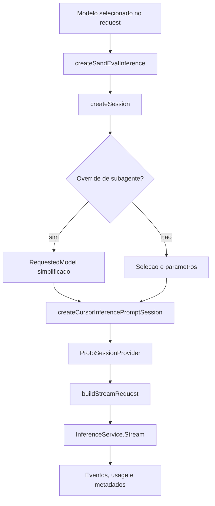

# Inferência: sessão, modelo, stream e fronteira externa

## O que foi recuperado com ligação concreta

O caminho de inferência mais completo deste snapshot está em `sand-eval-runner.cjs`: `main` cria `createSandEvalInference`, que fornece `createSession`; a fábrica `createCursorInferencePromptSession` monta um cliente de `InferenceService`, um provider de sessão protobuf e middleware de imagens. O executor chama `client.stream` com contexto, tools, modelo e sinal de cancelamento. Fontes: [sand-eval-runner.cjs:630752–630792](../../../reference/runtime/sand-eval-runner.cjs#L630752-L630792), [sand-eval-runner.cjs:597538–597577](../../../reference/runtime/sand-eval-runner.cjs#L597538-L597577), [sand-eval-runner.cjs:494620–494721](../../../reference/runtime/sand-eval-runner.cjs#L494620-L494721).

No `host-main.cjs`, a extensão de nome `inference` apenas disponibiliza transcrição de áudio e preview de voz. Ela não injeta um provider do turno principal. Fonte: [host-main.cjs:682062–682074](../../../reference/runtime/host-main.cjs#L682062-L682074).

## Fluxo



## Funções e contratos

### `createSandRequestedModelFromSelection(selection)`

Constrói `RequestedModel` com `modelId`, `maxMode` e uma lista de parâmetros `{id, value}`. O código não identifica por si só qual modelo será servido pelo backend; solicitado e servido são noções diferentes. Fonte: [sand-eval-runner.cjs:597500–597514](../../../reference/runtime/sand-eval-runner.cjs#L597500-L597514).

### `createSandSubagentRequestedModel(modelId)`

Constrói override com o ID do modelo e `maxMode: false`. `createSandEvalInference.createSession` usa esse caminho quando o `sessionOptions.modelId` existe e difere do modelo principal; do contrário conserva a seleção principal. Fonte: [sand-eval-runner.cjs:597515–597517](../../../reference/runtime/sand-eval-runner.cjs#L597515-L597517), [sand-eval-runner.cjs:597549–597577](../../../reference/runtime/sand-eval-runner.cjs#L597549-L597577).

### `createSandEvalInference(options)`

Expõe três portas: resolver privacidade, obter URLs de mídia e criar sessões. A sessão recebe getters de auth/team/machine, modelo solicitado, config opcional, motivo de inferência, callback de request ID e linhagem. O código do eval chama essa fábrica explicitamente. Fonte: [sand-eval-runner.cjs:597549–597577](../../../reference/runtime/sand-eval-runner.cjs#L597549-L597577). [README](../../functions/createSandEvalInference/README.md).

### `createCursorInferencePromptSession(options)`

Cria cliente Connect de `InferenceService`; delega a `createProtoSessionProvider(client, requestedModel, modelConfig, inferenceReason)`; chama `getSession(imageResizingWithContentHashMiddleware)`. Não é uma API HTTP compatível com qualquer servidor apenas por mudar uma URL: os contratos observados são protobuf/Connect e incluem múltiplas dependências. Fonte: [sand-eval-runner.cjs:597538–597547](../../../reference/runtime/sand-eval-runner.cjs#L597538-L597547). [README](../../functions/createCursorInferencePromptSession/README.md).

### Construção e envio de stream

`buildStreamRequest` inclui mensagens, ferramentas, provider-defined tools, modelo/config, invocation, conversation/group, automação, origem, motivo de roteamento, request pai/raiz, tool call do pai, tipo de subagente, turn unit, compactação, resumo e marcações de mensagem simulada. Headers levam request ID e trace quando presentes. `client.stream` recebe `ctx.signal`. Fonte: [sand-eval-runner.cjs:494620–494671](../../../reference/runtime/sand-eval-runner.cjs#L494620-L494671).

Esses metadados permitem correlação e política no serviço remoto. Sua presença não recupera o algoritmo interno de roteamento, pesos, prompts de backend ou fornecedor final do modelo.

### `createFullStream` e saídas assíncronas

O executor devolve `fullStream` e Promises separadas de `usage`, `extendedUsage`, `providerMetadata`, `invocationId` e `response`. As Promises têm tratamento preventivo de rejeição não consumida. A run shell observa o modelo servido e contabiliza uso através de wrappers antes de executar o agente. Fontes: [sand-eval-runner.cjs:494671–494725](../../../reference/runtime/sand-eval-runner.cjs#L494671-L494725), [sand-eval-runner.cjs:592061–592096](../../../reference/runtime/sand-eval-runner.cjs#L592061-L592096).

### Sessão de sumarização

A run shell pode escolher um modelo externo de sumarização ou usar `SAND_SUMMARIZATION_MODEL_ID`. Essa sessão é separada da principal e recebe flag `isSummarizationSession`. O código não autoriza deduzir que o mesmo modelo sempre faz conversa e compactação. Fonte: [sand-eval-runner.cjs:592096–592125](../../../reference/runtime/sand-eval-runner.cjs#L592096-L592125).

### `createSandAttachedMediaUrlProvider`

Usa `AgentService.GetSignedUrlForAttachedMedia` com conversation, key, MIME e comprimento opcional. Retorna chave, URLs e validade/refresh. É uma dependência de mídia da inferência, não armazenamento persistente público. Fonte: [sand-eval-runner.cjs:597518–597537](../../../reference/runtime/sand-eval-runner.cjs#L597518-L597537).

### Áudio no host

`createSandTranscribeAudio` normaliza MIME e língua, chama `AiService.TranscribeAudio` com deadline de **60 segundos** e retorna texto/tempo. `createSandVoicePreview` chama `TextToSpeech` para uma saudação pré-definida, com deadline de **20 segundos**, e retorna áudio base64/MIME. Fonte: [host-main.cjs:681987–682074](../../../reference/runtime/host-main.cjs#L681987-L682074).

## Retries e limites

O bundle define tuning de stream, incluindo tentativas headless e overload e limite de tempo. O eval tem defaults próprios em `SAND_EVAL_STREAM_TUNING`; por isso não aplicar cegamente defaults do host a uma avaliação. A run shell injeta políticas e callbacks no `createStreamAttempt`, documentado em [recuperação](../cancellation-recovery/README.md). Fontes: [sand-eval-runner.cjs:228092–228107](../../../reference/runtime/sand-eval-runner.cjs#L228092-L228107), [sand-eval-runner.cjs:597010–597070](../../../reference/runtime/sand-eval-runner.cjs#L597010-L597070), [sand-eval-runner.cjs:592292–592377](../../../reference/runtime/sand-eval-runner.cjs#L592292-L592377).

## Lacunas precisas

- A implementação do serviço `InferenceService.Stream` não está demonstrada por seu stub cliente.
- Não há prova, nesta análise, de funcionamento com Ollama, OpenRouter ou outro provider.
- Não foi feito request de inferência, nem recuperadas/reutilizadas credenciais do programa original.
- O caminho de avaliação recuperado não foi apresentado como bootstrap do turno Temporal de produção.

## Conferência

```bash
rg -n 'createSandEvalInference|createCursorInferencePromptSession|this.client.stream|createProtoSessionProvider' reference/runtime/sand-eval-runner.cjs
sed -n '682062,682074p' reference/runtime/host-main.cjs
```
