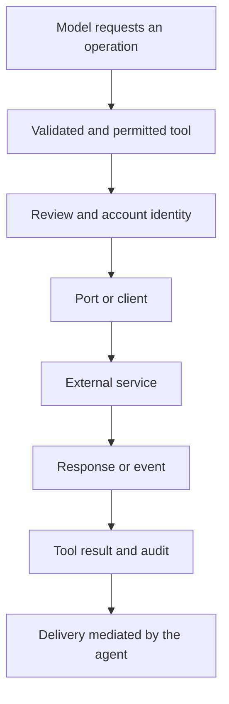

# Integrations: ports, MCP, external agents, and communication

[English](README.en.md) · [Português (Brasil)](README.md)

[Index](../../README.en.md) · [Tools](../tools/README.en.md) · [Approvals](../approvals/README.en.md)

## Recovered model

The harness receives dependencies through ports: tasks, memory, MCP, browser, email, meetings, bots, files, and cloud agents. A builder assembles tools only when the port exists and policy permits it. This separates local orchestration from the remote service's implementation. The bundle preserves clients, schemas, and adapters; it does not automatically contain each provider's backend. [MCP builder](../../../reference/runtime/host-main.cjs#L780714-L780769), [conversation builders](../../../reference/runtime/host-main.cjs#L768995-L769085).

## MCP and plugins

The `mcpManagementTools` builder covers adding a server, authenticating, inspecting status/plugins, installing/removing a plugin, removing/renaming an account, restarting servers, searching for plugins, and saving instructions. If `host.mcpManagement` is null, it returns an empty list. The factory receives the conversation ID, card emitter, tasks, gates, account/team bot, and review context. [Source](../../../reference/runtime/host-main.cjs#L780714-L780769).

| Layer | Visible contract |
| --- | --- |
| Discovery | `GetMcpTools`/`GetDynamicTools`, depending on the namespace |
| Invocation | `CallMcpTool`/`CallDynamicTool` |
| Lifecycle | Management tools operating through the host port |
| Accounts | Explicit identifiers and labels per account |
| Authorization | Agent policy, action review, and authentication state |
| Context | MCP instructions enter a prompt section, which may be frozen |

The name pairs appear in [mcp-meta-tool-names](../../../reference/runtime/host-main.cjs#L740843-L740851); prompt composition appears in [system-prompt-assembly](../../../reference/runtime/sand-eval-runner.cjs#L553641-L553701).

The supplied context includes a removal-intent guard and private-tailnet review. This demonstrates specific handling of lifecycle operations; it is not evidence that every remote endpoint uses the same guard. A recovered tool list also does not prove that an account is connected.

## Internal agents versus cloud agents

`SendToAgent` sends to a persistent bot by ID; `Task`/`Subagent` creates delegated execution; `CloudAgent` refers to the client for executing repository work. Global cancellation attempts to reach each category through the available ports and reports unavailability. Do not share IDs or return semantics between them without a contract. [Inter-agent messages](../../../reference/runtime/host-main.cjs#L757386-L757434), [delegated cancellation](../../../reference/runtime/host-main.cjs#L780933-L781063).

## Communication: intention, sending, and delivery

`createSendToAgentTool` binds `recordDelivery`, catches port errors, and records the delivery result when the return value is structured. `ack` is the text provided by the port. A legacy string return is returned directly. Consequently, “the tool executed,” “the port accepted,” “the message was delivered,” and “the recipient replied” are not interchangeable. [Source](../../../reference/runtime/host-main.cjs#L757386-L757434).

`SendToUser` is assembled with the host's update emitters and can include a destination, ack token, and toolCallId. The implementation checks transport blocks, task threads, and other conditions before publishing. Automation has additional restrictions and uses `WakeParent` for mediated delivery. [Builder](../../../reference/runtime/host-main.cjs#L769034-L769085), [automation transport](../../../reference/runtime/host-main.cjs#L782170-L782172).



## Meetings as an example of a specialized contract

The `meetingRequest` agent prompt distinguishes assistant text from a message actually posted. `RespondInMeeting` queues the send; the review/posting result arrives later. The agent can request work from its parent, and new messages can interrupt the turn while retaining the history. These textual contracts have their own wrappers and ports; they should not be used as proof of the conferencing service's implementation. [Prompt and wake messages](../../../reference/runtime/host-main.cjs#L754002-L754113).

## What the available artifacts support and what remains open

They allow identification of schemas, names, assembly conditions, result handling, and dependencies. Additional sources are still required for remote authentication, data retention, delivery guarantees, quotas, and each service's internal logic. An account's current capabilities can only be verified through authorized execution, which was not part of this static mapping.

```bash
rg -n 'mcpManagementTools|function createSendToAgentTool|var MeetingRequestPrompt|AUTOMATION_SUBAGENT_VISIBLE_TRANSCRIPT_BLOCKED' reference/runtime/host-main.cjs
```
