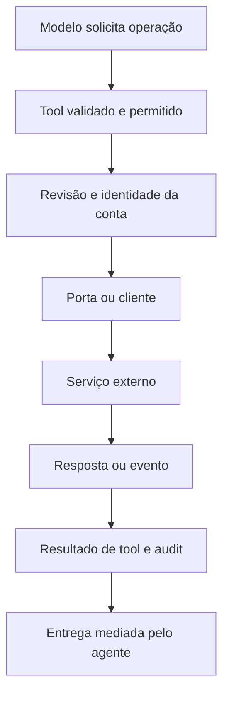

# Integrações: portas, MCP, agentes externos e comunicação

[Índice](../../README.md) · [Ferramentas](../tools/README.md) · [Aprovações](../approvals/README.md)

## Modelo recuperado

O harness recebe dependências por portas: tarefas, memória, MCP, browser, email, reuniões, bots, arquivos e cloud agents. Um builder monta ferramentas somente quando a porta existe e a política permite. Isso separa o orchestration local da implementação do serviço remoto. O bundle preserva clientes, schemas e adapters; não contém automaticamente o backend de cada fornecedor. [Builder MCP](../../../reference/runtime/host-main.cjs#L780714-L780769), [builders de conversa](../../../reference/runtime/host-main.cjs#L768995-L769085).

## MCP e plugins

O builder `mcpManagementTools` cobre adicionar servidor, autenticar, inspecionar status/plugin, instalar/remover plugin, remover/renomear conta, reiniciar servidores, buscar plugins e salvar instruções. Se `host.mcpManagement` é nulo, retorna lista vazia. A factory recebe conversation ID, emissor de card, tasks, gates, conta/team bot e contexto de revisão. [Fonte](../../../reference/runtime/host-main.cjs#L780714-L780769).

| Camada | Contrato visível |
| --- | --- |
| Descoberta | `GetMcpTools`/`GetDynamicTools`, dependendo do namespace |
| Invocação | `CallMcpTool`/`CallDynamicTool` |
| Lifecycle | Ferramentas de management sobre a porta do host |
| Contas | Identificadores e labels explícitos por conta |
| Autorização | Política de agente, revisão da ação e estado de autenticação |
| Contexto | Instruções MCP entram em seção do prompt, possivelmente congelada |

Os pares de nomes estão em [mcp-meta-tool-names](../../../reference/runtime/host-main.cjs#L740843-L740851); composição do prompt em [system-prompt-assembly](../../../reference/runtime/sand-eval-runner.cjs#L553641-L553701).

O contexto passado inclui um guard de intenção de remoção e revisão de private tailnet. Isso demonstra preocupação específica com operações de lifecycle; não é evidência de que todo endpoint remoto usa o mesmo guard. Uma lista de ferramenta recuperada também não comprova uma conta conectada.

## Agentes internos versus cloud agents

`SendToAgent` envia a um bot persistente por ID; `Task`/`Subagent` cria execução delegada; `CloudAgent` se refere ao cliente de execução de trabalho em repositório. Cancelamento global tenta atingir cada categoria pelas portas disponíveis e informa indisponibilidade. Não compartilhar IDs ou semântica de retorno entre elas sem contrato. [Mensagens entre agentes](../../../reference/runtime/host-main.cjs#L757386-L757434), [cancelamento delegado](../../../reference/runtime/host-main.cjs#L780933-L781063).

## Comunicação: intenção, envio e entrega

`createSendToAgentTool` vincula `recordDelivery`, captura erro da porta e registra o resultado de entrega quando o retorno é estruturado. `ack` é o texto que a porta fornece. Um retorno antigo em string é devolvido diretamente. Portanto, “tool executou”, “porta aceitou”, “mensagem entregue” e “destinatário respondeu” não são intercambiáveis. [Fonte](../../../reference/runtime/host-main.cjs#L757386-L757434).

`SendToUser` é montada com emissores de atualização do host e pode conter destino, ack token e toolCallId. A implementação verifica bloqueios de transporte, thread de task e outras condições antes da publicação. A automação possui restrições adicionais e usa `WakeParent` para entrega mediada. [Builder](../../../reference/runtime/host-main.cjs#L769034-L769085), [transporte de automação](../../../reference/runtime/host-main.cjs#L782170-L782172).



## Reuniões como exemplo de contrato especializado

O prompt do agente `meetingRequest` distingue texto de assistant de uma mensagem efetivamente postada. `RespondInMeeting` enfileira o envio; resultado de revisão/postagem chega depois. O agente pode pedir trabalho ao parent, e mensagens novas podem interromper o turno mantendo o histórico. Esses contratos textuais têm wrappers e portas próprios; não devem ser usados como prova da implementação do serviço de conferência. [Prompt e mensagens de wake](../../../reference/runtime/host-main.cjs#L754002-L754113).

## O que esta extração permite e o que fica aberto

Permite identificar schemas, nomes, condições de montagem, tratamento de resultados e dependências. Ainda exige fonte adicional para autenticação remota, retenção de dados, garantias de entrega, quotas e lógica interna de cada serviço. As capacidades atuais de uma conta só podem ser verificadas em execução autorizada, que não fez parte deste mapeamento estático.

```bash
rg -n 'mcpManagementTools|function createSendToAgentTool|var MeetingRequestPrompt|AUTOMATION_SUBAGENT_VISIBLE_TRANSCRIPT_BLOCKED' reference/runtime/host-main.cjs
```
