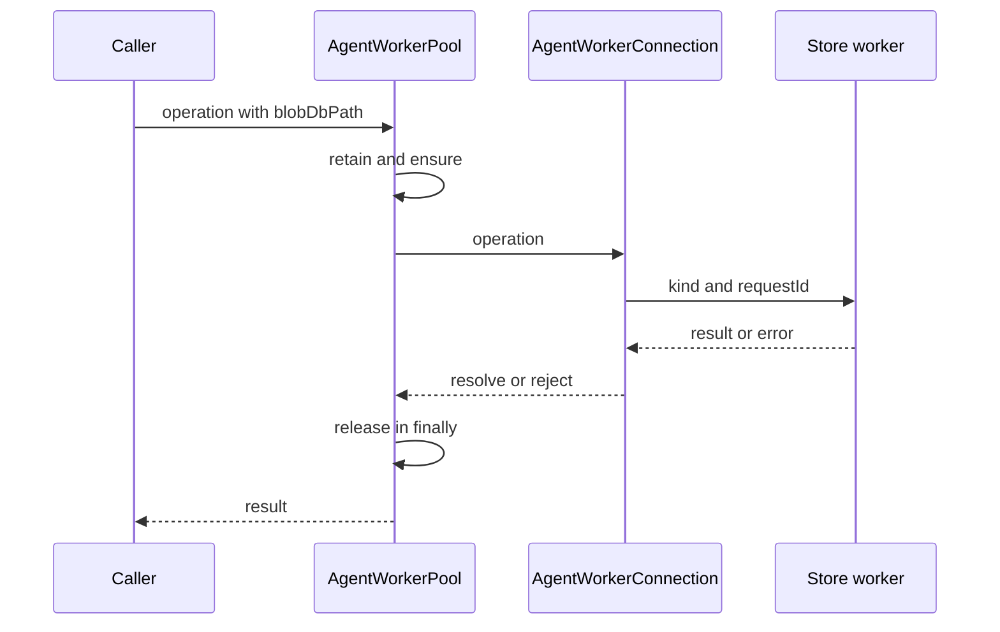

# Storage workers and isolation boundaries

[English](README.en.md) · [Português (Brasil)](README.md)

## What is actually isolated here

`AgentWorkerPool` uses `node:worker_threads.Worker` to perform blob storage outside the main thread. The reuse key is `blobDbPath`. The worker receives boot data and handles messages carrying a `requestId`. This mechanism does not prove the existence of a VM, container, or permissions sandbox per agent. Source: [host-main.cjs:715085–715345](../../../reference/runtime/host-main.cjs#L715085-L715345).

The name `agent-isolation` must be interpreted through the code: thread separation and store operations. Model and tool execution have their own composition, described in [turns](../turns/README.en.md).

## Protocol



## Functions

### `defaultWorkerEntryPath2`

Resolves the bundle directory and appends `agent-isolation/agent-store-worker.cjs`. This identifies a worker file, not the `SandAgentRunner` entry point. Source: [host-main.cjs:715123–715128](../../../reference/runtime/host-main.cjs#L715123-L715128).

### `AgentWorkerConnection.constructor`

Creates a `Worker` with `workerData`, captures stdout/stderr, and installs message, error, and exit handlers. A `walk-export-closure-progress` progress message calls `onProgress` without completing the Promise; other messages remove the pending request and resolve/reject it. Source: [host-main.cjs:715136–715166](../../../reference/runtime/host-main.cjs#L715136-L715166).

### `send(build, transfer, onProgress)`

Rejects a dead connection. Increments `nextRequestId`, builds the message, registers callbacks in the map, updates activity, and calls `postMessage`. The `transfer` array is passed to the worker when supplied. Responses without a pending request are ignored. Source: [host-main.cjs:715183–715208](../../../reference/runtime/host-main.cjs#L715183-L715208).

### `die(error)` and `close()`

`die` is idempotent: it marks the connection dead, rejects pending requests, clears the map, and notifies the pool. `close` attempts the close message and then terminates the thread. An error during protocol-level closing does not prevent termination. Sources: [host-main.cjs:715174–715183](../../../reference/runtime/host-main.cjs#L715174-L715183), [host-main.cjs:715284–715293](../../../reference/runtime/host-main.cjs#L715284-L715293).

### Blob operations

The connection exposes `init`, `setBlob`, `getBlob`, `findLatestRootBlobId`, `clearBlobs`, `clearStaleCheckpointRoots`, `collectGarbage`, `walkExportClosure`, and `getBlobsByHexIds`. `walkExportClosure` transports byte and blob-count limits and supports incremental progress. Source: [host-main.cjs:715216–715284](../../../reference/runtime/host-main.cjs#L715216-L715284).

### `AgentWorkerPool.ensure`

Reuses an existing connection by DB key; if none exists, it attempts to free capacity, prepares boot data, installs a connection in the map, starts the sweep, and awaits `init`. The exit callback removes the connection only if it is still the one registered, avoiding removal of a replacement. Source: [host-main.cjs:715295–715345](../../../reference/runtime/host-main.cjs#L715295-L715345). [README](../../functions/AgentWorkerPool-ensure/README.en.md).

### `retain`, `release`, eviction, and sweep

Public operations increase the activity count before `ensure` and always decrease it in `finally`. Eviction avoids retained paths. The sweep code uses activity and an idle timeout; the configured defaults are **64 workers**, **5 minutes** of idle time, **30 seconds** between sweeps, and a **5-second** DB busy timeout. Sources: [host-main.cjs:715295–715313](../../../reference/runtime/host-main.cjs#L715295-L715313), [host-main.cjs:715346–715530](../../../reference/runtime/host-main.cjs#L715346-L715530).

These numbers are compiled local settings. `maxWorkers` participates in the eviction policy; do not assert a hard limit without considering what happens when every connection is retained.

### `forwardStream`

Groups stdout/stderr by line, strips a trailing CR, limits each forwarded line to a cap defined as 8 KiB, and flushes large partial buffers. The constant's name refers to bytes, but truncation uses JavaScript string length and `slice`; this detail matters for Unicode. Source: [host-main.cjs:715090–715121](../../../reference/runtime/host-main.cjs#L715090-L715121).

## Confirmed worker side

The [worker entry point](../../../reference/runtime/workers/state/agent-store-worker.cjs#L22661-L22808) requires `parentPort`, reads `workerData`, and opens `ConversationBlobStoreDb` before installing the listener. An opening failure reports the code and exits with code 1. In the message switch, `init` returns thread/PID; operations call the store synchronously inside the handler; `get-blob` copies bytes into a `Uint8Array` before transferring the buffer; `close` closes the DB, responds, and closes the port. Operation exceptions become a `kind: error` response with the same `requestId`, name, and code when available.

The storage protocol is visible on both sides. This is not an inference based solely on the filename. The original worker also remains preserved and was not executed in this analysis.

## Failures and actual guarantees

| Situation | Identified behavior |
| --- | --- |
| Worker dies | Rejects pending requests and removes the corresponding connection. |
| Duplicate/late response | Ignored when no request is pending. |
| Worker error | Reconstructs an Error with message, name, and code. |
| Pool operation fails | `finally` releases the retention. |
| Progress message | Does not resolve the main Promise. |

Sources: [host-main.cjs:715129–715208](../../../reference/runtime/host-main.cjs#L715129-L715208), [host-main.cjs:715346–715442](../../../reference/runtime/host-main.cjs#L715346-L715442).

## Security boundary and scope

Filesystem, network, or credential restrictions per worker thread have not been demonstrated. The observed separation moves storage work off the main thread and provides operation correlation. The box boundary, process control, and tool policies must be analyzed as a separate component, rather than inferred from the directory name.

## Verification

```bash
rg -n 'AgentWorkerConnection|AgentWorkerPool|DEFAULT_MAX_WORKERS|walk-export-closure-progress' reference/runtime/host-main.cjs
sed -n '715123,715345p' reference/runtime/host-main.cjs
```
