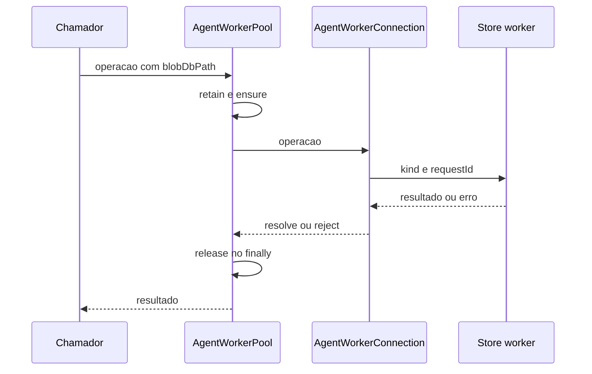

# Workers de armazenamento e limites de isolamento

## O que realmente é isolado aqui

`AgentWorkerPool` usa `node:worker_threads.Worker` para executar o armazenamento de blobs fora da thread principal. A chave de reaproveitamento é `blobDbPath`. O worker recebe dados de boot e atende mensagens com `requestId`. Esse mecanismo não prova uma VM, container ou sandbox de permissões por agente. Fonte: [host-main.cjs:715085–715345](../../../reference/runtime/host-main.cjs#L715085-L715345).

O nome `agent-isolation` precisa ser interpretado pelo código: separação de thread e operações de store. A execução do modelo e de ferramentas tem composição própria em [turnos](../turns/README.md).

## Protocolo



## Funções

### `defaultWorkerEntryPath2`

Resolve o diretório do bundle e concatena `agent-isolation/agent-store-worker.cjs`. A identidade é um arquivo de worker, não o entrypoint do `SandAgentRunner`. Fonte: [host-main.cjs:715123–715128](../../../reference/runtime/host-main.cjs#L715123-L715128).

### `AgentWorkerConnection.constructor`

Cria `Worker` com `workerData`, captura stdout/stderr, instala handlers de mensagem, erro e saída. Uma mensagem de progresso `walk-export-closure-progress` chama `onProgress` sem finalizar a Promise; as demais removem o pendente e resolvem/rejeitam. Fonte: [host-main.cjs:715136–715166](../../../reference/runtime/host-main.cjs#L715136-L715166).

### `send(build, transfer, onProgress)`

Recusa conexão morta. Incrementa `nextRequestId`, constrói a mensagem, registra callbacks no mapa, atualiza atividade e chama `postMessage`. O array `transfer` é entregue ao worker quando fornecido. Respostas sem request pendente são ignoradas. Fonte: [host-main.cjs:715183–715208](../../../reference/runtime/host-main.cjs#L715183-L715208).

### `die(error)` e `close()`

`die` é idempotente: marca morte, rejeita pendentes, limpa mapa e notifica pool. `close` tenta a mensagem de fechamento e depois termina a thread. Erro no fechamento protocolar não impede a terminação. Fontes: [host-main.cjs:715174–715183](../../../reference/runtime/host-main.cjs#L715174-L715183), [host-main.cjs:715284–715293](../../../reference/runtime/host-main.cjs#L715284-L715293).

### Operações de blob

A conexão expõe `init`, `setBlob`, `getBlob`, `findLatestRootBlobId`, `clearBlobs`, `clearStaleCheckpointRoots`, `collectGarbage`, `walkExportClosure` e `getBlobsByHexIds`. `walkExportClosure` transporta limites de bytes e quantidade de blobs e admite progresso incremental. Fonte: [host-main.cjs:715216–715284](../../../reference/runtime/host-main.cjs#L715216-L715284).

### `AgentWorkerPool.ensure`

Reaproveita conexão existente pela chave de DB; caso ausente, tenta liberar capacidade, prepara boot, instala conexão no mapa, inicia sweep e aguarda `init`. A callback de saída remove a conexão apenas se ainda for a mesma registrada, evitando apagar uma substituta. Fonte: [host-main.cjs:715295–715345](../../../reference/runtime/host-main.cjs#L715295-L715345). [README](../../functions/AgentWorkerPool-ensure/README.md).

### `retain`, `release`, eviction e sweep

As operações públicas aumentam contagem de atividade antes de `ensure` e sempre reduzem no `finally`. Eviction evita caminhos retidos. O código de sweep usa atividade e timeout de ociosidade; os defaults configurados são **64 workers**, **5 minutos** de idle, **30 segundos** entre sweeps e **5 segundos** de busy timeout do DB. Fontes: [host-main.cjs:715295–715313](../../../reference/runtime/host-main.cjs#L715295-L715313), [host-main.cjs:715346–715530](../../../reference/runtime/host-main.cjs#L715346-L715530).

Esses números são configurações locais compiladas. `maxWorkers` participa da política de eviction; não afirmar um limite rígido sem considerar o comportamento quando todas as conexões estão retidas.

### `forwardStream`

Agrupa stdout/stderr por linha, retira CR final, limita cada linha encaminhada a um teto definido como 8 KiB e descarrega buffers parciais grandes. O nome da constante fala em bytes, mas o corte usa comprimento de string JavaScript e `slice`; esse detalhe importa para Unicode. Fonte: [host-main.cjs:715090–715121](../../../reference/runtime/host-main.cjs#L715090-L715121).

## Lado do worker confirmado

O [entrypoint do worker](../../../reference/runtime/workers/state/agent-store-worker.cjs#L22661-L22808) exige `parentPort`, lê `workerData` e abre `ConversationBlobStoreDb` antes de instalar o listener. Falha na abertura relata o código e encerra com saída 1. No switch de mensagens, `init` retorna thread/PID; operações chamam o store de modo síncrono dentro do handler; `get-blob` copia bytes para um `Uint8Array` antes de transferir o buffer; `close` fecha DB, responde e fecha a porta. Exceções de operação viram resposta `kind: error` com o mesmo `requestId`, nome e código quando disponíveis.

O protocolo de storage aparece dos dois lados. Não é uma inferência baseada apenas no nome do arquivo. O worker original também permanece preservado e não foi executado nesta análise.

## Falhas e garantias reais

| Situação | Comportamento identificado |
| --- | --- |
| Worker morre | Rejeita requests pendentes e remove a conexão correspondente. |
| Resposta duplicada/tardia | Sem request pendente, é ignorada. |
| Erro do worker | Reconstrói Error com message, name e code. |
| Operação de pool falha | `finally` libera a retenção. |
| Mensagem de progresso | Não resolve a Promise principal. |

Fonte: [host-main.cjs:715129–715208](../../../reference/runtime/host-main.cjs#L715129-L715208), [host-main.cjs:715346–715442](../../../reference/runtime/host-main.cjs#L715346-L715442).

## Fronteira de segurança e escopo

Não foi demonstrada restrição de filesystem, rede ou credenciais por worker thread. A separação observada retira trabalho de armazenamento da thread principal e fornece correlação de operações. A fronteira da box, controle de processos e políticas de ferramentas precisa ser analisada como outro componente, não inferida do nome da pasta.

## Conferência

```bash
rg -n 'AgentWorkerConnection|AgentWorkerPool|DEFAULT_MAX_WORKERS|walk-export-closure-progress' reference/runtime/host-main.cjs
sed -n '715123,715345p' reference/runtime/host-main.cjs
```
