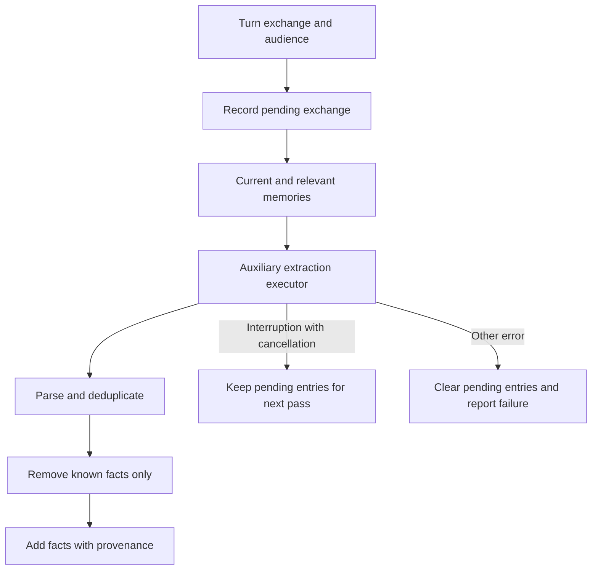

# Memory: storage, search, extraction, and Dream

[English](README.en.md) · [Português (Brasil)](README.md)

[Index](../../README.en.md) · [Prompts](../prompts/README.en.md) · [Proactivity](../proactivity/README.en.md)

## What the code shows

There are three different mechanisms: the explicit `UpdateMemory` tool, an auxiliary extraction pass at the end of a turn, and a special `dream` subagent type. Durable memory has scopes and formats; recall is not simply resending the entire history. None of these mechanisms, in isolation, establishes an algorithm for selecting spontaneous opportunities.

Sources: [types and format in the host](../../../reference/runtime/host-main.cjs#L702523-L702843), [extraction in eval](../../../reference/runtime/sand-eval-runner.cjs#L536087-L536386), [post-turn pass](../../../reference/runtime/sand-eval-runner.cjs#L590582-L590674).

## Types, owners, and surfaces

| Type | Owner | Format | Surface | Listed default |
| --- | --- | --- | --- | --- |
| `profile` | Bot | `v1_shard` | Always in context | Yes; enables per-turn extraction |
| `journal` | Bot | `v1_shard` | Always in context, subject to truncation | Yes |
| `shared_profile` | User | `v1_shard` | Shared between assistants | Yes |
| `shared_journal` | User | `v1_shard` | Shared between assistants | Yes |
| `notes` | Bot | `v2_jsonl` | Always in context | Not part of the default array |

`parseMemoryTypes` requires lower_snake_case names, valid path fields, and mandatory metadata for placeholders; it rejects duplicates. `enabledMemoryTypes()` filters definitions using the supplied array, defaulting to four types. The existence of `notes` and its `dreamPrompt` does not establish activation. [Types](../../../reference/runtime/host-main.cjs#L702530-L702639), [defaults](../../../reference/runtime/host-main.cjs#L753920-L753949).

## Physical and logical formats

In v1 format, `getAgentMemoryDir` uses the `memory` directory; the profile is in `profile.md`, and history in `log/`. A fact has a dated line and may have a provenance comment. `memoryIdFor` computes the SHA-1 of normalized text and uses the first 16 hexadecimal digits. This hash is a deduplication key, not source authentication. `normalizeMemoryContent` caps a fact at 500 characters; `memoryDedupeKey` converts normalized content to lowercase. [Format](../../../reference/runtime/host-main.cjs#L702640-L702842).

In JSONL format, the schema includes `id`, `type`, `text`, `meta`, `speaker`, `source`, and `created_at`. `parseMemoryJsonlFile` retains the raw line even when parsing fails; aggregation uses valid entries only. `memoryTypeFilePath` validates `meta` and converts dynamic fields into slugs capped at 64 characters. Visible paths use `/me/...` or `/bot/...`. [JSONL](../../../reference/runtime/host-main.cjs#L754592-L754714).

## Scopes and writes

`memoryTypeTarget` chooses `shardTarget` or `folderTarget`. The destination depends on the type's owner, the audience (`user`/`team`), the conversation type, and `userBotScope`. For files, user-owned memory cannot be saved as team memory. A conversation without an identified person may refuse private memory. `offeredMemoryTypes` removes user-owned types in team bots. [Destinations](../../../reference/runtime/host-main.cjs#L771533-L771605).

`createSandMemoryStateTool` validates the `write`/`forget` action, type, and fact; translates them into internal arguments; and calls `executeMemoryUpdate`. This calls `executeStateUpdate`, which checks for pending approval before applying the update. The fallback is narrow: a failure to forget a fact in agent scope, in a personal bot whose default is conversation, may try conversation scope. It is not an unrestricted fallback between users or teams. [Writes](../../../reference/runtime/host-main.cjs#L771606-L771736).

## Search and ranking

`collectMemoryCandidates` combines only stores supplied by dependencies: agent, user, user_bot, and files. The `/memories` mount offers list/read/search. `RecallMemory` uses `createWordOverlapSearch`, with distinctive-word overlap and a case-insensitive literal fallback only if ranking found nothing. The analyzed code does not use embeddings for this path. Default result count: 20 facts; maximum: 50; presentation budget: 4,000 characters. The first line may exceed the budget because stopping only occurs after an item has already been displayed. [Mount and tool](../../../reference/runtime/host-main.cjs#L769524-L769889), [search](../../../reference/runtime/sand-eval-runner.cjs#L559354-L559424).

Another helper, `memoryRecallRank`, computes:

\[
r(m)=\log_2 I(m)+\frac{t_m}{30\cdot24\cdot60\cdot60\cdot1000}
\]

`I` is 1.5 for the `[episode]` prefix, 0.5 for `[note]`, and 1 otherwise. Comparing this ranking is equivalent to comparing importance with exponential decay and a 30-day half-life at the same query instant; the current instant would be a common term. The helper does not delete a fact after 30 days and is not the ranking formula for the lexical `RecallMemory` path. [Helper](../../../reference/runtime/host-main.cjs#L702640-L702665).

## Extraction at the end of a turn

The recovered caller, `settleCompletedTurn`, only calls extraction when it has not been disabled, the run has not been superseded, a memory store exists, the turn is not hidden, the prompt is nonempty and considered memorable, the runner is not a subagent, and at least one enabled type has `perTurnExtraction:true`. `isMemorableExchange` ignores empty strings and a list of trivial replies; text longer than 40 characters or containing a question mark passes immediately. This prevents describing the pass as unconditional. [Call gate](../../../reference/runtime/sand-eval-runner.cjs#L591126-L591150), [filter](../../../reference/runtime/sand-eval-runner.cjs#L536107-L536151).



`runMemoryExtraction` stores pending exchanges per audience and adds earlier exchanges that have not yet been reviewed. `gatherExtractionMemories` combines profile facts, recent facts, private notes, and up to 10 relevant facts from the archive; the auxiliary scan requests up to 500 records. `extractMemories` uses `session.getExecutor()`, adds system/user prompts, and consumes text-deltas, with `inferenceReason:"memory-extraction"`. The default requests durable profile facts. [Extraction](../../../reference/runtime/sand-eval-runner.cjs#L536171-L536386).

`parseExtractedMemories` recognizes `profile`, `log`, `note`, `remove`, and `NONE`, and deduplicates through normalization. `applyExtractedMemories` only accepts removals present in the known set; additions go through `store.addMemory`. The parser is more permissive than the default prompt: untagged lines can become log entries. Any reconstruction should account for this without assuming additional semantic validation that was not found.

On failure, `runMemoryExtraction` retains pending entries only if an interruption occurred and the error is a cancellation error. For other errors, it clears pending entries, returns `{ok:false,error}`, and writes diagnostics. On success, it clears pending entries, applies changes, and counts added/removed facts. [Continuity](../../../reference/runtime/sand-eval-runner.cjs#L590591-L590674).

## Dream

The `dream` type and `DREAM_TOOLS` manifest are concrete. They permit only searching/reading the transcripts loaded for it and querying/updating memory, with `connectors:"none"` and static discovery. `host.dream.transcripts` supplies the read port. `notes.dreamPrompt` instructs consolidation of durable facts and removal of superseded notes. [Type](../../../reference/runtime/host-main.cjs#L753920-L753963), [manifest](../../../reference/runtime/host-main.cjs#L756923-L756931), [port](../../../reference/runtime/sand-eval-runner.cjs#L571294-L571308).

No complete scheduler was found in these two bundles establishing when Dream is triggered, by whom, for which users, with what budget, or over which transcripts. The word “nightly” in a manifest rationale expresses intent; it is not evidence of an active cron. The post-turn pass above has separate code and should not be called Dream.

## Verification

```bash
rg -n 'runMemoryExtraction|extractMemories|applyExtractedMemories|DREAM_TOOLS|host.dream|DEFAULT_ENABLED_MEMORY_TYPE_NAMES' reference/runtime/{host-main,sand-eval-runner}.cjs
```
