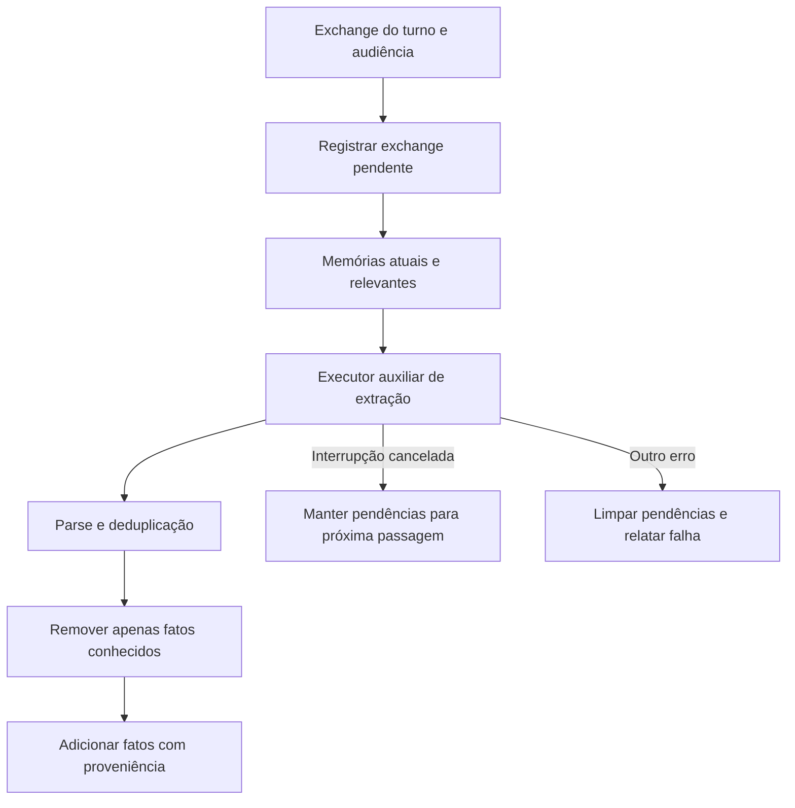

# Memória: armazenamento, busca, extração e Dream

[Índice](../../README.md) · [Prompts](../prompts/README.md) · [Proatividade](../proactivity/README.md)

## O que o código mostra

Há três mecanismos diferentes: ferramenta explícita `UpdateMemory`, extração auxiliar ao fim de um turno e um tipo especial de subagente `dream`. A memória durável possui escopos e formatos; recall não é simplesmente reenviar todo o histórico. Nenhum desses mecanismos, isoladamente, prova um algoritmo de seleção de oportunidades espontâneas.

Fontes: [tipos e formato no host](../../../reference/runtime/host-main.cjs#L702523-L702843), [extração no eval](../../../reference/runtime/sand-eval-runner.cjs#L536087-L536386), [passe pós-turno](../../../reference/runtime/sand-eval-runner.cjs#L590582-L590674).

## Tipos, donos e superfícies

| Tipo | Dono | Formato | Superfície | Padrão listado |
| --- | --- | --- | --- | --- |
| `profile` | Bot | `v1_shard` | Sempre em contexto | Sim; habilita extração por turno |
| `journal` | Bot | `v1_shard` | Sempre em contexto, sujeito ao recorte | Sim |
| `shared_profile` | Usuário | `v1_shard` | Compartilhado entre assistentes | Sim |
| `shared_journal` | Usuário | `v1_shard` | Compartilhado entre assistentes | Sim |
| `notes` | Bot | `v2_jsonl` | Sempre em contexto | Não faz parte do array padrão |

`parseMemoryTypes` exige nomes lower_snake_case, campos de path válidos e metadados obrigatórios para placeholders; rejeita duplicatas. `enabledMemoryTypes()` filtra as definições pelo array recebido, usando quatro tipos como default. A existência de `notes` e de seu `dreamPrompt` não prova ativação. [Tipos](../../../reference/runtime/host-main.cjs#L702530-L702639), [defaults](../../../reference/runtime/host-main.cjs#L753920-L753949).

## Formatos físicos e lógicos

No formato v1, `getAgentMemoryDir` usa a pasta `memory`; perfil fica em `profile.md`, histórico em `log/`. Um fato tem uma linha datada e pode ter comentário de proveniência. `memoryIdFor` calcula SHA-1 do texto normalizado e usa os primeiros 16 hexadecimais. Esse hash é uma chave de deduplicação, não uma autenticação de origem. `normalizeMemoryContent` limita o fato a 500 caracteres; `memoryDedupeKey` converte o conteúdo normalizado para minúsculas. [Formato](../../../reference/runtime/host-main.cjs#L702640-L702842).

No formato JSONL, o schema inclui `id`, `type`, `text`, `meta`, `speaker`, `source` e `created_at`. `parseMemoryJsonlFile` conserva a linha bruta mesmo quando o parse falha; a agregação utiliza apenas entradas válidas. `memoryTypeFilePath` valida `meta` e transforma campos dinâmicos em slugs, limitados a 64 caracteres. Caminhos visíveis usam `/me/...` ou `/bot/...`. [JSONL](../../../reference/runtime/host-main.cjs#L754592-L754714).

## Escopos e escrita

`memoryTypeTarget` escolhe `shardTarget` ou `folderTarget`. O destino depende do dono do tipo, da audiência (`user`/`team`), do tipo de conversa e de `userBotScope`. Para arquivos, memória de dono user não pode ser salva como team. Uma conversa sem pessoa identificada pode recusar memória privada. `offeredMemoryTypes` remove tipos pertencentes ao usuário em team bots. [Destinos](../../../reference/runtime/host-main.cjs#L771533-L771605).

`createSandMemoryStateTool` valida ação `write`/`forget`, tipo e fato; traduz para argumentos internos e chama `executeMemoryUpdate`. Este chama `executeStateUpdate`, que verifica aprovação pendente antes de aplicar. O fallback é estreito: falha ao esquecer um fato no escopo agent, num bot pessoal cujo default é conversation, pode tentar o escopo conversation. Não é um fallback irrestrito entre usuários ou equipes. [Escrita](../../../reference/runtime/host-main.cjs#L771606-L771736).

## Busca e ordenação

`collectMemoryCandidates` junta apenas stores fornecidos pelas dependências: agent, user, user_bot e arquivos. O mount `/memories` oferece list/read/search. `RecallMemory` usa `createWordOverlapSearch`, com sobreposição de palavras distintivas e fallback literal case-insensitive somente se o ranking não encontrou nada. O código analisado não usa embeddings para esse caminho. Resultado padrão: 20 fatos; máximo: 50; orçamento de apresentação: 4.000 caracteres. A primeira linha pode ultrapassar o orçamento porque a interrupção só ocorre após um item já exibido. [Mount e ferramenta](../../../reference/runtime/host-main.cjs#L769524-L769889), [busca](../../../reference/runtime/sand-eval-runner.cjs#L559354-L559424).

Outro helper, `memoryRecallRank`, calcula:

\[
r(m)=\log_2 I(m)+\frac{t_m}{30\cdot24\cdot60\cdot60\cdot1000}
\]

`I` vale 1,5 para prefixo `[episode]`, 0,5 para `[note]` e 1 nos demais casos. Comparar esse ranking equivale a comparar importância com decaimento exponencial de meia-vida de 30 dias para um mesmo instante de consulta; o instante atual seria um termo comum. O helper não apaga um fato após 30 dias e não é a fórmula de ranking do caminho lexical `RecallMemory`. [Helper](../../../reference/runtime/host-main.cjs#L702640-L702665).

## Extração ao fim do turno

O caller recuperado `settleCompletedTurn` só chama a extração quando ela não foi desativada, o run não foi superseded, há memory store, o turno não é hidden, o prompt não está vazio e é considerado memorável, o runner não é subagente e pelo menos um tipo habilitado possui `perTurnExtraction:true`. `isMemorableExchange` ignora strings vazias e uma lista de respostas triviais; texto com mais de 40 caracteres ou ponto de interrogação passa imediatamente. Isso evita descrever o passe como incondicional. [Gate de chamada](../../../reference/runtime/sand-eval-runner.cjs#L591126-L591150), [filtro](../../../reference/runtime/sand-eval-runner.cjs#L536107-L536151).



`runMemoryExtraction` guarda pendências por audiência e acrescenta exchanges anteriores ainda não revisados. `gatherExtractionMemories` combina perfil, recentes, notas privadas e até 10 fatos relevantes do arquivo; a varredura auxiliar solicita até 500 registros. `extractMemories` usa `session.getExecutor()`, acrescenta system/user prompts e consome text-deltas, com `inferenceReason:"memory-extraction"`. O default pede fatos duráveis de perfil. [Extração](../../../reference/runtime/sand-eval-runner.cjs#L536171-L536386).

`parseExtractedMemories` reconhece `profile`, `log`, `note`, `remove` e `NONE`, e deduplica com normalização. `applyExtractedMemories` só aceita remoções presentes no conjunto conhecido; adições passam por `store.addMemory`. O parser é mais permissivo que o prompt default: linhas sem tag podem virar log. Isso deve constar numa eventual reconstrução, sem supor uma validação semântica adicional não encontrada.

Em falha, `runMemoryExtraction` conserva pendências somente se houve interrupção e o erro é de cancelamento. Nos demais erros, limpa pendências; retorna `{ok:false,error}` e escreve diagnóstico. Em sucesso, limpa pendências, aplica alterações e conta fatos adicionados/removidos. [Continuidade](../../../reference/runtime/sand-eval-runner.cjs#L590591-L590674).

## Dream

O tipo `dream` e o manifesto `DREAM_TOOLS` são concretos. Permitem apenas buscar/ler os transcripts carregados para ele e consultar/atualizar memória, com `connectors:"none"` e descoberta estática. `host.dream.transcripts` fornece a porta de leitura. `notes.dreamPrompt` orienta consolidar fatos duráveis e abandonar notas superadas. [Tipo](../../../reference/runtime/host-main.cjs#L753920-L753963), [manifesto](../../../reference/runtime/host-main.cjs#L756923-L756931), [porta](../../../reference/runtime/sand-eval-runner.cjs#L571294-L571308).

Não foi localizado, nesses dois bundles, um agendador completo que prove quando Dream é disparado, por quem, para quais usuários, com qual orçamento ou quais transcripts. A palavra “nightly” em justificativa de manifesto é intenção declarada; não é evidência de cron ativo. O passe pós-turno acima tem código separado e não deve receber o nome Dream.

## Verificação

```bash
rg -n 'runMemoryExtraction|extractMemories|applyExtractedMemories|DREAM_TOOLS|host.dream|DEFAULT_ENABLED_MEMORY_TYPE_NAMES' reference/runtime/{host-main,sand-eval-runner}.cjs
```
