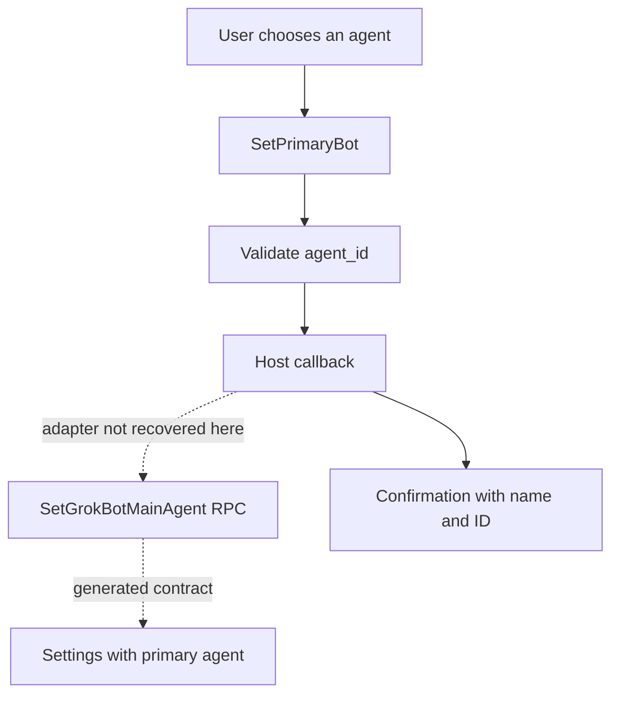

# Primary bot: preferred identity and parent agent

[English](README.en.md) · [Português (Brasil)](README.md)

## Responsibility

The code exposes a primary-agent setting per user and a tool to change it. The remote contract states that the selection replaces the previous one and pins the agent in the sidebar; the owner can later undo the pin, and deleting the agent clears the pointer. This setting does not establish a central algorithm that receives every proactive opportunity. [`SetGrokBotMainAgent` contract](../../../reference/runtime/host-main.cjs#L212218-L212233).

**Primary bot** must also be distinguished from **parent agent**. Primary is the user's preferred identity. Parent is the agent that dispatched a child execution. `WakeParent` hands off through the run's parent/child relationship; no mandatory lookup of the primary bot was found along this path. [Primary tool](../../../reference/runtime/host-main.cjs#L757504-L757522), [WakeParent](../proactivity/README.en.md#3-how-wakeparent-exits-without-losing-the-result).

| Term | Meaning supported by the source | Does not imply |
| --- | --- | --- |
| Primary/main bot | Agent designated by user configuration | Universal supervisor of every agent |
| Parent agent | Owner of the child execution, with its ID in the metadata | That it is the configured primary bot |
| Main-agent tool profile | Capability profile of the main runner | That this runner has the account's primary role |
| Executor/subagent | Delegated run with its own capabilities and context | A new persistent agent in the roster |

## `createSetPrimaryBotTool`

The factory receives `setPrimaryBot` through injection and constructs a `PLATFORM_ACTION` tool named `SetPrimaryBot`. The schema requires a textual `agent_id`, with `trim` and a minimum length of one. The executable body calls the callback and constructs a confirmation using the returned name and ID. This function contains no automatic score-based selection. [Source](../../../reference/runtime/host-main.cjs#L757504-L757522), [individual README](../../functions/createSetPrimaryBotTool/README.en.md).

The tool description instructs the model to use the operation only when the user requested a change, list the existing agents with brief reasons, ask for the user's preference, and wait for the answer. This is a usage policy expressed in the prompt. The wrapper does not implement consent state that checks whether those steps occurred.

The builder includes the tool only if `agentManagement.setPrimaryBot` is available. This is an optional host capability, not a method implemented by the wrapper. [Builder](../../../reference/runtime/host-main.cjs#L772016-L772025).

## Remote contract

### `SetGrokBotMainAgent`

The generated request contains `agent_id`; the response contains settings. The service comment specifies a live `AGENT` owned by the caller, one selection per user, and the `sand_grok_main_agent` gate. A deleted agent or one not owned by the caller produces `not_found`. These are contracts recovered from the protobuf descriptor; the database handler and server-side ownership check do not appear here. [Generated messages](../../../reference/runtime/host-main.cjs#L197305-L197349), [service](../../../reference/runtime/host-main.cjs#L212218-L212233).

### `EnsureGrokBotDefaultMainAgent`

The contract states that the operation creates or selects the default when necessary, or reports the existing primary agent. The ID is fixed per user to converge across retries/concurrent calls. A disabled gate produces `invalid_argument`; a caller outside the required Temporal harness produces `failed_precondition`. Neither the ID derivation algorithm nor the creation transaction was recovered. [Service](../../../reference/runtime/host-main.cjs#L212234-L212250).

### Local ID validation

`isMainAgentId` requires a string that is nonempty after trimming and whose original length is at most 64. This check does not query the roster or establish ownership. Another layer may apply AgentId parsing; the isolated helper should not be treated as authorization. [Source](../../../reference/runtime/host-main.cjs#L487509-L487513).

## Flow supported by the evidence



The bundle contains the tool and the RPC descriptor. This does not justify drawing a direct call between them as if the callback binding had been located. The dotted arrows preserve that gap.

## Relationship to proactivity

The primary tool does not observe calendars, messages, or files, produce candidates, or calculate relevance. The proactivity runtime labels a run's origin and forwards handoffs to a parent; these mechanisms are documented in [proactivity](../proactivity/README.en.md) and [background-wakes](../background-wakes/README.en.md).

When a product description says the primary agent “coordinates everything,” that must be broken down into verifiable responsibilities: preferred-agent selection, delegation ownership, capability policy, opportunity selection, scheduling, and delivery. Only some of those connections are present in this source.

## Static verification

```bash
rg -n 'createSetPrimaryBotTool|setPrimaryBot|isMainAgentId' reference/runtime/host-main.cjs
rg -n 'setGrokBotMainAgent:|ensureGrokBotDefaultMainAgent:' reference/runtime/host-main.cjs
```

Basis: snapshot `655acca99bff0d17466547611108f94ed6a8a5e7`. No agent configuration was changed during the analysis.
