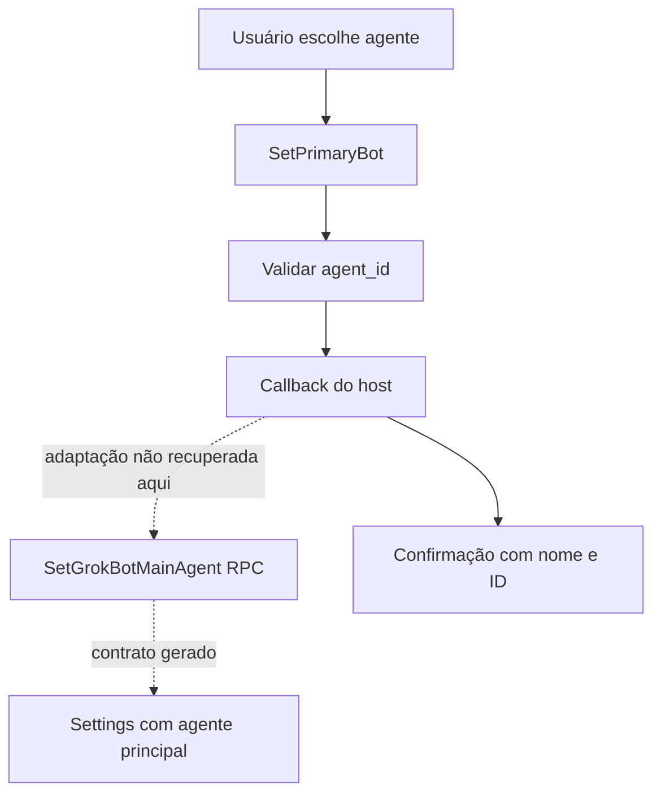

# Primary bot: identidade principal e agente pai

## Qual é a responsabilidade

O código recupera uma configuração de agente principal por usuário e uma ferramenta para alterá-la. O contrato remoto declara que a seleção substitui a anterior e fixa o agente na sidebar; o dono pode desfazer o pin depois, e a exclusão do agente limpa o ponteiro. Essa configuração não demonstra um algoritmo central que recebe todas as oportunidades proativas. [Contrato `SetGrokBotMainAgent`](../../../reference/runtime/host-main.cjs#L212218-L212233).

Também é preciso separar **primary bot** de **parent agent**. Primary é a identidade preferida do usuário. Parent é o agente que despachou uma execução filha. `WakeParent` faz handoff para a relação pai/filho da run; não foi localizada uma consulta obrigatória ao primary bot nesse percurso. [Ferramenta primary](../../../reference/runtime/host-main.cjs#L757504-L757522), [WakeParent](../proactivity/README.md#3-como-wakeparent-encerra-sem-perder-o-resultado).

| Termo | Significado sustentado pela fonte | Não implica |
| --- | --- | --- |
| Primary/main bot | Agente apontado por configuração do usuário | Supervisor universal de todos os agentes |
| Parent agent | Dono da execução filha, com ID em seus metadados | Que é o primary bot configurado |
| Main-agent tool profile | Perfil de capacidades do runner principal | Que aquele runner ocupa o papel primary na conta |
| Executor/subagent | Run delegada com capacidades e contexto próprios | Um novo agente persistente no roster |

## `createSetPrimaryBotTool`

A factory recebe `setPrimaryBot` por injeção e constrói uma ferramenta `PLATFORM_ACTION`, de nome `SetPrimaryBot`. O schema exige `agent_id` textual, com `trim` e comprimento mínimo de um. O corpo executável chama o callback e forma uma confirmação com nome e ID devolvidos. Não existe seleção automática por score nessa função. [Fonte](../../../reference/runtime/host-main.cjs#L757504-L757522), [README individual](../../functions/createSetPrimaryBotTool/README.md).

A descrição da ferramenta instrui o modelo a usar a operação apenas quando o usuário pediu a troca, listar os agentes existentes com razões curtas, perguntar a preferência e aguardar a resposta. Isso é política de uso expressa no prompt. O wrapper não possui um estado de consentimento implementado que confira se essas etapas ocorreram.

O builder inclui a ferramenta somente se `agentManagement.setPrimaryBot` está disponível. Isso é uma capacidade opcional do host, não um método implementado pelo wrapper. [Builder](../../../reference/runtime/host-main.cjs#L772016-L772025).

## Contrato remoto

### `SetGrokBotMainAgent`

O request gerado contém `agent_id`; a resposta contém settings. O comentário de serviço especifica um agente `AGENT` vivo, pertencente ao chamador, uma seleção por usuário e gate `sand_grok_main_agent`. Agente apagado ou não pertencente ao chamador produz `not_found`. Esses são contratos recuperados do descriptor protobuf; o handler de banco e a verificação de ownership do servidor não aparecem aqui. [Mensagens geradas](../../../reference/runtime/host-main.cjs#L197305-L197349), [serviço](../../../reference/runtime/host-main.cjs#L212218-L212233).

### `EnsureGrokBotDefaultMainAgent`

O contrato declara que a operação cria ou seleciona o default quando necessário, ou relata o principal existente. O ID é fixo por usuário para convergência em retries/chamadas simultâneas. O gate desligado produz `invalid_argument`; chamador fora do harness Temporal exigido produz `failed_precondition`. Não foi recuperado o algoritmo que deriva esse ID nem a transação de criação. [Serviço](../../../reference/runtime/host-main.cjs#L212234-L212250).

### Validação local de ID

`isMainAgentId` exige string não vazia após trim e tamanho original de no máximo 64. Essa checagem não consulta o roster nem prova ownership. Outra camada pode aplicar parsing de AgentId; não se deve tratar o helper isolado como autorização. [Fonte](../../../reference/runtime/host-main.cjs#L487509-L487513).

## Fluxo sustentado pela evidência



O bundle contém a ferramenta e o descriptor do RPC. Isso não basta para desenhar uma chamada direta entre ambos como se a ligação do callback tivesse sido localizada. As setas pontilhadas preservam essa lacuna.

## Relação com proatividade

A ferramenta primary não observa calendários, mensagens ou arquivos, não produz candidatos e não calcula relevância. O runtime de proatividade marca a origem de uma run e encaminha handoffs a um pai; esses mecanismos estão documentados em [proatividade](../proactivity/README.md) e [background-wakes](../background-wakes/README.md).

Quando uma descrição de produto fala que o principal “coordena tudo”, isso precisa ser desmembrado em responsabilidades verificáveis: escolha do agente preferido, dono de uma delegação, política de capacidades, seleção de oportunidade, agendamento e entrega. Apenas parte dessas ligações está presente nesta fonte.

## Verificação estática

```bash
rg -n 'createSetPrimaryBotTool|setPrimaryBot|isMainAgentId' reference/runtime/host-main.cjs
rg -n 'setGrokBotMainAgent:|ensureGrokBotDefaultMainAgent:' reference/runtime/host-main.cjs
```

Base: snapshot `655acca99bff0d17466547611108f94ed6a8a5e7`. Nenhuma configuração de agente foi alterada durante a análise.
