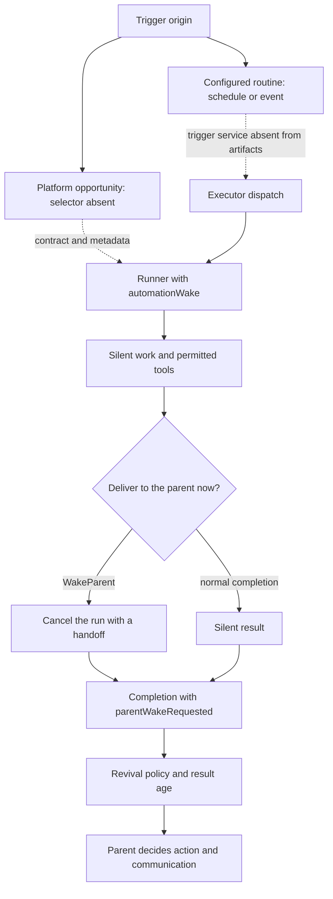

# Proactivity: triggering, silent execution, and delivery

[English](README.en.md) · [Português (Brasil)](README.md)

## What the available artifacts establish

The harness contains concrete mechanisms for performing work without a new user message, preserving its provenance, finishing silently, producing a handoff, and resuming the parent agent. **The implementation that selects a spontaneous opportunity and decides when to start that work was not found in these artifacts.** This distinction prevents treating a prompt or field name as an engine that the code does not provide.

There are two different surfaces. `host-main.cjs` contains Sand Host integration, generated contracts, stores, and parts of the harness; its `SendPipeline.sendPrompt` ends in the BOX execution refusal. `sand-eval-runner.cjs` also incorporates the `grok-bot-harness` package and preserves more complete implementations of dispatch, execution, and revival. This makes it possible to study the shared algorithm, but does not establish which version is deployed in the backend. [BOX refusal](../../../reference/runtime/host-main.cjs#L740157-L740194), [dispatch in eval](../../../reference/runtime/sand-eval-runner.cjs#L584012-L584122).

| Layer | Recovered evidence | Boundary |
| --- | --- | --- |
| Spontaneous selection | `platformProactivity` field, `sand-proactivity-wake` routing reason, `platform` label, contractual reference to a `proactivity due set` | No opportunity ranking, eligibility criteria, or selection loop was recovered |
| Explicit automations | Schedule/event definition, store, normalization, `testAutomation` RPC, isolated execution | The remote service that triggers schedules and receives events is not implemented here |
| Silent work | `hidden`, `isSilenceAllowed`, `quietWork`, `quietOrigin` | These fields do not themselves select worthwhile work |
| Parent mediation | `WakeParent`, intentional cancellation, `automationParentWake`, `parentWakeRequested` | The tool does not send a message directly to the user |
| Resumption | Selection among `automation_parent_wake`, `quiet`, `canvas`, `generic`; handling of delayed results | A relevance prompt is not a deterministic relevance classifier |
| Read-only operation | MCP read allowlist, `readOnlyHint`, refusal aliases | Does not automatically apply to all automations; the common dispatch creates an executor with `readonly: false` |

Sources: [trust marker](../../../reference/runtime/sand-eval-runner.cjs#L526080-L526086), [routing](../../../reference/runtime/sand-eval-runner.cjs#L591676-L591709), [label](../../../reference/runtime/sand-eval-runner.cjs#L589677-L589698), [catalog contract](../../../reference/runtime/host-main.cjs#L215121-L215133), [MCP policy](../../../reference/runtime/sand-eval-runner.cjs#L554017-L554058), [revival](../../../reference/runtime/sand-eval-runner.cjs#L583924-L584007).

## End-to-end flow



The dotted arrows mark the missing boundary, not a located call. The solid path between executor, result, and revival is present in the eval runner. The callback that receives the completion must be connected by the host; the runtime explicitly logs a warning if this callback is absent. [Completion and missing handler](../../../reference/runtime/sand-eval-runner.cjs#L535295-L535489).

## 1. Origin, trust, and attribution

### `automationWakeTrustMarker(wake, isRenamedSpelling)`

A routine can arrive as a hidden wake. This helper only supplies the trusted automation marker when `wake` exists, `untrusted !== true`, and `platformProactivity !== true`. An event marked as untrusted or a platform initiative receives an empty string. The spelling boolean selects the current or legacy marker without changing the trust rule. [Implementation](../../../reference/runtime/sand-eval-runner.cjs#L526080-L526086), [function README](../../functions/automationWakeTrustMarker/README.en.md).

The implication is concrete: “initiated by the platform” is not converted into “requested by the user.” This preserves the distinction between an authorized instruction and material from an external source. The function does not authenticate users or approve actions; it controls a prompt fragment.

### `sandRunWakeProvenance(options)`

The helper prefers `options.automationWake` and uses `resumedWakeProvenance` as a fallback. It copies `untrusted` and, when present, the minimal email envelope: sender, destination mailbox, and authentication result. It does not copy the full event content. This provenance remains separate from the work instruction. [Implementation](../../../reference/runtime/sand-eval-runner.cjs#L589702-L589717).

### `automationRunTrigger` and `automationRunForLabeling`

`automationRunTrigger` returns `platform` first, then `event` when `untrusted === true`, and `schedule` otherwise. `automationRunForLabeling` only produces metadata when a wake exists, the origin is `automation`, and this is not a continuation of the same turn; a revival reuses the previous run and increments `settleSeq`. An ordinary subagent is not treated as an automation unless it is the parent-mediated automation subagent. [Implementation](../../../reference/runtime/sand-eval-runner.cjs#L589677-L589699).

These labels support attribution and subsequent evaluation. They are not the opportunity-selection algorithm.

## 2. The actual dispatch of a routine

`createAutomationSubagentDispatch` returns a function that receives automation and executor identifiers, a prompt, connector scope, and optional tracing identifiers. It:

1. Reuses the in-flight promise for the same `subagentAgentId`.
2. Creates an executor with `readonly: false`, origin `automation`, and transport `parentMediated: true`.
3. Configures handlers to collect completions from subagents and shells started by that executor.
4. Starts the run hidden, silent, and marked as `quietWork`.
5. While child work remains and no `WakeParent` has occurred, drains the children and resumes the executor with their results.
6. On a handoff, stops the remaining work; on external cancellation, drains shutdown and removes the handoff from the aborted result.
7. Registers background execution with the automation's origin and removes the deduplication entry on completion.

[Full implementation](../../../reference/runtime/sand-eval-runner.cjs#L584012-L584122), [function README](../../functions/createAutomationSubagentDispatch/README.en.md).

This routine does **not** set `platformProactivity` or decide that “there is something interesting to do.” It processes work that has already been selected. The combination of `readonly: false` and mediated transport also shows why “automation” and “read-only proactivity subagent” cannot be treated as synonyms.

## 3. How `WakeParent` exits without losing the result

The tool validates a nonempty `message` and forwards the text and its `toolCallId` to `requestAutomationParentWake`. The runner callback exists only for `isParentMediatedAutomationSubagent`; the first call wins, records the text, and cancels the run with `automationParentWakeAbort`. The error carries `intentional: true` and `completedToolCallId`, allowing the completed tool call to be distinguished from an external interruption. [Tool](../../../reference/runtime/sand-eval-runner.cjs#L564143-L564161), [callback](../../../reference/runtime/sand-eval-runner.cjs#L591766-L591775), [specific error](../../../reference/runtime/sand-eval-runner.cjs#L554063-L554085).

On exit, the runtime constructs `aborted` as `automationParentWake === undefined && aborted2`. When the handoff exists, it adds `result.automationParentWake`. The subagent runtime uses this text in place of `finalAssistantText` and emits `parentWakeRequested: true`. The mechanism therefore turns a technical cancellation into a semantic handoff completion. [Result](../../../reference/runtime/sand-eval-runner.cjs#L592532-L592545), [completion](../../../reference/runtime/sand-eval-runner.cjs#L535295-L535329), [function README](../../functions/createWakeParentTool/README.en.md).

The tool's return text states that the parent has been woken, but the located implementation is a request to the runtime. Without the completion handler or the production host, that return value is not evidence of delivery to the user.

## 4. How a completion determines the resumption type

`revivalInstructionOf` applies this priority:

| Condition, in the order tested by the code | Result |
| --- | --- |
| At least one completion has `parentWakeRequested === true` | `automation_parent_wake` |
| All completions have `quietOrigin` | `quiet` |
| There is exactly one completed canvas-producing completion, from a recognized cursor-agent, with a valid path | `canvas` |
| None of the preceding conditions | `generic` |

[Implementation](../../../reference/runtime/sand-eval-runner.cjs#L583887-L583948), [function README](../../functions/revivalInstructionOf/README.en.md).

`buildSubagentRevival` uses the classification to assemble the prompt and exposes `quiet` or `canvas` flags. `saysWhereResultGoes` marks explicit handoffs and room origins. `revivalRunLength` avoids mixing awaited and unawaited results in the same sequence, ignoring cursor-agents when calculating the transition. `owesSubagentRevivalReply` requires a reply for canvas and for subagents that were actually awaited. [Helpers](../../../reference/runtime/sand-eval-runner.cjs#L583895-L583935).

The `quiet` prompt instructs the parent to notify once when there is a real change, a new actionable result, or a relevant blocker; for “nothing changed,” waiting, and duplicates, it instructs the parent to finish silently. This is an instruction to the model. The function contains no numerical score, utility threshold, or deterministic comparison between events.

## 5. Held results and staleness

`heldForMs` is an explicit completion field. `describeHeldDuration` rounds the delay into minutes, hours, or days; `subagentRevivalBlock` includes that information alongside the result. If all handoffs requesting the parent have been held, the prompt uses `HELD_AUTOMATION_PARENT_WAKE_INSTRUCTION`, which makes action conditional on current relevance. When at least one result arrived late, it adds `HELD_REVIVAL_NOTE`, except on the canvas path. [Formatting and selection](../../../reference/runtime/sand-eval-runner.cjs#L583877-L584007).

`renderAutomationHandoffInboxPrompt` distinguishes two cases: an immediate handoff remains due even if a new user message has arrived; a held handoff must be reassessed and should not be incorporated into an unrelated conversation. No global opportunity TTL was recovered in this function. Age is passed to the model as evidence, and the semantic decision remains in the prompt. [Handoff inbox](../../../reference/runtime/sand-eval-runner.cjs#L583974-L583991).

## 6. What the read-only policy actually guarantees

The code normalizes the connector identifier, removes the account suffix and known scope prefixes, and consults a catalog of operations recognized as reads. An MCP tool is accepted when it declares `readOnlyHint` or appears in that allowlist. `readonlyMcpToolIsBlocked` materializes the accepted `providerIdentifier + NUL + toolName` pairs and blocks the rest, with an explicit exception for the dynamic discovery namespace. [MCP policy](../../../reference/runtime/sand-eval-runner.cjs#L554017-L554058).

`withReadonlySubagentRefusals` prevents an omitted name from remaining executable through an alias: it adds refusal aliases to an offered tool, counts the attempt, and throws `ToolCallUnexpectedEnvironmentError`. If no tool can carry aliases or no names can be refused, it returns the original list. [Alias refusal](../../../reference/runtime/sand-eval-runner.cjs#L582540-L582576).

These functions establish a tool policy, not an operating-system sandbox. The connection between this policy and all spontaneous production triggers was not recovered. The automation manifest has its own restrictions and permits capabilities unavailable to a read-only profile. [Automation manifest in the host](../../../reference/runtime/host-main.cjs#L756821-L756882).

## 7. What remains outside the available artifacts

| Question | Available evidence | Supported conclusion |
| --- | --- | --- |
| Who observes activity and decides to investigate? | Proactivity metadata and presence contracts exist | The initial selector was not found |
| What is the spontaneous scanning interval? | A 15-second timer in the automations extension | That timer reconciles pending remote deletions; it does not establish opportunity scanning |
| Is there a score, cooldown, and budget per opportunity? | The runner has a turn budget | Execution limits do not reveal the selection policy |
| Does the primary agent decide everything? | A primary-bot selection tool and configuration RPCs | Primary bot is a preferred identity; it does not establish a central opportunity algorithm |
| Does `host-pending-wakes.json` establish wake recovery? | A filename constant and inventory references | Without a connected reader/writer/consumer, the filename does not establish an active queue |
| Does the BOX code run today? | `refuseBoxTurn` always throws | This snapshot's local send path is retired |

Sources: [reconciliation](../../../reference/runtime/host-main.cjs#L505585-L505680), [timer](../../../reference/runtime/host-main.cjs#L505894-L506027), [primary bot](../primary-bot/README.en.md), [wake constant](../../../reference/runtime/host-main.cjs#L453683-L453695), [recreation with empty lists](../../../reference/runtime/host-main.cjs#L740513-L740535).

## Cases for interpreting the behavior correctly

| Situation | Recovered path | What should not be concluded |
| --- | --- | --- |
| A routine finishes with nothing new | Final result and quiet origin; silent revival prompt | That a fixed “novelty” classifier exists |
| A routine needs to remind the user | `WakeParent` ends the run and carries the complete request to the parent | That ordinary final text was sent to the user |
| A handoff arrives very late | Age is inserted into the prompt; instruction to reassess relevance | That automatic expiry uses a specific TTL |
| The user cancels during child work | Dispatcher marks the result aborted and removes the handoff | That cancellation creates a new proactive notification |
| An opportunity is marked by the platform | No trusted automation marker; `platform` label | That the source supplied the algorithm that generated the opportunity |

## Reading path and static verification

Start with the READMEs for [automations](../automations/README.en.md), [background work and messages](../background-wakes/README.en.md), and [primary bot](../primary-bot/README.en.md). To repeat the searches from the repository root:

```bash
rg -n 'platformProactivity|proactivity due set' reference/runtime/{host-main,sand-eval-runner}.cjs
rg -n 'createAutomationSubagentDispatch|requestAutomationParentWake|automationParentWake' reference/runtime/sand-eval-runner.cjs
rg -n 'revivalInstructionOf|HELD_REVIVAL_NOTE|QUIET_REVIVAL_INSTRUCTION' reference/runtime/sand-eval-runner.cjs
```

These commands only read files. This documentation comes from static analysis of commit `655acca99bff0d17466547611108f94ed6a8a5e7`; it does not claim observed execution or validation of the remote service.
