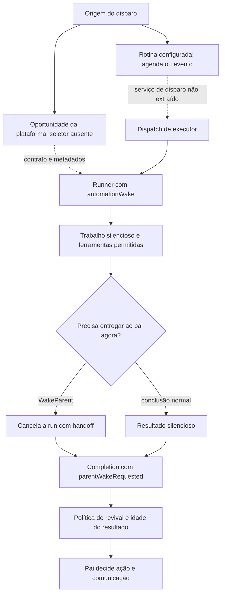

# Proatividade: disparo, execução silenciosa e entrega

## O que a extração comprova

O harness contém mecanismos concretos para executar trabalho sem uma nova mensagem do usuário, conservar sua origem, concluir em silêncio, produzir um handoff e retomar o agente pai. **A implementação que escolhe uma oportunidade espontânea e decide quando iniciar esse trabalho não foi localizada nesta extração.** Essa distinção evita transformar um prompt ou um nome de campo em um motor que o código não fornece.

Há duas superfícies diferentes. `host-main.cjs` contém integração do Sand Host, contratos gerados, stores e partes do harness; seu `SendPipeline.sendPrompt` termina na recusa de execução BOX. `sand-eval-runner.cjs` também incorpora o pacote `grok-bot-harness` e preserva implementações mais completas de dispatch, execução e revival. Isso permite estudar o algoritmo compartilhado, mas não prova qual versão está implantada no backend. [Recusa BOX](../../../reference/runtime/host-main.cjs#L740157-L740194), [dispatch no eval](../../../reference/runtime/sand-eval-runner.cjs#L584012-L584122).

| Camada | Evidência recuperada | Limite |
| --- | --- | --- |
| Seleção espontânea | Campo `platformProactivity`, motivo de roteamento `sand-proactivity-wake`, rótulo `platform`, referência contratual a um `proactivity due set` | Não há ranking de oportunidades, critérios de elegibilidade ou loop de seleção recuperado |
| Automações explícitas | Definição de agenda/evento, store, normalização, RPC `testAutomation`, execução isolada | O serviço remoto que dispara a agenda e recebe eventos não está implementado aqui |
| Trabalho silencioso | `hidden`, `isSilenceAllowed`, `quietWork`, `quietOrigin` | Esses campos não escolhem por si mesmos qual trabalho vale a pena |
| Mediação do pai | `WakeParent`, cancelamento intencional, `automationParentWake`, `parentWakeRequested` | A ferramenta não envia diretamente a mensagem para o usuário |
| Retomada | Seleção entre `automation_parent_wake`, `quiet`, `canvas`, `generic`; tratamento de resultados atrasados | Prompt de relevância não equivale a um classificador determinístico de relevância |
| Somente leitura | Allowlist de reads MCP, `readOnlyHint`, aliases de recusa | Não se aplica automaticamente a todas as automações; o dispatch comum cria executor com `readonly: false` |

Fontes: [marcador de confiança](../../../reference/runtime/sand-eval-runner.cjs#L526080-L526086), [roteamento](../../../reference/runtime/sand-eval-runner.cjs#L591676-L591709), [rótulo](../../../reference/runtime/sand-eval-runner.cjs#L589677-L589698), [contrato do catálogo](../../../reference/runtime/host-main.cjs#L215121-L215133), [política MCP](../../../reference/runtime/sand-eval-runner.cjs#L554017-L554058), [revival](../../../reference/runtime/sand-eval-runner.cjs#L583924-L584007).

## Fluxo de ponta a ponta



As setas pontilhadas assinalam a fronteira que falta, não uma chamada localizada. O percurso sólido entre executor, resultado e revival está no eval runner. O callback que recebe a completion precisa ser conectado pelo host; o runtime registra explicitamente um aviso se esse callback não existir. [Completion e ausência de handler](../../../reference/runtime/sand-eval-runner.cjs#L535295-L535489).

## 1. Origem, confiança e atribuição

### `automationWakeTrustMarker(wake, isRenamedSpelling)`

Uma rotina pode chegar como wake oculto. Esse helper só fornece o marcador de automação confiável quando existe `wake`, `untrusted !== true` e `platformProactivity !== true`. Um evento marcado como não confiável ou uma iniciativa da plataforma recebe string vazia. O booleano de grafia seleciona o marcador atual ou legado, sem mudar a regra de confiança. [Implementação](../../../reference/runtime/sand-eval-runner.cjs#L526080-L526086), [README da função](../../functions/automationWakeTrustMarker/README.md).

A implicação é concreta: “foi iniciado pela plataforma” não é convertido em “foi solicitado pelo usuário”. Isso preserva a diferença entre instrução autorizada e material de uma fonte externa. A função não autentica usuários nem aprova ações; ela controla um fragmento do prompt.

### `sandRunWakeProvenance(options)`

O helper prefere `options.automationWake` e usa `resumedWakeProvenance` como alternativa. Copia `untrusted` e, quando presente, o envelope mínimo de email: remetente, caixa de destino e resultado de autenticação. Não copia o conteúdo completo do evento. Essa proveniência fica separada da instrução de trabalho. [Implementação](../../../reference/runtime/sand-eval-runner.cjs#L589702-L589717).

### `automationRunTrigger` e `automationRunForLabeling`

`automationRunTrigger` retorna `platform` primeiro, depois `event` quando `untrusted === true`, e `schedule` no restante. `automationRunForLabeling` só produz metadados quando há wake, a origem é `automation` e não é continuação do mesmo turno; uma revival reaproveita a run anterior e incrementa `settleSeq`. Um subagente comum não é tratado como automação, exceto quando é o subagente de automação mediado pelo pai. [Implementação](../../../reference/runtime/sand-eval-runner.cjs#L589677-L589699).

Esses rótulos são atribuição e avaliação posterior. Não são o algoritmo de escolha de oportunidades.

## 2. O dispatch real de uma rotina

`createAutomationSubagentDispatch` devolve uma função que recebe identificação da automação e do executor, prompt, escopo de conectores e identificadores opcionais de rastreamento. Ela:

1. Reaproveita a promise em andamento para o mesmo `subagentAgentId`.
2. Cria um executor com `readonly: false`, origem `automation` e transporte `parentMediated: true`.
3. Configura handlers para recolher completions de subagentes e shells iniciados por esse executor.
4. Inicia a run oculta, silenciosa e marcada como `quietWork`.
5. Enquanto houver trabalho filho e nenhum `WakeParent`, drena os filhos e retoma o executor com seus resultados.
6. Ao receber handoff, interrompe o trabalho restante; quando há cancelamento externo, drena o encerramento e retira o handoff do resultado abortado.
7. Registra a execução em background com a origem da automação e remove a deduplicação ao terminar.

[Implementação integral](../../../reference/runtime/sand-eval-runner.cjs#L584012-L584122), [README da função](../../functions/createAutomationSubagentDispatch/README.md).

Essa rotina **não** define `platformProactivity` e não decide “há algo interessante para fazer”. Ela implementa o processamento de um trabalho que já foi selecionado. A combinação `readonly: false` com transporte mediado também mostra por que “automação” e “subagente de proatividade somente leitura” não podem ser tratados como sinônimos.

## 3. Como `WakeParent` encerra sem perder o resultado

A ferramenta valida um `message` não vazio e encaminha o texto e seu `toolCallId` a `requestAutomationParentWake`. O callback do runner existe apenas para `isParentMediatedAutomationSubagent`; a primeira chamada vence, grava o texto e cancela a run com `automationParentWakeAbort`. O erro carrega `intentional: true` e `completedToolCallId`, permitindo distinguir a ferramenta concluída de uma interrupção externa. [Ferramenta](../../../reference/runtime/sand-eval-runner.cjs#L564143-L564161), [callback](../../../reference/runtime/sand-eval-runner.cjs#L591766-L591775), [erro específico](../../../reference/runtime/sand-eval-runner.cjs#L554063-L554085).

Na saída, o runtime constrói `aborted` como `automationParentWake === undefined && aborted2`. Quando o handoff existe, acrescenta `result.automationParentWake`. O runtime de subagentes usa esse texto em lugar de `finalAssistantText` e emite `parentWakeRequested: true`. O mecanismo, portanto, transforma um cancelamento técnico em uma completion semântica de handoff. [Resultado](../../../reference/runtime/sand-eval-runner.cjs#L592532-L592545), [completion](../../../reference/runtime/sand-eval-runner.cjs#L535295-L535329), [README da função](../../functions/createWakeParentTool/README.md).

A frase de retorno da ferramenta declara que o pai foi acordado, mas a implementação localizada é um pedido ao runtime. Sem o handler de completion ou sem o host de produção, esse retorno não constitui prova de entrega ao usuário.

## 4. Como uma completion decide o tipo de retomada

`revivalInstructionOf` aplica esta prioridade:

| Condição, na ordem em que o código testa | Resultado |
| --- | --- |
| Pelo menos uma completion com `parentWakeRequested === true` | `automation_parent_wake` |
| Todas as completions têm `quietOrigin` | `quiet` |
| Há exatamente uma completion de produção de canvas, concluída, proveniente de um cursor-agent reconhecido e com caminho válido | `canvas` |
| Nenhuma condição anterior | `generic` |

[Implementação](../../../reference/runtime/sand-eval-runner.cjs#L583887-L583948), [README da função](../../functions/revivalInstructionOf/README.md).

`buildSubagentRevival` usa a classificação para montar o prompt e expõe flags `quiet` ou `canvas`. `saysWhereResultGoes` marca handoffs explícitos e origens em sala. `revivalRunLength` evita misturar numa mesma sequência resultados aguardados e não aguardados, ignorando cursor-agents ao calcular a transição. `owesSubagentRevivalReply` exige resposta para canvas e para subagentes efetivamente aguardados. [Helpers](../../../reference/runtime/sand-eval-runner.cjs#L583895-L583935).

O prompt `quiet` orienta o pai a avisar uma vez quando houver mudança real, resultado novo acionável ou bloqueio relevante; para “nada mudou”, espera e duplicatas, orienta a terminar silenciosamente. Isso é uma instrução ao modelo. Não há nessa função uma pontuação numérica, limiar de utilidade ou comparação determinística entre acontecimentos.

## 5. Resultados retidos e obsolescência

`heldForMs` é um campo explícito da completion. `describeHeldDuration` arredonda o atraso em minutos, horas ou dias; `subagentRevivalBlock` inclui essa informação junto do resultado. Se todos os handoffs que pedem o pai estão retidos, o prompt usa `HELD_AUTOMATION_PARENT_WAKE_INSTRUCTION`, que condiciona a ação à relevância atual. Quando pelo menos um resultado chegou atrasado, acrescenta `HELD_REVIVAL_NOTE`, exceto no percurso de canvas. [Formatação e escolha](../../../reference/runtime/sand-eval-runner.cjs#L583877-L584007).

`renderAutomationHandoffInboxPrompt` diferencia dois casos: o handoff imediato continua devido mesmo que uma nova mensagem do usuário tenha chegado; o handoff retido precisa ser reavaliado e não deve ser incorporado a uma conversa não relacionada. Não há um TTL global de oportunidade recuperado nessa função. A idade é passada ao modelo como evidência, e a decisão semântica continua no prompt. [Inbox do handoff](../../../reference/runtime/sand-eval-runner.cjs#L583974-L583991).

## 6. O que a política somente leitura realmente garante

O código normaliza o identificador do conector, remove sufixo de conta e prefixos de escopo conhecidos, e consulta um catálogo de operações reconhecidas como leitura. Uma ferramenta MCP é aceita quando declara `readOnlyHint` ou está nessa allowlist. `readonlyMcpToolIsBlocked` materializa os pares `providerIdentifier + NUL + toolName` aceitos e bloqueia o restante, com exceção explícita do namespace de descoberta dinâmica. [Política MCP](../../../reference/runtime/sand-eval-runner.cjs#L554017-L554058).

`withReadonlySubagentRefusals` impede que um nome omitido continue executável por alias: acrescenta aliases de recusa a uma ferramenta oferecida, conta a tentativa e lança `ToolCallUnexpectedEnvironmentError`. Se não há ferramenta que possa carregar aliases ou nomes recusáveis, devolve a lista original. [Recusa de aliases](../../../reference/runtime/sand-eval-runner.cjs#L582540-L582576).

Essas funções comprovam uma política de ferramentas, não um sandbox de sistema operacional. A associação entre essa política e todos os disparos espontâneos de produção não está recuperada. O manifesto de automações possui restrições próprias e permite capacidades que um perfil somente leitura não permite. [Manifesto de automação no host](../../../reference/runtime/host-main.cjs#L756821-L756882).

## 7. O que continua fora da extração

| Pergunta | Evidência disponível | Conclusão permitida |
| --- | --- | --- |
| Quem observa atividade e decide investigar? | Metadados de proatividade e contratos de presença existem | O seletor inicial não foi localizado |
| Qual o intervalo de varredura espontânea? | Timer de 15 segundos na extensão de automações | Esse timer reconcilia exclusões remotas pendentes; não prova varredura de oportunidades |
| Há score, cooldown e orçamento por oportunidade? | Há orçamento de turno no runner | Limites de execução não revelam a política de seleção |
| O principal decide tudo? | Ferramenta de seleção de primary bot e RPCs de configuração | Primary bot é uma identidade preferida; não prova um algoritmo central de oportunidades |
| `host-pending-wakes.json` prova recuperação de wakes? | Constante de nome e referências de inventário | Sem leitor/escritor/consumidor conectado, o nome do arquivo não prova fila ativa |
| O código BOX roda hoje? | `refuseBoxTurn` lança sempre | O caminho local de envio deste snapshot está aposentado |

Fontes: [reconciliação](../../../reference/runtime/host-main.cjs#L505585-L505680), [timer](../../../reference/runtime/host-main.cjs#L505894-L506027), [primary bot](../primary-bot/README.md), [constante de wakes](../../../reference/runtime/host-main.cjs#L453683-L453695), [recriação com listas vazias](../../../reference/runtime/host-main.cjs#L740513-L740535).

## Casos para interpretar corretamente o comportamento

| Situação | Caminho recuperado | O que não se deve concluir |
| --- | --- | --- |
| Rotina termina sem novidade | Resultado final e origem quiet; prompt de revival silencioso | Que existe um classificador fixo de “novidade” |
| Rotina precisa lembrar o usuário | `WakeParent` encerra a run e transporta o pedido completo ao pai | Que um texto final comum foi enviado ao usuário |
| Handoff chega muito tarde | Idade inserida no prompt; instrução de revisar relevância | Que existe expiração automática por um TTL específico |
| Usuário cancela durante trabalho filho | Dispatcher marca abortado e remove handoff | Que o cancelamento cria uma nova notificação proativa |
| Oportunidade marcada pela plataforma | Sem marcador de automação confiável; rótulo `platform` | Que a fonte forneceu o algoritmo que gerou a oportunidade |

## Roteiro de leitura e verificação estática

Parta dos READMEs de [automações](../automations/README.md), [background e mensagens](../background-wakes/README.md) e [primary bot](../primary-bot/README.md). Para repetir as buscas a partir da raiz do repositório:

```bash
rg -n 'platformProactivity|proactivity due set' reference/runtime/{host-main,sand-eval-runner}.cjs
rg -n 'createAutomationSubagentDispatch|requestAutomationParentWake|automationParentWake' reference/runtime/sand-eval-runner.cjs
rg -n 'revivalInstructionOf|HELD_REVIVAL_NOTE|QUIET_REVIVAL_INSTRUCTION' reference/runtime/sand-eval-runner.cjs
```

Esses comandos apenas leem os arquivos. Esta documentação resulta de análise estática do commit `655acca99bff0d17466547611108f94ed6a8a5e7`; não declara execução observada nem validação do serviço remoto.
