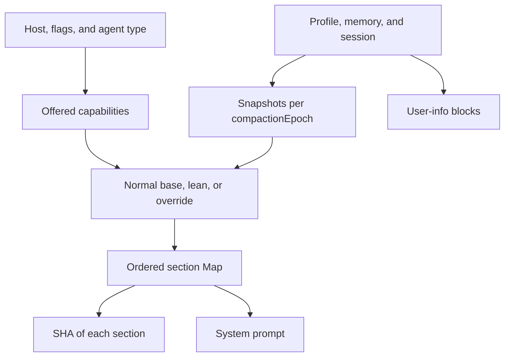

# Prompts: composition, context, and per-conversation freezing

[English](README.en.md) · [Português (Brasil)](README.md)

[Index](../../README.en.md) · [Memory](../memory/README.en.md) · [Tools](../tools/README.en.md)

## Responsibility

The system prompt is assembled from sections, capabilities, and snapshots. It is not a single universal string. `createSystemPromptAssembly(deps)` builds a closure aware of the agent type, profile, memory, session, routines, gates, and mounted tools. Its complete body appears in the [eval runner](../../../reference/runtime/sand-eval-runner.cjs#L552679-L553779). The host retains some of the text and formats, but does not preserve this entire body at the corresponding location.

## Observed order

`renderSections` inserts into a `Map` in this order:

| Position | Sections | Relevant conditions |
| --- | --- | --- |
| 1 | Base, spotlight, voice | Base override, lean executor, tools, and voice channel |
| 2 | Profile, identity, team bot, personal Slack, files | Providers, session type, and parent parity |
| 3 | Multitask, internal-detail boundary, MCP accounts, timezone | Gates and available context |
| 4 | Memory | Policy, snapshot, and possible separate block in user-info |
| 5 | Current session, active sessions, related conversations | Linked sessions supplied by the host |
| 6 | Automations, tasks, skills, channels, agent directory | Mounted ports and capabilities |
| 7 | Sending rules, MCP instructions, box, and computer | Gates, access, and full override |

This is the code order in [renderSections](../../../reference/runtime/sand-eval-runner.cjs#L553641-L553701), not an editorial reconstruction of the complete prompt. Null sections disappear. A frozen prompt can change the composition through `composeSandFrozenPrompt`.



## Main functions

### `getBaseSystemPrompt`

Selection has concrete precedence: lean executor with available facts; full override; base override; normal construction guided by gates. The parent-mediated automation variant has its own prompt. Capabilities unavailable under a plan or team, web tools, media generation, email, and computer access change the wording. [Implementation](../../../reference/runtime/sand-eval-runner.cjs#L553395-L553522).

### `resolveProfileForPrompt` and `prepareAgentProfilePromptSnapshot`

The explicit provider takes precedence. Without it, only runners with parent parity can fall back to store metadata. The snapshot records profile, identity, and compaction epoch. Identity changes may appear as an update before being incorporated into the prefix after compaction. `persistAnnouncedAgentProfile` checks epoch and identity before persisting so it does not overwrite a snapshot that has changed. [Source](../../../reference/runtime/sand-eval-runner.cjs#L552700-L552805).

### `getMemorySections`

Distinguishes four states: a store that retains nothing; facts included in the system section; unresolved facts; and facts resolved in user-info. `userInfoResolved:false` does not mean empty memory. `userInfoWithheld:true` represents the policy to withhold memory. The policy section can be ready even when the facts have not arrived. [Source](../../../reference/runtime/sand-eval-runner.cjs#L553064-L553097).

### `frozen`

Reads a snapshot pinned by section name and `compactionEpoch`. Without a store, it uses live rendering; an unresolved sentinel produces temporary absence. With a store, `resolveFrozenPromptSection` decides whether to reuse a snapshot or persist a new one. The function serves timezone, memory, automations, directory, MCP instructions, and other sections. It does not freeze the entire agent's state. [Source](../../../reference/runtime/sand-eval-runner.cjs#L553098-L553140).

### `renderSystemPrompt`

Converts non-null sections into text, or uses the frozen composition; computes SHA-256 per section; and preserves recent static prefixes preceding the first conversation-specific section. `staticPrefixLength` subsequently recognizes whether a system prompt starts with one of these prefixes. The code supports prefix observation and stability; actual cache savings depend on the provider and require measurement. [Source](../../../reference/runtime/sand-eval-runner.cjs#L553713-L553779).

### `createSystemPromptGeneratorForRun`

Captures skill pointers, base override, and lean facts at the start of run generation. The closure receives tools and derives `sandMountedTurnTools(tools)` before rendering. This avoids advertising computer access merely because a flag allows it: mounting `ListMachines` and `CopyToBox` can also be part of the condition. [Source](../../../reference/runtime/sand-eval-runner.cjs#L553641-L553747).

## Textual instructions and enforcement

Text such as “the subagent does not speak to the user” guides the model; manifests, ports, and transport refusals enforce some of these rules in code. The documentation distinguishes these layers. A sentence in a prompt does not establish that the entire backend implements the rule, and text present in a bundle does not establish that it was selected for a turn. [Automation text in the host](../../../reference/runtime/host-main.cjs#L753837-L753863), [automation manifest](../../../reference/runtime/host-main.cjs#L756822-L756882).

## What was not recovered

This analysis contains no production-turn dump. Actual gate values, external providers, and saved snapshots from a specific conversation are missing. An account's final prompt cannot be inferred simply by concatenating every constant in the bundle.

```bash
rg -n 'createSystemPromptAssembly|function renderSections|function renderSystemPrompt|createSystemPromptGeneratorForRun' reference/runtime/sand-eval-runner.cjs
```
