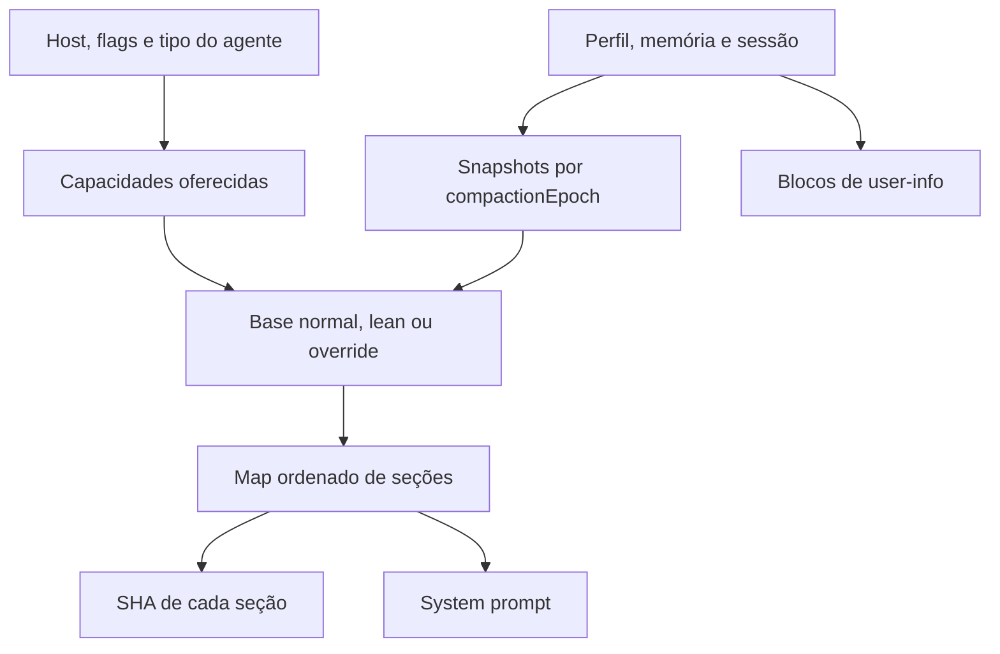

# Prompts: composição, contexto e congelamento por conversa

[Índice](../../README.md) · [Memória](../memory/README.md) · [Ferramentas](../tools/README.md)

## Responsabilidade

O system prompt é montado de seções, capabilities e snapshots. Ele não é uma única string universal. `createSystemPromptAssembly(deps)` constrói uma closure que conhece o tipo de agente, perfil, memória, sessão, rotinas, gates e ferramentas montadas. Seu corpo completo aparece no [eval runner](../../../reference/runtime/sand-eval-runner.cjs#L552679-L553779). O host guarda parte dos textos e formatos, mas não preserva todo esse corpo no mesmo ponto.

## Ordem observada

`renderSections` insere em um `Map`, nesta ordem:

| Posição | Seções | Condições relevantes |
| --- | --- | --- |
| 1 | Base, spotlight, voz | Base override, executor lean, ferramentas e canal de voz |
| 2 | Perfil, identidade, team bot, Slack pessoal, arquivos | Providers, tipo de sessão e paridade com parent |
| 3 | Multitask, fronteira de detalhes internos, contas MCP, fuso | Gates e contexto disponível |
| 4 | Memória | Política, snapshot e possível bloco separado no user-info |
| 5 | Sessão atual, sessões ativas, conversas relacionadas | Sessões vinculadas fornecidas pelo host |
| 6 | Automações, tasks, skills, canais, diretório de agentes | Portas e capacidades montadas |
| 7 | Regras de envio, instruções MCP, box e computador | Gates, acesso e override completo |

Essa é a ordem do código em [renderSections](../../../reference/runtime/sand-eval-runner.cjs#L553641-L553701), não uma reconstrução editorial do prompt completo. Seções nulas desaparecem. Um prompt congelado pode mudar a composição via `composeSandFrozenPrompt`.



## Funções principais

### `getBaseSystemPrompt`

A seleção tem precedência concreta: executor lean com fatos disponíveis; override completo; base override; construção normal guiada por gates. A variante de automação mediada pelo parent tem prompt próprio. Capacidades indisponíveis por plano ou equipe, ferramentas web, geração de mídia, email e acesso ao computador alteram a redação. [Implementação](../../../reference/runtime/sand-eval-runner.cjs#L553395-L553522).

### `resolveProfileForPrompt` e `prepareAgentProfilePromptSnapshot`

O provider explícito tem precedência. Sem ele, apenas runners com paridade com o parent podem cair no metadata do store. O snapshot registra perfil, identidade e época de compactação. Alterações de identidade podem aparecer como atualização antes de serem incorporadas ao prefixo após compactação. `persistAnnouncedAgentProfile` verifica época e identidade antes de persistir para não sobrescrever um snapshot que mudou. [Fonte](../../../reference/runtime/sand-eval-runner.cjs#L552700-L552805).

### `getMemorySections`

Distingue quatro estados: store que não guarda nada; fatos incluídos na seção system; fatos ainda não resolvidos; fatos resolvidos em user-info. `userInfoResolved:false` não é memória vazia. `userInfoWithheld:true` representa a política de reter a memória. A seção de políticas pode estar pronta mesmo quando os fatos ainda não chegaram. [Fonte](../../../reference/runtime/sand-eval-runner.cjs#L553064-L553097).

### `frozen`

Lê um snapshot fixado pelo nome da seção e `compactionEpoch`. Sem store, usa renderização live; um sentinel de não resolvido produz ausência temporária. Com store, `resolveFrozenPromptSection` decide reutilizar ou persistir novo snapshot. A função serve a fuso, memória, automações, diretório, instruções MCP e outras seções. Não equivale a congelar o estado de todo o agente. [Fonte](../../../reference/runtime/sand-eval-runner.cjs#L553098-L553140).

### `renderSystemPrompt`

Converte seções não nulas em texto, ou usa a composição congelada; calcula SHA-256 por seção; preserva prefixos estáticos recentes anteriores à primeira seção específica da conversa. `staticPrefixLength` depois reconhece se um system prompt começa por um desses prefixos. O código sustenta observação e estabilidade do prefixo; economia real de cache depende do provider e precisa de medição. [Fonte](../../../reference/runtime/sand-eval-runner.cjs#L553713-L553779).

### `createSystemPromptGeneratorForRun`

Captura skill pointers, base override e fatos lean no início da geração do run. A closure recebe ferramentas e deriva `sandMountedTurnTools(tools)` antes de renderizar. Isso evita anunciar acesso ao computador apenas porque uma flag o permite: a montagem de `ListMachines` e `CopyToBox` também pode entrar na condição. [Fonte](../../../reference/runtime/sand-eval-runner.cjs#L553641-L553747).

## Instrução textual e enforcement

Textos como “subagente não fala com o usuário” orientam o modelo; manifestos, portas e recusas de transporte aplicam parte dessas regras no código. A documentação distingue essas camadas. Uma frase no prompt não prova que o backend inteiro implementa a regra, e um texto presente no bundle não prova que foi escolhido para um turno. [Textos de automação no host](../../../reference/runtime/host-main.cjs#L753837-L753863), [manifesto de automação](../../../reference/runtime/host-main.cjs#L756822-L756882).

## O que não foi recuperado

Não há um dump de um turno de produção nesta análise. Faltam valores efetivos dos gates, providers externos e snapshots salvos de uma conversa específica. O prompt final de uma conta não pode ser inferido apenas concatenando todas as constantes do bundle.

```bash
rg -n 'createSystemPromptAssembly|function renderSections|function renderSystemPrompt|createSystemPromptGeneratorForRun' reference/runtime/sand-eval-runner.cjs
```
