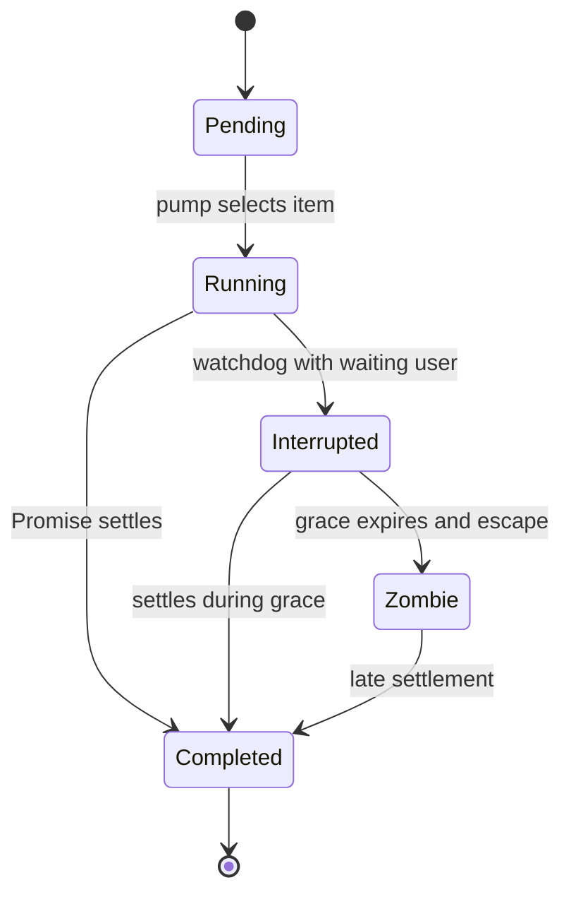

# Per-agent queues, priorities, and watchdog

[English](README.en.md) · [Português (Brasil)](README.md)

## Responsibility

`SandRunScheduler` schedules work already selected by another component. It receives an asynchronous function, an agent, and queue metadata. It does not search for opportunities, create intentions, or choose objectives. The code exists in the host, but this snapshot's BOX send path is refused before a local turn executes. Sources: [host-main.cjs:739617–739903](../../../reference/runtime/host-main.cjs#L739617-L739903), [host-main.cjs:740157–740194](../../../reference/runtime/host-main.cjs#L740157-L740194).

## `enqueue` contract

`enqueue(agentId, task, options)` returns a Promise that tracks the item. `options` includes `lane`, `source`, `acceptedAtMs`, `ackToken`, and `onCancelled`. The per-agent queue stores `pendingUser`, `pendingAgent`, `pendingBackground`, one `active` item, a generation counter, and a set of `zombies`. `enqueuedAtMs` comes from the injectable clock. Source: [host-main.cjs:739624–739688](../../../reference/runtime/host-main.cjs#L739624-L739688).

| Priority | Selection |
| --- | --- |
| `user` | First user item whose `source` is not `group-member`; if all are member items, the first in the queue. |
| `agent` | FIFO, after the user queue is emptied. |
| `background` | FIFO, after the other two. |

The handling of `group-member` makes the user queue **prioritized**, rather than strictly FIFO. The `pendingAhead` value used in telemetry is a position calculated at acceptance, not a promise of final order. Sources: [host-main.cjs:739619–739623](../../../reference/runtime/host-main.cjs#L739619-L739623), [host-main.cjs:739665–739686](../../../reference/runtime/host-main.cjs#L739665-L739686), [host-main.cjs:739757–739774](../../../reference/runtime/host-main.cjs#L739757-L739774).

## Observed state machine



`Interrupted` corresponds to the internal label `phase = "interrupted"`. In this scheduler, the transition records telemetry and schedules grace; **`onWatchdogFired` contains no call to cancel the task**. The phase name does not establish that the work was interrupted in the runtime. Source: [host-main.cjs:739853–739878](../../../reference/runtime/host-main.cjs#L739853-L739878).

## Main functions

### `takeNextUserTask(pending)`

Searches for `source !== "group-member"`; removes the item by index or, if no preferred candidate exists, at index zero. Returns `undefined` if empty. [README](../../functions/takeNextUserTask/README.en.md). Source: [host-main.cjs:739619–739623](../../../reference/runtime/host-main.cjs#L739619-L739623).

### `SandRunScheduler.enqueue`

Creates a Promise and record, inserts it into the lane, reports queue depths, arms the watchdog when applicable, and schedules `pump` in a microtask. An already-disposed scheduler invokes `onCancelled` through a Promise and accepts no new execution. Source: [host-main.cjs:739632–739688](../../../reference/runtime/host-main.cjs#L739632-L739688).

### `pump(agentId)`

Returns if disposed, if no queue exists, or if an item is active. Selects by priority, increments the generation, creates a `settled` Promise, and assigns `active` before calling the task. `try/catch` also converts a synchronous error into a rejection. Completion calls `onTaskSettled`, which resolves/rejects the item's Promise and only releases the slot if the generation is still current. Source: [host-main.cjs:739756–739836](../../../reference/runtime/host-main.cjs#L739756-L739836). [README](../../functions/SandRunScheduler-pump/README.en.md).

### `armWatchdog`, `waitedBehindActiveMs`, and `onWatchdogFired`

The watchdog exists only when a user item is pending **and** work is active. The measured wait starts at `max(user enqueuedAtMs, active startedAtMs)`, avoiding counting time before the current active item began. Defaults in `RunLifecycle`: **120 seconds** of waiting and **30 seconds** of grace, configurable through the supplied environment. The check runs again when the timer fires to avoid premature action. Sources: [host-main.cjs:739837–739879](../../../reference/runtime/host-main.cjs#L739837-L739879), [host-main.cjs:739904–739950](../../../reference/runtime/host-main.cjs#L739904-L739950).

### `escapeWedgedRun`

After grace, confirms the generation and resolves the item's public Promise, records its real Promise in `zombies`, releases `active`, and calls `pump`. If the old task continues, it can coexist with the next one. `onTaskSettled` recognizes late completion by generation and does not clear the new active item. This is an escape from a blocked queue, not a guarantee of single execution after the escape. Source: [host-main.cjs:739879–739903](../../../reference/runtime/host-main.cjs#L739879-L739903). [README](../../functions/SandRunScheduler-escapeWedgedRun/README.en.md).

### `drain` and `dispose`

`drain` takes a snapshot of the active item, zombies, and pending items and waits with `Promise.allSettled`. New items arriving after the snapshot do not automatically become part of it. `dispose` cancels timers and empties pending items through `onCancelled`, but does not kill the active task. Source: [host-main.cjs:739689–739755](../../../reference/runtime/host-main.cjs#L739689-L739755).

### `RunLifecycle.enqueueExclusiveRun`

Uses the scheduler when enabled. With `schedulerDisabled`, it serializes through a Promise chain in `runChains`, preserving progress after errors through `allSettled`. `beginSessionRun` and `endSessionRun` count work per session; when the count reaches zero, they record completion and attempt to remove inactive sessions. Source: [host-main.cjs:739904–740111](../../../reference/runtime/host-main.cjs#L739904-L740111).

## Implications for a future reconstruction

Replicating this scheduler requires preserving member priority, generations, the distinct semantics of the two Promises, cancellation callbacks, and zombie behavior. Replacing everything with a FIFO queue would change the contract. Presenting it as isolation or a proactivity engine would also be incorrect. The runner's actual interruption mechanism is documented in [cancellation and recovery](../cancellation-recovery/README.en.md).

## Safe verification

```bash
sed -n '739617,739952p' reference/runtime/host-main.cjs
rg -n 'takeNextUserTask|escapeWedgedRun|RUN_WATCHDOG_DEFAULT_MS' reference/runtime/host-main.cjs
```
