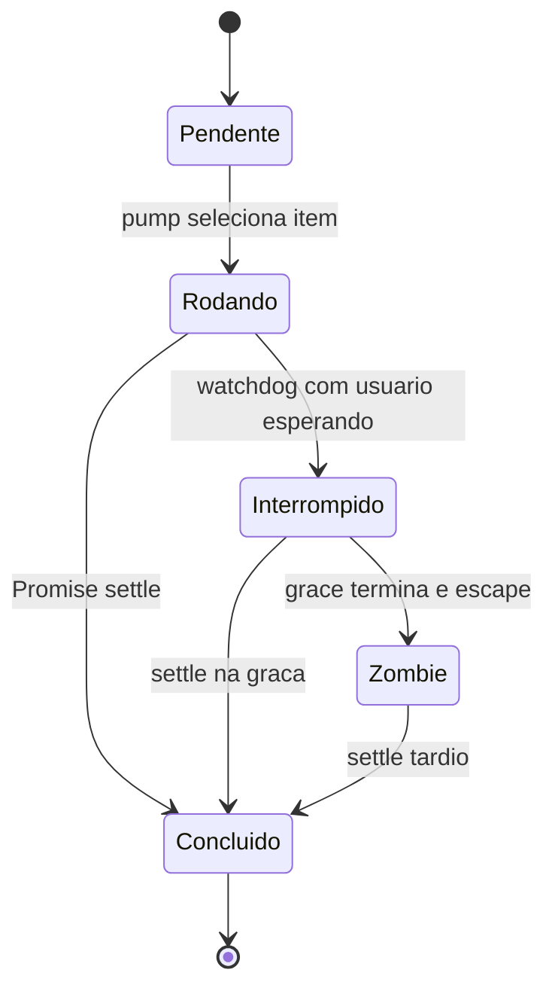

# Filas por agente, prioridades e watchdog

## Responsabilidade

`SandRunScheduler` é um scheduler de trabalhos já escolhidos por outro componente. Recebe uma função assíncrona, um agente e metadados de fila. Ele não procura oportunidades, cria intenções ou escolhe objetivos. O código existe no host, mas o envio BOX desse snapshot é recusado antes de executar um turno local. Fontes: [host-main.cjs:739617–739903](../../../reference/runtime/host-main.cjs#L739617-L739903), [host-main.cjs:740157–740194](../../../reference/runtime/host-main.cjs#L740157-L740194).

## Contrato de `enqueue`

`enqueue(agentId, task, options)` devolve uma Promise que acompanha o item. `options` inclui `lane`, `source`, `acceptedAtMs`, `ackToken` e `onCancelled`. A fila por agente guarda `pendingUser`, `pendingAgent`, `pendingBackground`, um `active`, um contador de geração e um conjunto de `zombies`. `enqueuedAtMs` vem do relógio injetável. Fonte: [host-main.cjs:739624–739688](../../../reference/runtime/host-main.cjs#L739624-L739688).

| Prioridade | Seleção |
| --- | --- |
| `user` | Primeiro usuário cujo `source` não é `group-member`; se todos são membros, primeiro da fila. |
| `agent` | FIFO, depois de esvaziar usuários. |
| `background` | FIFO, depois das outras duas. |

O tratamento de `group-member` faz a fila de usuário ser **priorizada**, não estritamente FIFO. `pendingAhead` usado em telemetria é uma posição calculada na aceitação, não uma promessa de ordem final. Fontes: [host-main.cjs:739619–739623](../../../reference/runtime/host-main.cjs#L739619-L739623), [host-main.cjs:739665–739686](../../../reference/runtime/host-main.cjs#L739665-L739686), [host-main.cjs:739757–739774](../../../reference/runtime/host-main.cjs#L739757-L739774).

## Máquina de estados observada



`Interrompido` é o rótulo interno `phase = "interrupted"`. Neste scheduler, a transição registra telemetria e agenda grace; **não há chamada ao cancelamento da tarefa dentro de `onWatchdogFired`**. O nome da fase não prova que o trabalho foi interrompido no runtime. Fonte: [host-main.cjs:739853–739878](../../../reference/runtime/host-main.cjs#L739853-L739878).

## Funções principais

### `takeNextUserTask(pending)`

Procura `source !== "group-member"`; retira o item pelo índice ou, sem candidato preferido, índice zero. Retorna `undefined` se vazio. [README](../../functions/takeNextUserTask/README.md). Fonte: [host-main.cjs:739619–739623](../../../reference/runtime/host-main.cjs#L739619-L739623).

### `SandRunScheduler.enqueue`

Cria Promise e registro, insere na lane, relata profundidades, arma watchdog se houver condição e agenda `pump` em microtask. Scheduler já disposto invoca `onCancelled` por Promise e não aceita nova execução. Fonte: [host-main.cjs:739632–739688](../../../reference/runtime/host-main.cjs#L739632-L739688).

### `pump(agentId)`

Retorna se disposto, sem fila ou com ativo. Seleciona a prioridade, incrementa geração, cria Promise `settled` e atribui `active` antes de chamar a tarefa. `try/catch` também converte erro síncrono em rejeição. O término chama `onTaskSettled`, que resolve/rejeita a Promise do item e só libera o slot se a geração ainda for a vigente. Fonte: [host-main.cjs:739756–739836](../../../reference/runtime/host-main.cjs#L739756-L739836). [README](../../functions/SandRunScheduler-pump/README.md).

### `armWatchdog`, `waitedBehindActiveMs` e `onWatchdogFired`

Só há watchdog quando existe usuário pendente **e** trabalho ativo. O tempo considerado começa em `max(enqueuedAtMs do usuário, startedAtMs do ativo)`, evitando contar espera anterior ao ativo atual. Defaults em `RunLifecycle`: **120 segundos** de espera e **30 segundos** de grace, configuráveis pelo ambiente recebido. A verificação se repete ao disparar para evitar ação prematura. Fontes: [host-main.cjs:739837–739879](../../../reference/runtime/host-main.cjs#L739837-L739879), [host-main.cjs:739904–739950](../../../reference/runtime/host-main.cjs#L739904-L739950).

### `escapeWedgedRun`

Após grace, confirma geração e resolve a Promise pública do item, registra sua Promise real em `zombies`, libera `active` e chama `pump`. Se a tarefa antiga continuar, ela pode coexistir com a seguinte. `onTaskSettled` reconhece o término tardio pela geração e não apaga o novo ativo. Isso é uma saída contra bloqueio de fila, não garantia de execução única após o escape. Fonte: [host-main.cjs:739879–739903](../../../reference/runtime/host-main.cjs#L739879-L739903). [README](../../functions/SandRunScheduler-escapeWedgedRun/README.md).

### `drain` e `dispose`

`drain` tira uma fotografia de ativo, zombies e itens pendentes e aguarda `Promise.allSettled`. Novos itens que entrem depois da fotografia não passam automaticamente a fazer parte dela. `dispose` cancela timers e esvazia pendentes via `onCancelled`, mas não mata a tarefa ativa. Fonte: [host-main.cjs:739689–739755](../../../reference/runtime/host-main.cjs#L739689-L739755).

### `RunLifecycle.enqueueExclusiveRun`

Usa o scheduler quando habilitado. Com `schedulerDisabled`, serializa por uma cadeia de Promises em `runChains`, preservando progresso após erro mediante `allSettled`. `beginSessionRun` e `endSessionRun` contabilizam trabalhos por sessão; ao zerar, registram conclusão e tentam retirar sessões não ativas. Fonte: [host-main.cjs:739904–740111](../../../reference/runtime/host-main.cjs#L739904-L740111).

## Consequências para reconstrução futura

Replicar este scheduler exige manter prioridade de membros, gerações, semântica distinta das duas Promises, callbacks de cancelamento e comportamento de zombie. Trocar tudo por uma fila FIFO alteraria o contrato. Também seria incorreto apresentá-lo como isolamento ou como motor de proatividade. O mecanismo real de interrupção do runner é documentado em [cancelamento e recuperação](../cancellation-recovery/README.md).

## Conferência segura

```bash
sed -n '739617,739952p' reference/runtime/host-main.cjs
rg -n 'takeNextUserTask|escapeWedgedRun|RUN_WATCHDOG_DEFAULT_MS' reference/runtime/host-main.cjs
```
