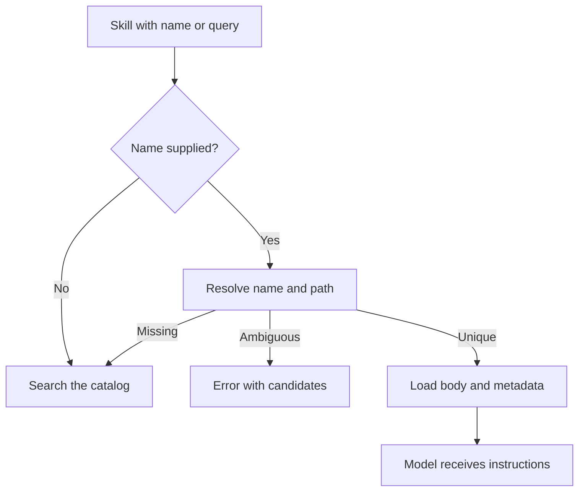

# Skills: discovery, reading, caching, and writing

[English](README.en.md) · [Português (Brasil)](README.md)

[Index](../../README.en.md) · [Prompts](../prompts/README.en.md) · [Integrations](../integrations/README.en.md)

## Responsibility

A skill is instructional content the agent can retrieve. The harness separates the catalog, search, body loading, auxiliary files, and content modification. There are managed, plugin, and personal skills; being able to see a skill does not grant permission to modify content from any origin. [IDs and normalization](../../../reference/runtime/host-main.cjs#L683903-L683970), [catalog and loading](../../../reference/runtime/sand-eval-runner.cjs#L565559-L566114).

## Discovery and context

`buildSkillToolCatalog` computes labels, removes skills the model cannot invoke, and applies a token budget. When names repeat, the path identifies the skill. A shortened list in the prompt does not mean the others have disappeared: the tool can search the full catalog and the unlisted set. `Skill` is placed in static context, but its catalog is computed through a closure. [Catalog](../../../reference/runtime/sand-eval-runner.cjs#L565678-L565795), [factory](../../../reference/runtime/sand-eval-runner.cjs#L566081-L566114).

| Function | Algorithm and output |
| --- | --- |
| `catalogLabels` | Counts names and uses the visible path when a collision exists |
| `createSkillsVirtualMount` | Exposes `/skills`; indexes documents by path and reuses the index while the list's identity remains unchanged |
| `searchSkills` | Combines listed and unlisted skills; queries fuzzy ranking; returns candidates and records the search |
| `loadOrSearchSkill` | `query` searches without loading; `name` attempts resolution; missing searches; ambiguous throws an error; found loads |
| `createSkillTool` | Chooses the schema with/without search, assembles the tool, and exposes catalog-budget metrics |

Sources: [mount and ranker](../../../reference/runtime/sand-eval-runner.cjs#L565559-L565677), [search and resolution](../../../reference/runtime/sand-eval-runner.cjs#L566008-L566114).

## Loading flow



Recovered limits: a maximum of 10 search results, telemetry queries limited to 200 characters, and mount reads with a default window of 400 lines. The body returned by the tool excludes frontmatter; the contract provides the directory and auxiliary files listed by the store. The mechanism loads instructions; it does not automatically execute scripts mentioned in the text. [Constants and description](../../../reference/runtime/sand-eval-runner.cjs#L565559-L565729).

## Managed skills

`normalizeManagedSkill` rejects disabled items, unsafe directory IDs, empty bodies, and empty names. It parses the skill, limits its content, and uses the supplied description when the skill has none. `managedSkillRoots` derives directories beneath the box roots.

`SandManagedSkillsService` supports startup, auth-change, and on-demand ensure triggers. `refreshPromise` serializes refreshes; concurrent calls record a `pendingTrigger`. `runRefreshes` fetches, normalizes, and writes the cache; errors produce diagnostics and preserve lifecycle control. `dispose` prevents new effects when observed. `ensureSkill` checks the cache, forces a refresh when the skill is missing, and checks again. [Service](../../../reference/runtime/host-main.cjs#L683940-L684043).

This establishes a cache and its local triggers. The selection of managed skills and the content served by `options.fetch` belong to the external dependency, rather than the cache algorithm.

## Modification and ownership

`resolveBotSkillWriteTarget` prioritizes an exact ID and distinguishes the bot's own `bot-skills` plugin, other plugins, and personal workflows; it also resolves matches by name/path. The return value may carry `personalTwin`, indicating a personal skill with the same name. Refusal constants explicitly state that skills from another plugin must not be edited/shadowed through this route and that writing to a team bot is restricted to an owner/manager. These constants alone do not prove a real caller's identity: the store and update implementation must apply the returned target. [Write resolution](../../../reference/runtime/host-main.cjs#L762030-L762087).

## Boundaries

Skills do not replace tool policies, and a skill's content does not prove that a tool is assembled. The local cache, catalog seen by the model, and write authorization are separate layers. This was a static analysis; no remote search or loading of skills from real accounts took place.

```bash
rg -n 'function (createSkillTool|loadOrSearchSkill|searchSkills|normalizeManagedSkill|resolveBotSkillWriteTarget)|SandManagedSkillsService' reference/runtime/{host-main,sand-eval-runner}.cjs
```
