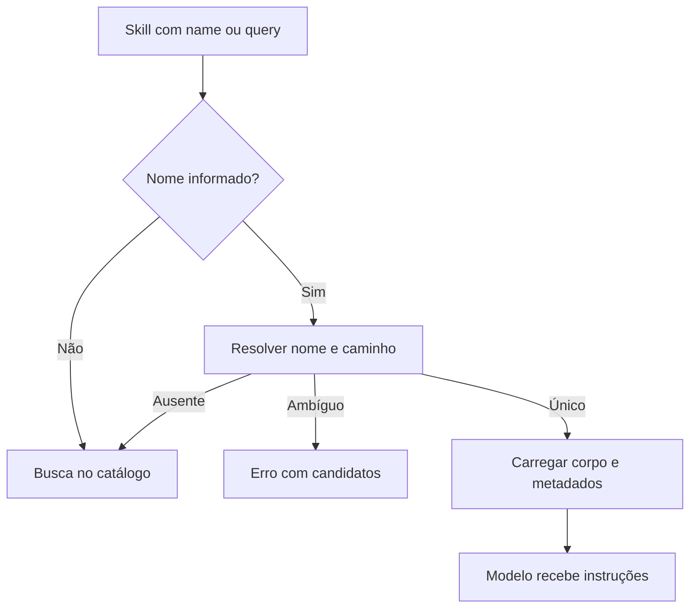

# Skills: descoberta, leitura, cache e escrita

[Índice](../../README.md) · [Prompts](../prompts/README.md) · [Integrações](../integrations/README.md)

## Responsabilidade

Uma skill é conteúdo de instrução recuperável pelo agente. O harness separa catálogo, busca, leitura do corpo, arquivos auxiliares e alteração do conteúdo. Há skills gerenciadas, de plugins e pessoais; a capacidade de ver uma skill não concede direito de alterar qualquer origem. [IDs e normalização](../../../reference/runtime/host-main.cjs#L683903-L683970), [catálogo e carga](../../../reference/runtime/sand-eval-runner.cjs#L565559-L566114).

## Descoberta e contexto

`buildSkillToolCatalog` calcula rótulos, elimina não invocáveis pelo modelo e aplica orçamento de tokens. Quando há nomes repetidos, o caminho identifica a skill. Uma lista reduzida no prompt não significa que as demais desapareceram: a ferramenta pode pesquisar o catálogo integral e o conjunto não listado. `Skill` é colocada em contexto estático, mas seu catálogo é calculado por closure. [Catálogo](../../../reference/runtime/sand-eval-runner.cjs#L565678-L565795), [factory](../../../reference/runtime/sand-eval-runner.cjs#L566081-L566114).

| Função | Algoritmo e saída |
| --- | --- |
| `catalogLabels` | Conta nomes e usa caminho visível quando há colisão |
| `createSkillsVirtualMount` | Expõe `/skills`; indexa documentos por path e reutiliza índice enquanto a identidade da lista não muda |
| `searchSkills` | Junta listadas e não listadas; consulta ranking fuzzy; retorna candidatos e registra busca |
| `loadOrSearchSkill` | `query` pesquisa sem carregar; `name` tenta resolver; missing pesquisa; ambiguous lança erro; found carrega |
| `createSkillTool` | Escolhe schema com/sem busca, monta ferramenta e expõe métricas do orçamento do catálogo |

Fontes: [mount e ranker](../../../reference/runtime/sand-eval-runner.cjs#L565559-L565677), [busca e resolução](../../../reference/runtime/sand-eval-runner.cjs#L566008-L566114).

## Fluxo de carga



Limites recuperados: busca com no máximo 10 resultados, query de telemetria limitada a 200 caracteres, leitura do mount com janela padrão de 400 linhas. O corpo retornado pela ferramenta não inclui frontmatter; o contrato informa a pasta e arquivos auxiliares listados pelo store. O mecanismo carrega instruções; ele não executa automaticamente scripts que o texto menciona. [Constantes e descrição](../../../reference/runtime/sand-eval-runner.cjs#L565559-L565729).

## Skills gerenciadas

`normalizeManagedSkill` rejeita itens desabilitados, ID de pasta inseguro, corpo vazio e nome vazio. Faz parse de skill, limita conteúdo e usa descrição fornecida quando não existe uma na skill. `managedSkillRoots` deriva pastas sob as raízes da box.

`SandManagedSkillsService` tem startup, auth change e ensure on-demand. `refreshPromise` serializa a atualização; chamadas concorrentes registram um `pendingTrigger`. `runRefreshes` busca, normaliza e escreve cache; erro gera diagnóstico e preserva o controle de ciclo. `dispose` impede novos efeitos quando observado. `ensureSkill` consulta cache, força refresh quando ausente e verifica novamente. [Serviço](../../../reference/runtime/host-main.cjs#L683940-L684043).

Isso comprova um cache e seus gatilhos locais. A origem da seleção de skills gerenciadas e o conteúdo servido por `options.fetch` pertencem à dependência externa, não ao algoritmo do cache.

## Alteração e propriedade

`resolveBotSkillWriteTarget` prioriza ID exato, distingue plugin próprio `bot-skills`, outros plugins e workflows pessoais; também resolve correspondência por nome/caminho. O retorno pode carregar `personalTwin`, indicando homônimo pessoal. As constantes de recusa explicitam que skills de outro plugin não devem ser editadas/sombreadas por essa rota e que escrita em team bot é reservada a owner/manager. As constantes sozinhas não provam a identidade de um chamador real: o store e a implementação de update precisam aplicar o destino retornado. [Resolução de escrita](../../../reference/runtime/host-main.cjs#L762030-L762087).

## Fronteiras

As skills não substituem as políticas de ferramenta, nem o conteúdo de uma skill prova que uma ferramenta está montada. Cache local, catálogo visto pelo modelo e autorização de escrita são camadas separadas. A análise foi estática; não houve busca remota nem carregamento de skills de contas reais.

```bash
rg -n 'function (createSkillTool|loadOrSearchSkill|searchSkills|normalizeManagedSkill|resolveBotSkillWriteTarget)|SandManagedSkillsService' reference/runtime/{host-main,sand-eval-runner}.cjs
```
