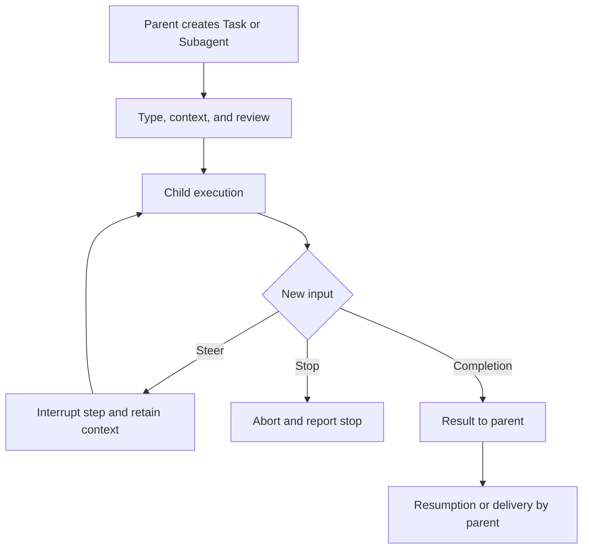

# Subagents: delegation, context, control, and return

[English](README.en.md) · [Português (Brasil)](README.md)

[Index](../../README.en.md) · [Documentary tasks](../tasks/README.en.md) · [Tools](../tools/README.en.md) · [Background wakes](../background-wakes/README.en.md)

## Three distinct entities

| Entity | Purpose | Relationship to the parent |
| --- | --- | --- |
| Documentary task | Persistent record of a workstream | Can list subagent IDs, but does not execute by itself |
| `Task`/`Subagent` subagent | Delegated execution with its own context, tools, and lifecycle | Result returns to the parent; may support resume, steer, and stop |
| Another bot via `SendToAgent` | Persistent agent already identified in the directory | Receives a message with priority and has its own conversation |

The `Task`/`Subagent` alias depends on `host.gates.tasks()`. `subagentKind` recognizes built-in names and normalizes computerUse, userComputerUse, and knowledgeWork; other names may be custom. [Types and name](../../../reference/runtime/host-main.cjs#L740853-L740874).

## Creation: `createSandTaskTool`

The factory uses `createTaskTool` from the agent package, with `CombinedResourceAccessor`: it preserves parent resources and supplies a read executor for the remote box. The child's initial configuration receives an empty, closed toolset; subsequent assembly applies the type's manifest. The tool session and summarization handler come from the turn. [Code](../../../reference/runtime/host-main.cjs#L763493-L763547).

| Concrete option | Value or condition | Implication |
| --- | --- | --- |
| `allowCustomModelId` | false | Does not accept an arbitrary model ID in this factory |
| `includeModelParameter` | `executorProfileSelectionEnabled` | Effort parameter depends on profile selection |
| `useClientSideSubagent` | true | Execution path selected by this factory; does not establish local desktop execution |
| `requireServerSideSubagent` | false | Does not require the server-side variant in this call |
| `requireExplicitSubagentTypeForNewSession` | Negation of system prompt override | A new child normally needs an explicit type |
| `enableJobCompletionNotifications` | true | Contract for notified completion |
| `trustedVideoAttachmentRoots` | Workspace if the box has a desktop | Restricted trust for video attachments |
| Forked executor context | Configuration has an executor and the gate is enabled | Executor can inherit the conversation; others use a self-contained prompt |

The default description instructs that the child sees neither the conversation nor the user. The forked variant changes that statement only for new executors. `resume` reuses a completed child with context; `MessageSubagent` serves a child that is still running. These are different operations. [Descriptions and factory](../../../reference/runtime/host-main.cjs#L763474-L763547).

## Capabilities by type

`TASK_SUBAGENT_TOOLS` reserves conversation, bot state, new delegations, and certain capabilities for the parent, but has named inclusions that must be read together with the groups. `EXECUTOR_TOOLS` adds canvas. Computer use receives neither connectors nor memory in the base manifest. Dream and sharing passes have narrower boundaries. Readonly variants, dynamic discovery, and history are resolved per turn in addition to the base manifest. [Manifests](../../../reference/runtime/host-main.cjs#L756882-L757275), [effective decision](../../../reference/runtime/sand-eval-runner.cjs#L543256-L543291).



## Control during execution

### `createSubagentManagementTools`

`CheckSubagent` lists all children or describes one ID: duration, tool-call count, recent activity, and transcript. It does not wait for completion. `MessageSubagent` goes through `reviewSteer` when available, then calls `steerSubagent`; an already-finished ID returns a not-running state. `StopSubagent` calls abort; its description says that stopping does not produce a separate revival with the child's result. [Factory](../../../reference/runtime/host-main.cjs#L781064-L781142).

### `normalizeSubagentIdArgs`

Accepts legacy aliases when the canonical field is absent. Conflicting aliases produce an error; equal aliases are normalized to `subagent_id` and recorded. The stop schema requires exactly one of an ID and `all:true`. [Normalization](../../../reference/runtime/host-main.cjs#L780855-L780929).

### `stopAllRunningSubagents`

Lists running children; performs aborts in parallel and, also in parallel, attempts to stop reachable delegated work. Each child is classified as stopped, alreadyFinished, or failed. Individual exceptions are caught without blocking the rest. The absence of the `stopDelegatedWork` port appears explicitly in the report. This does not guarantee that all remote work will be cancelled. [Implementation](../../../reference/runtime/host-main.cjs#L780933-L781063).

### `reviewSandSubagentAction`

Creates a target with action, prompt, type, ID, readonly, and resume, then executes the common review flow. The fingerprint binds the decision to the target, and the abort policy denies a cancelled operation. This wrapper does not recover the remote classifier's logic. [Review](../../../reference/runtime/host-main.cjs#L780771-L780823).

## Persistent bots and priority

`createSendToAgentTool` refuses self-messaging, validates the task thread, resolves images, and calls the `sendToAgent(target,message,images,priority,task?)` port. Its output records delivery/error; the `ack` text comes from the port. The schema declares priority true to wake the recipient, false to retain the message until a subsequent turn. Groups are an explicitly stated exception. The wrapper does not implement the recipient queue by itself. [Tool and schema](../../../reference/runtime/host-main.cjs#L757275-L757442).

## Boundaries still unresolved

Global concurrency, production quotas, operating-system isolation, and backend child persistence require their own contracts. `useClientSideSubagent:true` does not mean “runs on the Mac”: in eval, the executor client is inside the runner process. The child's result, the parent's wake, and a message delivered to the user are separate events.

```bash
rg -n 'createSandTaskTool|createSubagentManagementTools|stopAllRunningSubagents|createSendToAgentTool' reference/runtime/host-main.cjs
```
