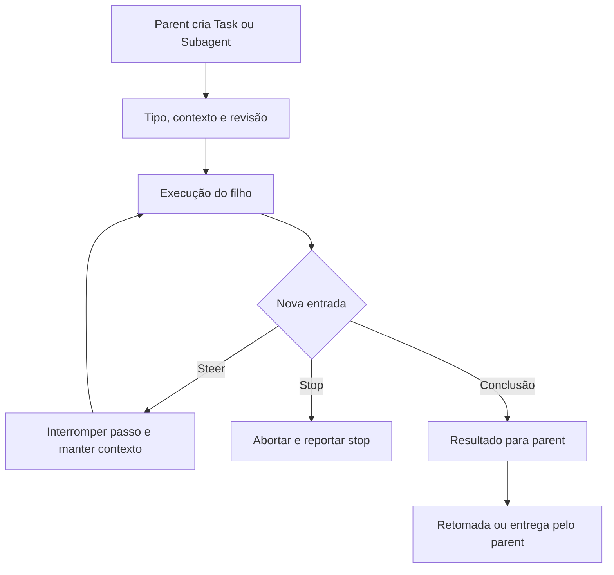

# Subagentes: delegação, contexto, controle e retorno

[Índice](../../README.md) · [Tasks documentais](../tasks/README.md) · [Ferramentas](../tools/README.md) · [Background wakes](../background-wakes/README.md)

## Três entidades distintas

| Entidade | Finalidade | Relação com o parent |
| --- | --- | --- |
| Task documental | Registro persistente de uma frente de trabalho | Pode listar IDs de subagentes, mas não executa por si |
| Subagente `Task`/`Subagent` | Execução delegada com contexto, ferramentas e ciclo próprios | Resultado retorna ao parent; pode ter resume, steer e stop |
| Outro bot via `SendToAgent` | Agente persistente já identificado no diretório | Recebe mensagem com prioridade e conversa própria |

O alias `Task`/`Subagent` depende de `host.gates.tasks()`. `subagentKind` reconhece nomes built-in e normaliza computerUse, userComputerUse e knowledgeWork; demais nomes podem ser customizados. [Tipos e nome](../../../reference/runtime/host-main.cjs#L740853-L740874).

## Criação: `createSandTaskTool`

A fábrica usa `createTaskTool` do pacote agent, com `CombinedResourceAccessor`: preserva recursos do parent e fornece um read executor da box remota. A configuração inicial do filho recebe um toolset vazio e fechado; a montagem posterior aplica o manifesto do tipo. A sessão de ferramentas e o summarization handler vêm do turno. [Código](../../../reference/runtime/host-main.cjs#L763493-L763547).

| Opção concreta | Valor ou condição | Implicação |
| --- | --- | --- |
| `allowCustomModelId` | false | Não aceita um ID livre de modelo nessa fábrica |
| `includeModelParameter` | `executorProfileSelectionEnabled` | Parâmetro de esforço depende da seleção de perfil |
| `useClientSideSubagent` | true | Caminho de execução selecionado por essa fábrica; não prova desktop local |
| `requireServerSideSubagent` | false | Não exige a variante server-side nessa chamada |
| `requireExplicitSubagentTypeForNewSession` | Negação de override de system prompt | Novo filho normalmente precisa de tipo explícito |
| `enableJobCompletionNotifications` | true | Contrato de conclusão notificada |
| `trustedVideoAttachmentRoots` | Workspace se box tem desktop | Confiança restrita para anexos de vídeo |
| Contexto executor forked | Config possui executor e gate habilitado | Executor pode herdar conversa; outros seguem prompt autocontido |

A descrição padrão instrui que o filho não vê a conversa nem o usuário. A variante forked muda essa afirmação apenas para novos executors. `resume` reutiliza um filho concluído com contexto; `MessageSubagent` serve a um filho ainda em execução. São operações diferentes. [Descrições e factory](../../../reference/runtime/host-main.cjs#L763474-L763547).

## Capacidades por tipo

`TASK_SUBAGENT_TOOLS` reserva conversa, estado do bot, novas delegações e certas capacidades ao parent, mas possui inclusões nominais que precisam ser lidas junto com os grupos. `EXECUTOR_TOOLS` acrescenta canvas. Computer use não recebe conectores nem memória no manifesto base. Dream e passagens de compartilhamento possuem fences mais estreitos. Variantes readonly, descoberta dinâmica e histórico são resolvidas por turno, além do manifesto base. [Manifestos](../../../reference/runtime/host-main.cjs#L756882-L757275), [decisão efetiva](../../../reference/runtime/sand-eval-runner.cjs#L543256-L543291).



## Controle em execução

### `createSubagentManagementTools`

`CheckSubagent` lista todos ou descreve um ID: duração, número de tool calls, atividade recente e transcript. Não é um wait de conclusão. `MessageSubagent` passa por `reviewSteer` quando disponível, depois chama `steerSubagent`; um ID já terminado retorna estado not-running. `StopSubagent` chama abort; a descrição informa que o stop não gera uma retomada separada com resultado do filho. [Factory](../../../reference/runtime/host-main.cjs#L781064-L781142).

### `normalizeSubagentIdArgs`

Aceita aliases legados quando o campo canônico não existe. Aliases conflitantes produzem erro; aliases iguais são normalizados para `subagent_id` e registrados. O schema de stop exige exatamente um entre ID e `all:true`. [Normalização](../../../reference/runtime/host-main.cjs#L780855-L780929).

### `stopAllRunningSubagents`

Lista filhos em execução; executa aborts em paralelo e, também em paralelo, tenta parar trabalho delegado alcançável. Cada filho é classificado como stopped, alreadyFinished ou failed. Exceções individuais são capturadas sem impedir o restante. Ausência da porta `stopDelegatedWork` aparece explicitamente no relatório. Isso não é garantia de que todo trabalho remoto será cancelado. [Implementação](../../../reference/runtime/host-main.cjs#L780933-L781063).

### `reviewSandSubagentAction`

Cria alvo com ação, prompt, tipo, ID, readonly e resume, e executa o fluxo de revisão comum. O fingerprint associa a decisão ao alvo e a política de abort nega operação cancelada. A lógica do classificador remoto não está recuperada por esse wrapper. [Revisão](../../../reference/runtime/host-main.cjs#L780771-L780823).

## Bots persistentes e prioridade

`createSendToAgentTool` recusa enviar para o próprio ID, valida task thread, resolve imagens e chama a porta `sendToAgent(target,message,images,priority,task?)`. A saída registra entrega/erro; o texto `ack` vem da porta. O schema declara prioridade true para acordar o destinatário, false para guardar até um próximo turno. Grupos são uma exceção declarada. O wrapper não implementa sozinho a fila de destinatário. [Tool e schema](../../../reference/runtime/host-main.cjs#L757275-L757442).

## Fronteiras ainda abertas

Concorrência global, cotas de produção, isolamento de sistema operacional e persistência de filhos no backend exigem seus próprios contratos. `useClientSideSubagent:true` não significa “roda no Mac”: no eval o cliente do executor está dentro do processo do runner. Resultado do filho, wake do parent e mensagem entregue ao usuário são eventos separados.

```bash
rg -n 'createSandTaskTool|createSubagentManagementTools|stopAllRunningSubagents|createSendToAgentTool' reference/runtime/host-main.cjs
```
