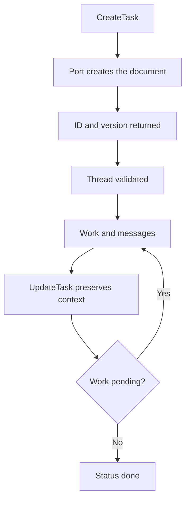

# Task documents and work threads

[English](README.en.md) · [Português (Brasil)](README.md)

[Index](../../README.en.md) · [Subagents](../subagents/README.en.md) · [Transcripts](../transcripts/README.en.md)

## Contract

A task is a Markdown document with frontmatter and a version record, associated with an agent and a thread. The harness accesses it through a `tasks` port. It is distinct from `Task`/`Subagent`, a progress list, and a turn ID. The recovered description declares server-side storage; the factories analyzed here delegate to the port and do not implement that server. [Tools](../../../reference/runtime/host-main.cjs#L739436-L739566).

## Recovered schema

| Field | Contract |
| --- | --- |
| ID | Ten lowercase hexadecimal characters, enforced by an anchored regex |
| Status | `open` or `done` |
| Name | Nonempty; structural maximum of 120 characters |
| Description | Nonempty; structural maximum of 120 characters; guidance text requests fewer than 60 |
| Body | Free-form Markdown |
| Subagents | A list of up to 20 IDs; an update replaces the list |
| Version | Appears in the returned record; the public tool analyzed does not accept `expectedVersion` |

The distinction between schema limits and style guidance is deliberately preserved in this documentation. [Constants](../../../reference/runtime/sand-eval-runner.cjs#L524650-L524658), [schemas](../../../reference/runtime/host-main.cjs#L739440-L739480).

## Functions

### `createSandTaskTools`

Assembles three tools, all with a dynamic-discovery hint:

1. **CreateTask:** validates the name, description, and optional body; calls `port.create`; and returns the document, ID, version, and guidance to use the thread.
2. **UpdateTask:** validates the ID and one edit mode; calls `port.update(id, taskEditOf(args))`; and only then returns the updated document.
3. **ReadTask:** without an ID, lists open tasks by default or recently completed tasks; with an ID, reads the document. Absence produces `SandToolInputError`.

Errors named `SandAgentTaskDocumentError` become input errors visible to the model. Other failures propagate. There is no automatic retry in this factory. [Implementation](../../../reference/runtime/host-main.cjs#L739482-L739566).

### `taskEditOf`

Selects exactly one category: structured fields, text replacement, or a complete rewrite. Mixing categories or supplying none throws an error. In replace mode, the helper uses an empty string for a missing side; the description requests the pair and requires a unique occurrence, but enforcing that occurrence depends on the document implementation below the port. Do not attribute a check to this helper that it does not perform. [Code](../../../reference/runtime/host-main.cjs#L739494-L739516).

### `resolveCardTaskThread`

An absent task ID returns to the main conversation. With an ID, it requires an available port, a valid format, and an existing document. A completed task is refused unless `setDoneThisTurn(id)` recognizes that it was closed in this turn. Finally, it calls `prepareThreadSend` if supplied. This port contributes to thread readiness; the complete criteria are not in this function. [Implementation](../../../reference/runtime/host-main.cjs#L725405-L725435).



## Prompt guidance

The Tasks section instructs the model to create records for ongoing work, preserve decisions and results, associate subagents, and publish results through the appropriate routes. These are instructions to the model. Creating the document does not automatically launch a subagent or complete the work; the operational connection requires subsequent calls. The prompt also distinguishes a task document from a cloud agent. [Prompt section](../../../reference/runtime/host-main.cjs#L739567-L739596).

## Remaining reverse-engineering work

The storage port must be traced to recover version conflicts, atomicity, indexing, ACLs, thread persistence, and reopening by the user. A `version` in the record does not demonstrate optimistic concurrency control in this tool's contract. This analysis includes no server test.

```bash
rg -n 'isSandAgentTaskId|function taskEditOf|function createSandTaskTools|resolveCardTaskThread' reference/runtime/{host-main,sand-eval-runner}.cjs
```
