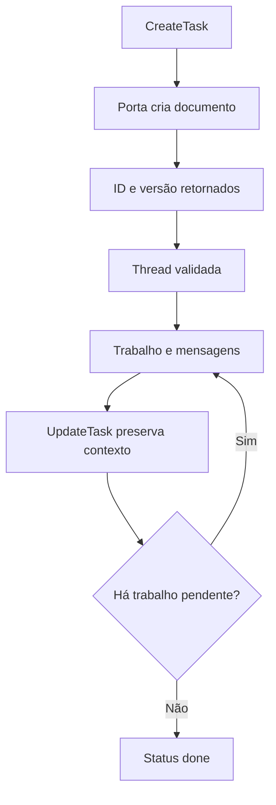

# Tasks documentais e threads de trabalho

[Índice](../../README.md) · [Subagentes](../subagents/README.md) · [Transcripts](../transcripts/README.md)

## Contrato

Uma task é um documento Markdown com frontmatter e registro de versão, associado ao agente e a uma thread. O harness a acessa por uma porta `tasks`. É distinta de `Task`/`Subagent`, de uma lista de progresso e de um ID de turno. A descrição recuperada declara armazenamento no servidor; as fábricas aqui analisadas delegam à porta, não implementam esse servidor. [Ferramentas](../../../reference/runtime/host-main.cjs#L739436-L739566).

## Schema recuperado

| Campo | Contrato |
| --- | --- |
| ID | Dez caracteres hexadecimais minúsculos, regex ancorada |
| Status | `open` ou `done` |
| Nome | Não vazio; máximo estrutural de 120 caracteres |
| Descrição | Não vazia; máximo estrutural de 120 caracteres; texto de orientação pede menos de 60 |
| Body | Markdown livre |
| Subagents | Lista de até 20 IDs; atualização substitui a lista |
| Version | Aparece no registro retornado; a ferramenta pública analisada não recebe `expectedVersion` |

A diferença entre limite de schema e orientação de estilo é intencionalmente preservada nesta documentação. [Constantes](../../../reference/runtime/sand-eval-runner.cjs#L524650-L524658), [schemas](../../../reference/runtime/host-main.cjs#L739440-L739480).

## Funções

### `createSandTaskTools`

Monta três ferramentas, todas com hint de descoberta dinâmica:

1. **CreateTask:** valida nome, descrição e body opcional; chama `port.create`; devolve documento, ID, versão e orientação para usar a thread.
2. **UpdateTask:** valida ID e uma modalidade de edição; chama `port.update(id, taskEditOf(args))`; só então retorna o documento atualizado.
3. **ReadTask:** sem ID, lista abertas por default ou recentemente concluídas; com ID, lê o documento. Ausência gera `SandToolInputError`.

Erros cujo nome é `SandAgentTaskDocumentError` viram erro de entrada visível ao modelo. Outras falhas são propagadas. Não existe retry automático nessa fábrica. [Implementação](../../../reference/runtime/host-main.cjs#L739482-L739566).

### `taskEditOf`

Escolhe exatamente uma categoria: campos estruturados; substituição textual; reescrita integral. Misturar categorias ou não fornecer nenhuma lança erro. Na modalidade replace, o helper usa string vazia para um dos lados ausente; a descrição pede o par e exige ocorrência única, mas essa exigência de ocorrência depende da implementação documental abaixo da porta. Não atribuir a esse helper uma verificação que ele não faz. [Código](../../../reference/runtime/host-main.cjs#L739494-L739516).

### `resolveCardTaskThread`

Task ID ausente volta para a conversa principal. Com ID, exige porta disponível, formato válido e documento existente. Task concluída é recusada, exceto se `setDoneThisTurn(id)` reconhecer fechamento neste turno. Por fim, chama `prepareThreadSend` se fornecida. Essa porta tem papel na prontidão da thread; os critérios completos não estão nesta função. [Implementação](../../../reference/runtime/host-main.cjs#L725405-L725435).



## Orientações do prompt

A seção Tasks manda criar registros para trabalho com continuidade, manter decisões e resultados, relacionar os subagentes e publicar resultados nas rotas apropriadas. Essas são instruções ao modelo. A criação do documento não dispara automaticamente um subagente nem conclui o trabalho; a conexão operacional exige chamadas subsequentes. O prompt também distingue uma task documental de um cloud agent. [Seção de prompt](../../../reference/runtime/host-main.cjs#L739567-L739596).

## Pendências de engenharia reversa

A porta de armazenamento precisa ser rastreada para recuperar conflitos de versão, atomicidade, índice, ACL, persistência da thread e reabertura pelo usuário. O registro possuir `version` não demonstra controle otimista no contrato desta ferramenta. Não há teste de servidor nesta análise.

```bash
rg -n 'isSandAgentTaskId|function taskEditOf|function createSandTaskTools|resolveCardTaskThread' reference/runtime/{host-main,sand-eval-runner}.cjs
```
