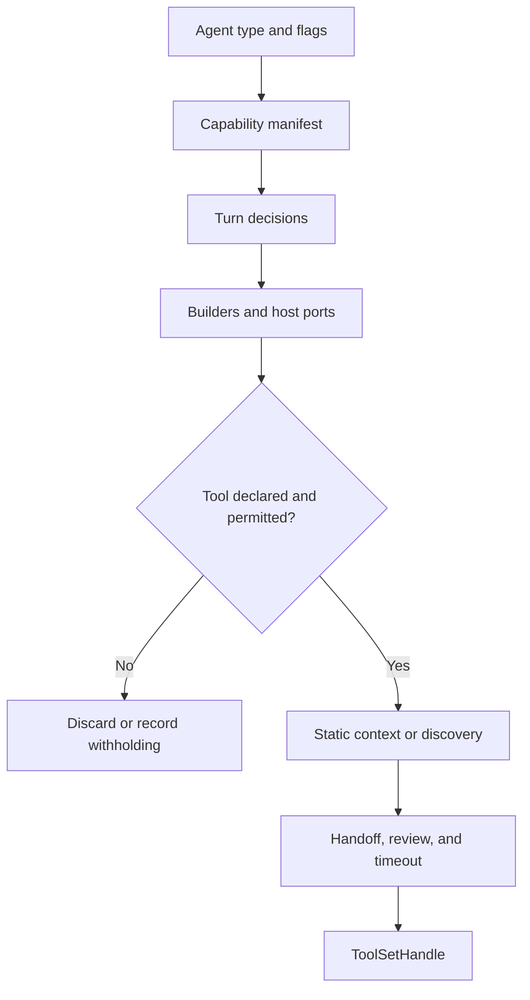

# Tools: catalog, policy, assembly, and execution

[English](README.en.md) · [Português (Brasil)](README.md)

[Harness index](../../README.en.md) · [Approvals](../approvals/README.en.md) · [Subagents](../subagents/README.en.md)

## Responsibility and evidence

The harness computes which capabilities an agent type may receive, assembles the tools whose dependencies exist in the host, and determines which descriptions enter the context directly. The policy also filters execution: it is more than a catalog for the model. The most complete assembly implementation is in the evaluation bundle; the host preserves manifests, builders, and several implementations, but its BOX send path is retired. This page documents recovered code without claiming current production execution.

Sources: [policy and manifests in the host](../../../reference/runtime/host-main.cjs#L756537-L757275), [decisions in the evaluation runner](../../../reference/runtime/sand-eval-runner.cjs#L543256-L543302), [assembly in the evaluation runner](../../../reference/runtime/sand-eval-runner.cjs#L582578-L582733).

## Flow



## Functions and contracts

| Symbol | Input | Work performed | Output and failure |
| --- | --- | --- | --- |
| `defineAgentTools` | Included/omitted groups, named exceptions, discovery, and hints | Traverses all known IDs; requires a decision for each; named inclusion/omission takes precedence over the group | A policy, or an error for a contradiction/unclassified ID |
| `extendAgentTools` | Base policy and delta | Applies omissions, then inclusions; preserves reasons; changes discovery and tools behind lookup | A new policy; changing from static to dynamic without `topLevel` fails |
| `resolveSandTurnToolDecisions` | Runner, subagent type, readonly, turn origin, and gates | Resolves the manifest and additional restrictions, including inbox writes by executor/knowledgeWork in automation | `offers`, `enforce`, placement, and connector access |
| `runTurnToolBuilders` | Builders, context, withheld-tool list, and optional mocks | Skips builders without offered capabilities; discards undeclared tools; counts `undeclared_tool` | The list actually assembled |
| `buildTurnTools` | Host, turn, and props | Resolves policies, assembles builders and devices, and adds wrappers and timeouts | A finalized toolset, which may be empty |
| `fencedToolSet` | Final tools and optional dynamic registry | Marks results, partitions static/dynamic tools, and builds `ToolSetHandle` | The execution and context set |

Details directly in the code: [define/extend](../../../reference/runtime/host-main.cjs#L756559-L756668), [builders](../../../reference/runtime/sand-eval-runner.cjs#L564594-L564645), [fence](../../../reference/runtime/sand-eval-runner.cjs#L554353-L554366).

### `buildTurnTools`, step by step

1. Resolves `decisions`. `offersNoTools` immediately returns `fencedToolSet([])`.
2. If a special set exists for a sharing pass, applies the policy and legacy forwarding before finalizing the set.
3. Creates the context with a dynamic registry, resources, review, and handoffs.
4. Runs `TURN_TOOL_BUILDERS`. An absent port, such as `host.tasks`, can produce an empty list even when the manifest permits the capability.
5. Adds device tools, applies readonly refusals, and handles compatibility with `UpdateState`.
6. Determines placement through the manifest, the readonly canvas exception, or hints. A dynamic tool remains subject to policy.
7. Wraps dynamic invocation in a specialized timeout; other tools receive timeouts by name and subagent type.
8. Finalizes the result in `fencedToolSet`.

This order matters: being permitted, being assembled, being visible in the prompt, and having an approved call are different states. [Complete code](../../../reference/runtime/sand-eval-runner.cjs#L582667-L582732).

## Recovered manifests

| Family | Visible contract |
| --- | --- |
| Main | Dynamic discovery; includes memory, routines, files, delegation, and administration according to groups and exceptions |
| Automation | Derives from Main; withholds direct user communication, acting as the user, credentials/money, and control of the user's computer; offers `WakeParent` |
| Task | Its own set for delegated execution; the parent controls conversation, state, and further delegation |
| Executor | Extends Task with canvas tools |
| Computer use | Box and desktop tools; no connectors, memory, or further delegation in the base manifest |
| Dream | Static; only `SearchTranscriptFiles`, `ReadTranscriptFile`, `RecallMemory`, and `UpdateMemory` |

Named exceptions must be read. For example, Task explicitly includes certain email tools while omitting broader groups; `resolveSandTurnToolDecisions` adds write withholding in readonly and automation contexts. Do not turn a group name into an absolute conclusion. [Manifests](../../../reference/runtime/host-main.cjs#L756706-L756990).

## Context and observability details

The hint strategy forces `RecallMemory`, `ReactToMessage`, `WakeParent`, and `SetStatus` into static context. A manifest can control placement when that variant is used. The tool protocol distinguishes model-facing names from internal IDs, records the real name by `toolCallId`, and keeps tool results marked to separate them from trusted instructions. [Placement](../../../reference/runtime/sand-eval-runner.cjs#L582578-L582667), [call identity](../../../reference/runtime/sand-eval-runner.cjs#L553781-L553820).

## Limits

The manifests and wrappers do not recover every connector implementation or the risk-classification service. Gates, ports, credentials, and deployment determine the actual set. A toolset observed in the evaluation runner does not prove that the production backend has the same set. See [integrations](../integrations/README.en.md) and [approvals](../approvals/README.en.md).

## Static verification

```bash
rg -n 'function (defineAgentTools|extendAgentTools|resolveSandTurnToolDecisions|runTurnToolBuilders|buildTurnTools|fencedToolSet)' reference/runtime/{host-main,sand-eval-runner}.cjs
```
