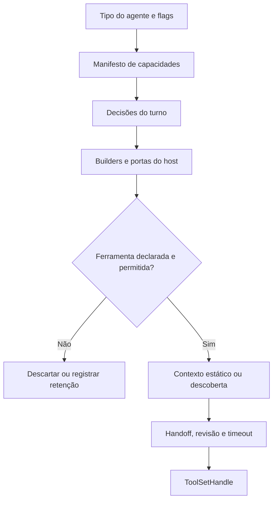

# Ferramentas: catálogo, política, montagem e execução

[Índice do harness](../../README.md) · [Aprovações](../approvals/README.md) · [Subagentes](../subagents/README.md)

## Responsabilidade e evidência

O harness calcula quais capacidades um tipo de agente pode receber, monta as ferramentas cujas dependências existem no host e define quais descrições entram diretamente no contexto. A política também filtra a execução: não é apenas um catálogo para o modelo. A implementação mais completa de montagem está no bundle de avaliação; o host preserva os manifestos, builders e várias implementações, mas seu caminho BOX de envio está aposentado. Esta página documenta código recuperado, sem afirmar execução atual em produção.

Fontes: [política e manifestos no host](../../../reference/runtime/host-main.cjs#L756537-L757275), [decisões no eval](../../../reference/runtime/sand-eval-runner.cjs#L543256-L543302), [montagem no eval](../../../reference/runtime/sand-eval-runner.cjs#L582578-L582733).

## Fluxo



## Funções e contratos

| Símbolo | Entrada | Trabalho realizado | Saída e falha |
| --- | --- | --- | --- |
| `defineAgentTools` | Grupos incluídos/omitidos, exceções nominais, discovery e hints | Percorre todos os IDs conhecidos; exige uma decisão para cada um; precedência da inclusão/omissão por nome sobre grupo | Política ou erro por contradição/ID sem classificação |
| `extendAgentTools` | Política base e delta | Aplica omissões, depois inclusões; mantém justificativas; altera descoberta e ferramentas atrás de lookup | Nova política; mudar de static para dynamic sem `topLevel` falha |
| `resolveSandTurnToolDecisions` | Runner, tipo de subagente, readonly, origem do turno e gates | Resolve manifesto e restrições adicionais, incluindo escritas de inbox por executor/knowledgeWork em automação | `offers`, `enforce`, placement e acesso a conectores |
| `runTurnToolBuilders` | Builders, contexto, lista de ferramentas retidas e mocks opcionais | Pula builders sem capacidades oferecidas; descarta ferramentas não declaradas; conta `undeclared_tool` | Lista efetivamente montada |
| `buildTurnTools` | Host, turno e props | Resolve políticas, monta builders e dispositivos, coloca wrappers e timeouts | Toolset fechado; pode ser vazio |
| `fencedToolSet` | Ferramentas finais e registro dinâmico opcional | Marca resultados, particiona estáticas/dinâmicas e constrói `ToolSetHandle` | Conjunto de execução e contexto |

Detalhes diretamente no código: [define/extend](../../../reference/runtime/host-main.cjs#L756559-L756668), [builders](../../../reference/runtime/sand-eval-runner.cjs#L564594-L564645), [fence](../../../reference/runtime/sand-eval-runner.cjs#L554353-L554366).

### `buildTurnTools`, passo a passo

1. Resolve `decisions`. `offersNoTools` retorna imediatamente `fencedToolSet([])`.
2. Se existe um conjunto especial para uma passagem de compartilhamento, aplica a política e o encaminhamento legado antes de fechar o conjunto.
3. Cria o contexto com registro dinâmico, recursos, revisão e handoffs.
4. Executa `TURN_TOOL_BUILDERS`. Uma porta ausente, como `host.tasks`, pode produzir lista vazia mesmo quando o manifesto permitir a capacidade.
5. Acrescenta ferramentas de dispositivo, aplica recusas readonly e compatibilidade com `UpdateState`.
6. Decide placement por manifesto, exceção de canvas readonly ou hints. Ferramenta dinâmica continua sujeita à política.
7. Envolve invocação dinâmica em timeout especializado; outras recebem timeout por nome e tipo de subagente.
8. Fecha o resultado em `fencedToolSet`.

Essa ordem importa: ser permitido, estar montado, ser visível no prompt e ter uma chamada aprovada são estados diferentes. [Código completo](../../../reference/runtime/sand-eval-runner.cjs#L582667-L582732).

## Manifestos recuperados

| Família | Contrato visível |
| --- | --- |
| Main | Descoberta dinâmica; inclui memória, rotinas, arquivos, delegação e administração segundo grupos e exceções |
| Automation | Deriva do Main; retém comunicação direta com usuário, atuação como usuário, credenciais/dinheiro e controle do computador do usuário; oferece `WakeParent` |
| Task | Conjunto próprio para execução delegada; o parent controla conversa, estado e nova delegação |
| Executor | Amplia Task com ferramentas de canvas |
| Computer use | Ferramentas da box e desktop; sem conectores, memória ou nova delegação no manifesto base |
| Dream | Estático; apenas `SearchTranscriptFiles`, `ReadTranscriptFile`, `RecallMemory`, `UpdateMemory` |

As exceções nominais precisam ser lidas. Por exemplo, Task inclui explicitamente determinadas ferramentas de email mesmo omitindo grupos mais amplos; `resolveSandTurnToolDecisions` acrescenta retenção de escritas em contextos readonly e de automação. Não transformar o nome de um grupo em uma conclusão absoluta. [Manifestos](../../../reference/runtime/host-main.cjs#L756706-L756990).

## Detalhes de contexto e observabilidade

`RecallMemory`, `ReactToMessage`, `WakeParent` e `SetStatus` são forçados a contexto estático pela estratégia de hints. Um manifesto pode controlar o placement quando essa variante é usada. O protocolo de ferramentas distingue nomes de modelo e IDs internos, registra o nome real pelo `toolCallId` e mantém resultados de ferramentas marcados para separá-los de instruções confiáveis. [Placement](../../../reference/runtime/sand-eval-runner.cjs#L582578-L582667), [identidade da chamada](../../../reference/runtime/sand-eval-runner.cjs#L553781-L553820).

## Limites

Os manifestos e wrappers não recuperam a implementação de todos os conectores nem o serviço classificador de risco. Gates, portas, credenciais e implantação determinam o conjunto real. Um toolset observado no eval não prova o mesmo conjunto no backend de produção. Consulte [integrações](../integrations/README.md) e [aprovações](../approvals/README.md).

## Verificação estática

```bash
rg -n 'function (defineAgentTools|extendAgentTools|resolveSandTurnToolDecisions|runTurnToolBuilders|buildTurnTools|fencedToolSet)' reference/runtime/{host-main,sand-eval-runner}.cjs
```
