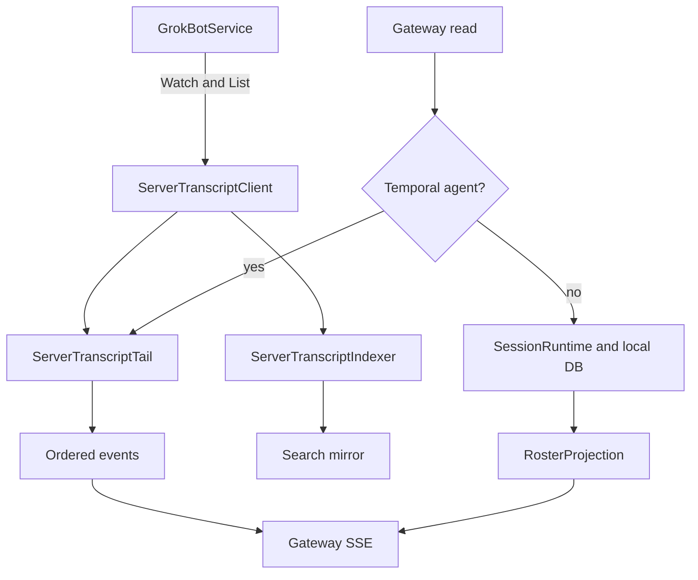

# Sessions, transcripts, remote tailing, and projections

[English](README.en.md) · [Português (Brasil)](README.md)

## Responsibility and boundaries

A transcript records the events of a conversation; it is neither the agent's semantic memory nor its task list. The host maintains local reads and writes per session, projections for consumers, and a remote tail for Temporal agents. The gateway's read APIs are wrapped by the same proxy that handles actions. Sources: [host-main.cjs:783170–783359](../../../reference/runtime/host-main.cjs#L783170-L783359), [host-main.cjs:491926–492328](../../../reference/runtime/host-main.cjs#L491926-L492328), [host-main.cjs:712928–713170](../../../reference/runtime/host-main.cjs#L712928-L713170).

## Identities

| Identity | Role |
| --- | --- |
| `agentId` | The agent/conversation targeted by many operations. |
| `sessionId` | A session scope; normalized when building tail state. |
| `entry.id` | The identifier of a transcript entry. |
| `generation` | The remote conversation generation, used to discard/restart projections. |
| `seq` and `updatedSeq` | Remote ordering and updates, transported as large integers. |
| `bootId` and local epoch | Form a replica stamp to distinguish restarts/rehydration. |
| `clientNonce` | Correlation/deduplication of send acceptance, not a guaranteed entry ID. |

Sources: [host-main.cjs:713046–713091](../../../reference/runtime/host-main.cjs#L713046-L713091), [host-main.cjs:710249–710335](../../../reference/runtime/host-main.cjs#L710249-L710335). Do not collapse these IDs into a single key in a reconstruction.

## Projection architecture



## Local functions

### `TranscriptManager`

Coordinates `SessionRuntime`, `RunLifecycle`, roster, groups, background wakes, automations, skills, forms, and other responsibilities. Many methods are short delegations; their logic resides in the called component. The constructor connects the store, acceptance ledger, memory, and ports. Source: [host-main.cjs:783170–783292](../../../reference/runtime/host-main.cjs#L783170-L783292).

### `SessionRuntime.ensureLoaded` and `loadActiveTranscript`

Use `pendingLoad` to share concurrent loading. They restore the active session and emit `cleared` when none exists or `snapshot` when it is loaded. A second concurrent completion does not improperly replace a transcript already installed. Source: [host-main.cjs:737822–737905](../../../reference/runtime/host-main.cjs#L737822-L737905).

### `SessionRuntime.appendEntry`

Normalizes the timestamp, writes to the session DB, and appends to the in-memory copy only when the result is `inserted`. A failure or duplicate produces a diagnostic and returns the outcome without emitting `appended`. After insertion, it signals activity/unread status according to type and focus. This avoids presenting something as persisted when it was not inserted. Source: [host-main.cjs:737907–737944](../../../reference/runtime/host-main.cjs#L737907-L737944). [README](../../functions/SessionRuntime-appendEntry/README.en.md).

### Activation and leases

`SessionRuntime` maintains live sessions, pending opens, deletions, and activation pin counts. A pin defers retirement until the last release; release uses `Symbol.dispose`. Background-agent reads use leases, allowing the resource to be released after the query. Sources: [host-main.cjs:737822–737879](../../../reference/runtime/host-main.cjs#L737822-L737879), [host-main.cjs:738187–738230](../../../reference/runtime/host-main.cjs#L738187-L738230).

### `TranscriptManager.dispose`

Marks disposal, stops the scheduler, waits for pending activations and roster emissions, tears down observers, gathers active/live/pending sessions, disposes stores, closes the DB with a checkpoint, and closes the worker pool. The order avoids closing a session while it is still being activated. Source: [host-main.cjs:783271–783294](../../../reference/runtime/host-main.cjs#L783271-L783294).

## Remote functions

### `createServerTranscriptClient`

Resolves access with caching, builds a Connect transport, and applies headers per request. `watch` calls `WatchGrokBotTranscripts`; `list` calls `ListGrokBotTranscriptEntries`. Omitted bodies can be read through signed URLs obtained via `PresignSandBoxStoreReads`, with bounded concurrency and partial reads that tolerate failures. Source: [host-main.cjs:712379–712492](../../../reference/runtime/host-main.cjs#L712379-L712492).

Access for required agents differs from the legacy path: with `legacyEnabled: false`, agents in `requiredAgents` remain eligible. In this proxy, the default access configuration returns `legacyEnabled: false`, while Temporal agents are required. Do not describe all remote reading as a disabled feature flag. Sources: [host-main.cjs:712410–712416](../../../reference/runtime/host-main.cjs#L712410-L712416), [host-main.cjs:714598–714609](../../../reference/runtime/host-main.cjs#L714598-L714609).

### `createServerTranscriptTail`

Maintains state per `(agentId, sessionId)` and serializes operations by key in `withAgent`. Each state contains a generation, confirmed update cursor, row map, counters, pending/missing-body queues, and retry state. The tail applies frames, rehydrates pages, and emits ordered snapshots/updates. Source: [host-main.cjs:712928–713170](../../../reference/runtime/host-main.cjs#L712928-L713170). [README](../../functions/createServerTranscriptTail/README.en.md).

`adoptGeneration` accepts the initial generation, ignores an old generation without explicit authority, and clears the projection when the generation changes. `epochOf` incorporates boot and generation; epoch changes prevent a consumer from mixing replicas. `fallBack` handles legacy BOX agents separately and preserves the server requirement for required agents. Source: [host-main.cjs:713077–713170](../../../reference/runtime/host-main.cjs#L713077-L713170).

Observed defaults: up to **256 cursors**, a maximum inline body of **256 KiB**, state idle time of **10 minutes**, stream backoff of **1 to 60 seconds**, body retries of up to **5 attempts**, and a **60-second** stream watchdog. These are compiled policies, not production metrics. Source: [host-main.cjs:712844–712868](../../../reference/runtime/host-main.cjs#L712844-L712868).

### `createServerTranscriptIndexer`

Synchronizes the search mirror from remote pages. `request` coalesces work: it marks `dirty` when already running and does not duplicate work that is queued or retrying. `pump` uses a pool of **2** synchronizations; an event becomes a hint with a **1.5-second** debounce. Failures use retry and do not erase the fact that another change arrived. Sources: [host-main.cjs:714158–714285](../../../reference/runtime/host-main.cjs#L714158-L714285).

### `RunLifecycle.withRunStates`

Projects activity states onto the roster. Temporal agents can receive an overlay from the server; the rest use the count of local runs. An activity projection is not the executor that produces the activity. Source: [host-main.cjs:740028–740071](../../../reference/runtime/host-main.cjs#L740028-L740071).

## What has not yet been proven

The server implementation that persists data and generates frames remains external to these excerpts. Reconnection and deduplication code show an intention to maintain consistency, but establishing the absence of replay, loss, or duplication in production would require authorized execution and test traffic. That was not performed in this analysis.

## Verification

```bash
rg -n 'createServerTranscriptClient|createServerTranscriptTail|createServerTranscriptIndexer|class SessionRuntime|var SessionRuntime' reference/runtime/host-main.cjs
sed -n '737907,737944p' reference/runtime/host-main.cjs
```
