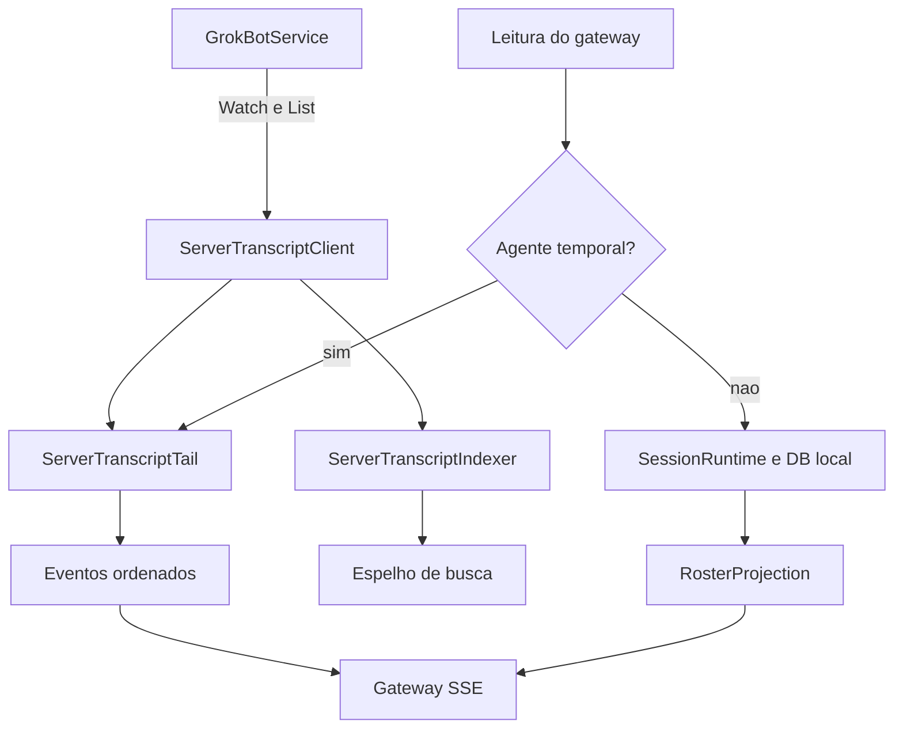

# Sessões, transcripts, cauda remota e projeções

## Responsabilidade e fronteiras

Transcript é o registro de eventos de uma conversa, não a memória semântica do agente nem a lista de tarefas. O host mantém leitura e escrita local por sessão, projeções para consumidores e uma cauda remota para agentes Temporal. As APIs de leitura do gateway são envolvidas pelo mesmo proxy que trata ações. Fontes: [host-main.cjs:783170–783359](../../../reference/runtime/host-main.cjs#L783170-L783359), [host-main.cjs:491926–492328](../../../reference/runtime/host-main.cjs#L491926-L492328), [host-main.cjs:712928–713170](../../../reference/runtime/host-main.cjs#L712928-L713170).

## Identidades

| Identidade | Papel |
| --- | --- |
| `agentId` | Agente/conversa alvo de muitas operações. |
| `sessionId` | Recorte de sessão; normalizado ao construir estado da cauda. |
| `entry.id` | Identificador de uma entrada do transcript. |
| `generation` | Geração remota da conversa, usada para descartar/reiniciar projeções. |
| `seq` e `updatedSeq` | Ordem e atualização remotas, transportadas como inteiros grandes. |
| `bootId` e epoch local | Compõem carimbo da réplica para distinguir reinícios/rehidratação. |
| `clientNonce` | Correlação/deduplicação de aceitação de envio, não ID de entrada garantido. |

Fontes: [host-main.cjs:713046–713091](../../../reference/runtime/host-main.cjs#L713046-L713091), [host-main.cjs:710249–710335](../../../reference/runtime/host-main.cjs#L710249-L710335). Não colapsar esses IDs em uma única chave na reconstrução.

## Arquitetura de projeção



## Funções locais

### `TranscriptManager`

Coordena `SessionRuntime`, `RunLifecycle`, roster, grupos, background wakes, automações, skills, formulários e outras responsabilidades. Muitos métodos são delegações curtas; a lógica fica no componente chamado. O construtor conecta store, ledger de aceitação, memória e portas. Fonte: [host-main.cjs:783170–783292](../../../reference/runtime/host-main.cjs#L783170-L783292).

### `SessionRuntime.ensureLoaded` e `loadActiveTranscript`

Usam `pendingLoad` para compartilhar carregamento concorrente. Restauram sessão ativa, emitem `cleared` quando inexistente ou `snapshot` quando carregada. Uma segunda conclusão concorrente não substitui indevidamente o transcript já instalado. Fonte: [host-main.cjs:737822–737905](../../../reference/runtime/host-main.cjs#L737822-L737905).

### `SessionRuntime.appendEntry`

Normaliza timestamp, escreve no DB da sessão e só acrescenta à cópia em memória quando o resultado é `inserted`. Falha ou duplicação gera diagnóstico e retorna o outcome sem emitir `appended`. Depois de inserir, sinaliza atividade/unread conforme tipo e foco. Isso evita apresentar como persistido algo que não foi inserido. Fonte: [host-main.cjs:737907–737944](../../../reference/runtime/host-main.cjs#L737907-L737944). [README](../../functions/SessionRuntime-appendEntry/README.md).

### Ativação e leases

`SessionRuntime` mantém sessões vivas, aberturas pendentes, exclusões e pin counts de ativação. O pin adia retirement até a última liberação; o release usa `Symbol.dispose`. Leituras de agentes em background usam leases, permitindo liberar o recurso após consulta. Fontes: [host-main.cjs:737822–737879](../../../reference/runtime/host-main.cjs#L737822-L737879), [host-main.cjs:738187–738230](../../../reference/runtime/host-main.cjs#L738187-L738230).

### `TranscriptManager.dispose`

Marca disposição, para scheduler, aguarda ativações pendentes e emissões de roster, desmonta observadores, reúne sessões ativas/vivas/pending, dispõe stores, fecha DB com checkpoint e fecha pool de workers. A ordem evita fechar uma sessão ainda sendo ativada. Fonte: [host-main.cjs:783271–783294](../../../reference/runtime/host-main.cjs#L783271-L783294).

## Funções remotas

### `createServerTranscriptClient`

Resolve acesso com cache, constrói transporte Connect e aplica headers por request. `watch` chama `WatchGrokBotTranscripts`; `list` chama `ListGrokBotTranscriptEntries`. Corpos omitidos podem ser lidos por URLs assinadas obtidas via `PresignSandBoxStoreReads`, com concorrência limitada e leitura parcial tolerante a falhas. Fonte: [host-main.cjs:712379–712492](../../../reference/runtime/host-main.cjs#L712379-L712492).

O acesso de agentes requeridos é diferente do caminho legado: com `legacyEnabled: false`, agentes presentes em `requiredAgents` continuam elegíveis. Neste proxy, a configuração padrão de acesso retorna `legacyEnabled: false`, enquanto agentes Temporal são requeridos. Não descrever toda leitura remota como uma feature flag desligada. Fontes: [host-main.cjs:712410–712416](../../../reference/runtime/host-main.cjs#L712410-L712416), [host-main.cjs:714598–714609](../../../reference/runtime/host-main.cjs#L714598-L714609).

### `createServerTranscriptTail`

Mantém estado por `(agentId, sessionId)` e serializa operações por chave em `withAgent`. Cada estado contém geração, cursor de atualização confirmado, mapa de linhas, contadores, filas de corpos pendentes/perdidos e retry. A cauda aplica frames, reidrata páginas e emite snapshots/updates ordenados. Fonte: [host-main.cjs:712928–713170](../../../reference/runtime/host-main.cjs#L712928-L713170). [README](../../functions/createServerTranscriptTail/README.md).

`adoptGeneration` aceita geração inicial, ignora geração antiga sem autoridade explícita e limpa a projeção quando a geração muda. `epochOf` incorpora boot e geração; mudanças de época evitam que um consumidor misture réplicas. `fallBack` trata agentes BOX legados separadamente e preserva a exigência de servidor para os agentes requeridos. Fonte: [host-main.cjs:713077–713170](../../../reference/runtime/host-main.cjs#L713077-L713170).

Defaults observados: até **256 cursors**, corpo inline máximo **256 KiB**, idle de estado **10 minutos**, backoff de stream **1 a 60 segundos**, retry de corpo até **5 tentativas**, watchdog de stream **60 segundos**. São políticas compiladas, não métricas de produção. Fonte: [host-main.cjs:712844–712868](../../../reference/runtime/host-main.cjs#L712844-L712868).

### `createServerTranscriptIndexer`

Sincroniza o espelho de busca a partir de páginas remotas. `request` coalesce trabalho: marca `dirty` se já executando, não duplica se queued ou em retry. `pump` usa pool de **2** sincronizações; evento vira hint com debounce de **1,5 segundo**. Falhas usam retry e não apagam o fato de ter chegado outra alteração. Fontes: [host-main.cjs:714158–714285](../../../reference/runtime/host-main.cjs#L714158-L714285).

### `RunLifecycle.withRunStates`

Projeta estados de atividade sobre o roster. Agentes Temporal podem receber overlay vindo do servidor; o restante usa contagem de runs locais. Uma projeção de atividade não é o executor que produz a atividade. Fonte: [host-main.cjs:740028–740071](../../../reference/runtime/host-main.cjs#L740028-L740071).

## O que ainda não foi provado

A implementação do servidor que persiste e gera frames permanece externa a estes trechos. O código de reconexão e deduplicação mostra intenção de consistência, mas ausência de replay, perda ou duplicação em produção exigiria execução autorizada e tráfego de teste. Não foi realizada nesta análise.

## Conferência

```bash
rg -n 'createServerTranscriptClient|createServerTranscriptTail|createServerTranscriptIndexer|class SessionRuntime|var SessionRuntime' reference/runtime/host-main.cjs
sed -n '737907,737944p' reference/runtime/host-main.cjs
```
